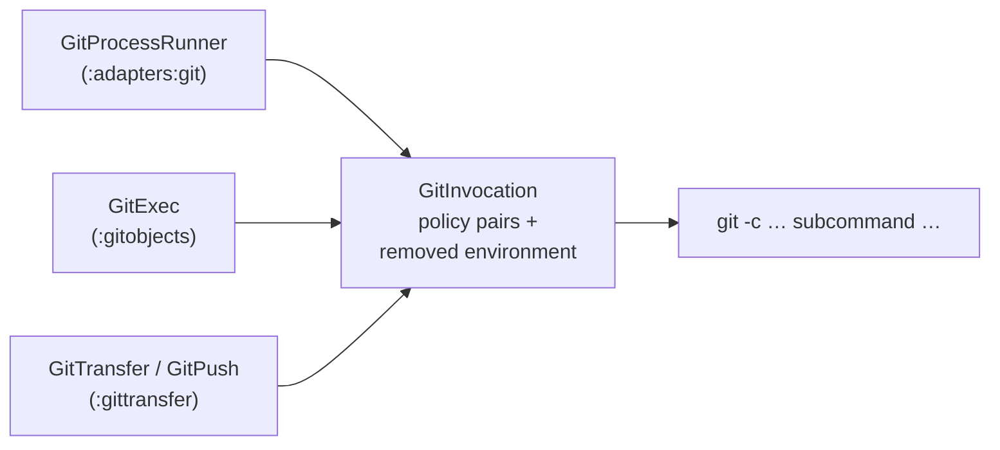

# ADR 0012: Git Invocation Policy

Status: accepted (2026-10-20, introduced by `own-git-invocation-policy`; its design D1–D4, D7 and D11
took these decisions, recorded here because a change's `design.md` archives with the change and
governs nothing afterwards)

## Context

The factory runs git in the operator's clone, whose `.git/config` is shared with the operator,
the operator's tools (husky rewrites `core.hooksPath` on every `npm install`) and, in host mode,
the gnome. Before this decision the factory treated that file as two things it is not:

- **Its own storage.** Every fresh claim and every resume wrote `core.hooksPath` into it. Before
  git 2.56 a writer takes `.git/config.lock` with no wait, so two `serve` slots claiming at once
  raced and one claim failed at random (CI, 2026-09-29).
- **A trusted source of policy.** Every factory git command read it. Verified on git 2.55: a
  planted hook ran in the factory's `update-ref` (`reference-transaction`) and `push`
  (`pre-push`); `commit.gpgSign` with `gpg.program` ran an arbitrary program in the factory's
  `commit-tree`; a local `refs/replace/` entry changed what `cat-file` returned for a commit id;
  `fetch`, and a `git commit`, started a detached `maintenance run --auto` in the shared clone.
- **A hook directory is not the only place a hook lives.** Since git 2.54 a hook can be defined
  in the configuration itself: `hook.<name>.command` names the program and `hook.<name>.event`
  the event it runs on. git runs such a hook whatever `core.hooksPath` says — verified on 2.56.0: a
  `reference-transaction` hook planted that way in `.git/config` ran in an `update-ref` carrying
  all eight pairs below, and also on `branch`, `add -A` and `worktree add`.

The factory started git from two launchers — `GitProcessRunner` (`:adapters:git`) and `GitExec`
(`:gitobjects`) — and stated a third policy in the transfer owner `GitTransfer` (ADR 0008). The
three disagreed: only `GitExec` neutralized hooks, only transfers stopped maintenance and stripped
inherited per-process configuration. There was no single statement of how the factory invokes
git.

## Decision

### The clone's configuration is untrusted input, not storage

The factory neither reads policy from a clone's local configuration nor writes any into it. What
a factory git process needs, it states on every invocation. The **git invocation policy** is that
statement: a closed set of command-scope pairs, which git ranks above every configuration file
(system, global, local, worktree), and a set of inherited environment variables removed from the
process. A rewrite of `.git/config` after the factory started therefore changes nothing a factory
git process does with the keys the set names.

### One owner, applied to every factory git process

`GitInvocation`, in the JDK-only leaf `:gittransfer`, owns the policy and builds the whole command
line: `commandLine(gitBinary, args)` returns the binary, the policy pairs, then the caller's
arguments. Both launchers hand that list to `ProcessBuilder` unchanged; neither builds a command
line of its own. `GitTransfer` (ADR 0008) and `GitPush` compose the same owner: every transfer
(fetch, harvest, clone) and both pushes `GitPush` builds open with the policy pairs, a transfer
adding its own set after them, and `commandLine` adds no second copy to arguments that already open with the pairs.

The eight pairs, each neutralizing a key that runs a program or changes what git reads or writes:

| Pair | Closes |
|------|--------|
| `core.hooksPath=/dev/null` | every hook, wherever the local configuration points |
| `commit.gpgSign=false` | a signing program run during a factory commit |
| `tag.gpgSign=false` | the same for a tag |
| `core.fsmonitor=false` | a filesystem-monitor command run on index reads |
| `branch.autoSetupMerge=false` | the `branch.<name>.*` write of branch creation |
| `maintenance.auto=false` | detached background maintenance in the shared clone |
| `gc.auto=0` | automatic garbage collection in the shared clone |
| `core.useReplaceRefs=false` | `refs/replace/` substituting what an object id reads as |

`/dev/null` needs no filesystem state; an empty hook directory under `.git` is writable by anyone
who can write `.git/config`. Gitaly and the Jenkins git plugin use the same value.

After the eight pairs come the **event switches**: one `hook.<event>.enabled=false` pair for every
hook event the githooks(5) page of git 2.56.0 lists, client and server side, in the page's order —
`applypatch-msg` through `post-index-change`, 28 events. `core.hooksPath=/dev/null` empties the
hook directory but says nothing about a hook defined in the configuration (`hook.<name>.command`
with `hook.<name>.event`, Context), so it alone does not cover them. git also has a per-name
switch, `hook.<name>.enabled`, but it needs the hook's name, which whoever writes the
configuration chooses; the event switch needs only the event, which the factory can list. Both
keep their place: the directory key disables the classic hooks, the event switches disable the
configured ones. The event list is written out in `GitInvocation`, read from the documentation of
the floor release, not derived at runtime; an event a later git adds is one new entry, like any
other key. A configured hook whose name is an event name (`hook.pre-commit.event`) makes git stop
with a fatal error by design — a refused command, not a hook that runs — and that is accepted.

The switches are why the factory's git floor is 2.56.0 (ADR 0008, the floor paragraph as amended
by this change): the switch is documented and verified there, and a policy naming a key the
installed git ignores neutralizes nothing. The box's git keeps its own floor, 2.51.0, until
`add-sandbox-base-image`: no factory policy runs inside the box, so the box needs no switch.

Removed from every factory git process's environment: `GIT_CONFIG_PARAMETERS` and
`GIT_CONFIG_COUNT`, so a per-process configuration inherited by the factory cannot add a key
back. `GitExec` keeps its stronger isolation (global and system files at `/dev/null`) as its own
addition on top; it is not a second policy anything must match.

A new key is one edit in the owner; a new launcher must call it. A build gate in `:bootstrap`
(`GitLaunchBoundarySpec`) asserts that the set of production classes depending on
`ProcessBuilder` equals a classified allowlist, and that both git launchers build their command
line through `GitInvocation.commandLine`.

### The factory writes no repository configuration

The per-claim `core.hooksPath` write is removed, together with its owner class; the port method
that ran it keeps only its other step, the clone's ref-backend check, under a name that says so.
The runner's untyped entry refuses, before launching anything, `config` in any form but a read
(`--get`, `--get-all`, `--get-regexp`, `--get-urlmatch`, `--list`/`-l`, the `get` and `list`
subcommands) and `remote add|rename|remove|rm|set-head|set-branches|set-url`, with
`RepositoryConfigWriteException` naming the subcommand and the owner — the same shape as the
refusal of an unowned transfer in ADR 0008. `branch` is not refused by flag: the factory's one
form writes nothing under `branch.autoSetupMerge=false`, and the identity spec asserts a
byte-identical `.git/config` after the factory's flows on a clone whose local configuration
plants a hook, a signing program, an fsmonitor command, `branch.autoSetupMerge=always` and a
replace ref.

With no writer, concurrent slots have nothing to race on in `.git/config`; the remedy is the
absence of the write, not a lock or a retry around it. Under the policy, `config --get
core.hooksPath` reports the command-scope value, so a check of what an earlier factory version
persisted reads with `--local`.

### What stays ambient

The policy holds no key that carries the operator's credentials or transport:
`credential.helper`, `core.sshCommand` and `url.<base>.insteadOf` stay the operator's, as ADR 0008
decided for `origin`. `core.pager` and `core.editor` are never consulted without a terminal;
`diff.external` is used by no factory `diff`, and a factory use of it adds the key to the owner.
The in-box git of a task environment is outside the factory's trust domain and outside this
policy.

### The boundary: what a command-scope set cannot close

git's own documentation (the "SECURITY" section of git(1)) states the general rule: running git
inside a `.git` directory that came from an untrusted source is not safe, because the commands
named in its configuration and hooks run as usual; the safe way to take in such a repository is a
fresh `git clone --no-local`. This policy closes the named keys of that class and not the class.
Three vectors remain open for the host-mode shared `.git`:

- **Attribute-selected filter drivers** (gitattributes(5), "filter"): a path's attribute names a
  driver, and the driver's command lives under `filter.<driver>.*`. The driver name is chosen by
  whoever writes the attributes, so a closed set cannot enumerate the keys to neutralize.
- **`$GIT_DIR/info/attributes`** (gitattributes(5)): a repository-local attribute file of the
  highest precedence, read by every checkout, outside any configuration scope.
- **`objects/info/alternates`** (gitrepository-layout(5)): a file, not a key, that makes git read
  objects from another object store.

Closing these is a separate clone per task, not a longer list of pairs, and belongs to
`add-sandbox-hardening` (non-goal NG1 of `own-git-invocation-policy`).

## Alternatives Considered

- **Keep the persisted write, serialized under `CloneMutationLock` and compared before writing** —
  the lock is in-process only, so the operator's git, husky, detached maintenance and a second
  instance still race; compare-then-write has a window; a value undone after the check stays
  undone until the next claim.
- **Write once at startup** — undone values stay undone for the daemon's whole lifetime.
- **Retry on the lock error, or raise the git floor to 2.56 for `core.configLockTimeout`** — both
  retry a write that should not exist and do nothing for the read side (hooks, signing, replace
  refs). (The floor did rise to 2.56 afterwards, for the event switches above, not for this lock.)
- **`GIT_CONFIG_GLOBAL=/dev/null` for the runner** — `origin` needs the operator's credentials.
- **Expose the pairs as a constant each launcher concatenates** — three concatenations kept in
  step by hand; the owner producing the command line leaves a launcher no way to forget it.
- **A new leaf below `:gittransfer`** — names the concept more precisely, but `:gittransfer` must
  acquire no dependency, so the base policy has to live in it.

## Consequences

- No factory git process runs a hook, a signing program or an fsmonitor command, or honours a
  replace ref, whatever the clone's local configuration says (NFR-S1 of the introducing change).
- The factory never modifies an operator clone's configuration; two slots claiming at once no
  longer meet on `.git/config.lock`.
- An operator who relied on the persisted `core.hooksPath` sees their own hooks run again in their
  own git. The stale line earlier versions left (`core.hooksPath=<clone>/.git/gnomish-empty-hooks`)
  is reported, never removed automatically.
- Every git argv carries 36 pairs more (the eight above and 28 event switches); an access log
  that records argv sees them on every record.
- The factory refuses to start on a git below 2.56.0; an operator on a distribution git that
  lags (Ubuntu 26.04 ships 2.53) installs a newer one first.
- `/dev/null` is POSIX; the factory already requires a POSIX host.

## See also

- `docs/adr/0008-git-transfer-policy.md` — the transfer owner that composes this policy, and the
  ambient-credentials decision for `origin`.
- `docs/sandbox-threat-registry.md` — threat #38 (hooks in factory copies) and threat #50 (the
  clone's configuration, hooks defined in it included).
- `docs/glossary.md` — *git invocation policy*, *transfer*.
- `.claude/rules/implementation.md` — the single-owner checklist this decision was implemented
  under.
