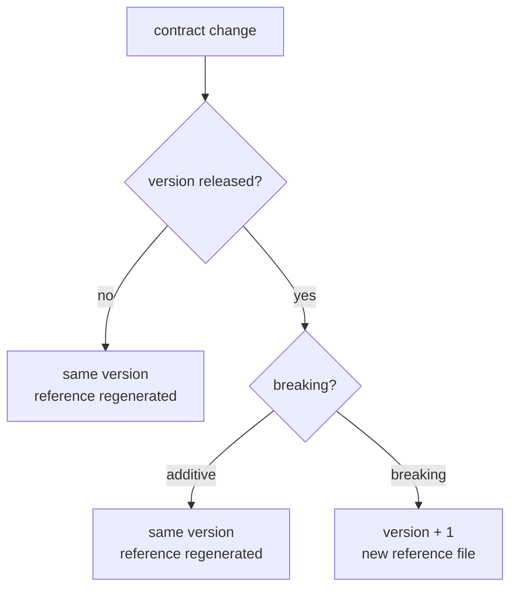

# ADR 0016: JSON Contract Versioning

Status: accepted (2026-10-12, introduced by `tighten-spec-contract`; its design D17 took this
decision on finding F100 — recorded here because a change's `design.md` archives with the change
and governs nothing afterwards)

## Context

The factory writes four JSON documents that something other than the writing code reads: a
script, a dashboard, an alerting rule, a later build of the factory. Each is a **JSON contract**,
and each carries an integer `version` at its top level (in the ledger, on every line).

| Contract         | Written by                                     | Read by (in this repository)                         | Reference files (test resources)                                                                                                   |
|------------------|------------------------------------------------|------------------------------------------------------|------------------------------------------------------------------------------------------------------------------------------------|
| Status report    | `status/json/StatusReportJsonMapper`           | operators' scripts (`gnomish status --json`)         | `test-fixtures/src/main/resources/status-report-v1.reference.json`, `application/src/test/resources/status-report-v1.escalations.reference.jsonl` |
| Board            | `board/json/BoardJsonMapper`                   | operators' scripts (`gnomish board --json`)          | `application/src/test/resources/board-v1.reference.json`                                                                          |
| Serve snapshot   | `serveobservability/json/SnapshotJsonMapper`   | `SnapshotJsonReader` (the dashboard), alerting rules | `application/src/test/resources/snapshot-v1.reference.json`                                                                       |
| Ledger           | `serveobservability/json/LedgerJsonMapper`     | `LedgerAggregator`, `SweepActionAggregator` (the dashboard) | `application/src/test/resources/ledger-v1.reference.jsonl`                                                                 |

How the version is carried today, as the code stands on 2026-10-12:

- **The writer stamps a literal `1`.** `StatusReportJsonMapper` and `BoardJsonMapper` pass `1`
  into the top-level DTO; `LedgerJsonMapper` passes `1` into every line DTO; the snapshot's `1`
  is set where the domain `Snapshot` is built (`app/SnapshotSources`) and copied through by the
  mapper. No constant names the version.
- **No reader gates on it.** `SnapshotJsonReader` carries the value through into the domain
  object without comparing it; the ledger aggregators do not read it. A reader meets an unknown
  shape by the per-field tolerance its own spec states (an unknown ledger token skips the line),
  not by the version.
- **A reference file pins the shape.** Each contract's mapper spec serializes a deterministic
  sample and asserts it is byte-identical to the reference file (`StatusReportJsonMapperSpec`,
  `BoardReferenceJsonSpec`, `SnapshotJsonMapperSpec`, `LedgerJsonMapperSpec`). A renamed,
  removed or retyped field therefore fails a spec; so does an added field, until the reference
  is regenerated.

What the reference comparison cannot decide is the author's next step: bump the version or
regenerate the file. Before this ADR, that was decided in review, and no document stated the
rule (finding F100 of `tighten-spec-contract`).

Out of scope: the `usage --json` mini-contract (`UsageReportJsonMapper`, its own `"version": 1`,
no reference file), the branch state files `task.json` and `state.json`, which are refused on an
unknown version by `StateFileVersionGate`, and the GitHub marker format (`GithubMarker.FORMAT_VERSION`).
Each is its own medium with its own reader; none is governed here.

## Decision

### Released means shipped in a tagged release

A contract version is **released** once a tagged release of the factory (a `v*` tag, published
with its distribution archive — the developer guide's *Releasing* section) has shipped a build
that writes it. From then on, readers the repository does not control may depend on it.

Before that, every consumer of the contract ships in this repository and is changed in the same
commit as the writer, so the version can be amended in place. On 2026-10-12 no `v*` tag exists
(in the clone or on `origin`; `docs/releases/v0.1.0.md` holds the notes for the first one), so
all four contracts are still unreleased at version 1, and the first tag releases them.

### What is breaking, what is additive

A change is **breaking** when a reader written against the released version could misread the
new document:

- a field renamed, removed, or retyped (a number becoming a string, an object becoming an array,
  a non-null field becoming nullable);
- a token's meaning changed: an enum value, a `type` discriminator or a unit now denotes
  something else, even under the same spelling.

A change is **additive** when every released reader still reads every field it knew, with the
meaning it knew:

- a new field;
- a new value of an open vocabulary whose readers already tolerate unknown values (the ledger's
  `outcome`, which `LedgerAggregator` skips when it does not know it). A new value of a
  vocabulary whose reader refuses unknown values is breaking: `SnapshotJsonReader` fails on an
  unrecognized snapshot token.

### The rule

1. **Breaking change to a released version** — the `version` is bumped, and a new reference file
   is committed under the new number (`status-report-v2.reference.json` beside
   `status-report-v1.reference.json`). The old file stays: it is the record of what released
   readers were promised.
2. **Additive change** — the `version` is unchanged, and the reference file is regenerated.
3. **Any change to an unreleased version** — the version is amended in place, and its reference
   file regenerated (the status-report spec's scenario `Pre-release amendment stays v1`).

The rule is applied by the author when the reference comparison fails, and checked in review;
no gate decides between rule 1 and rule 2, because the difference is the meaning of a field, not
its spelling.

## Consequences

- The reference failure now has a stated next step: the author classifies the change against the
  two lists above instead of arguing it in review.
- The first tagged release freezes version 1 of all four contracts at once; a breaking change
  after it costs a second reference file and a reader that knows both versions.
- No reader refuses an unknown `version` today. A reader that must refuse one (as
  `StateFileVersionGate` refuses an unknown state file) is added by the change that bumps the
  version, not by this ADR.

## Alternatives considered

- **Released = introduced by an archived change.** Rejected: every contract here was introduced
  by an archived change, so every reshape before the first release would have needed a bump,
  though no reader outside the repository could exist.
- **A gate that bumps the version automatically on any reference diff.** Rejected: it cannot
  tell an additive change from a breaking one and would bump on every new field.
- **Semantic version strings (`"1.2"`).** Rejected: readers here branch only on "can I read
  this"; an additive change needs no number, so one integer carries everything they use.
