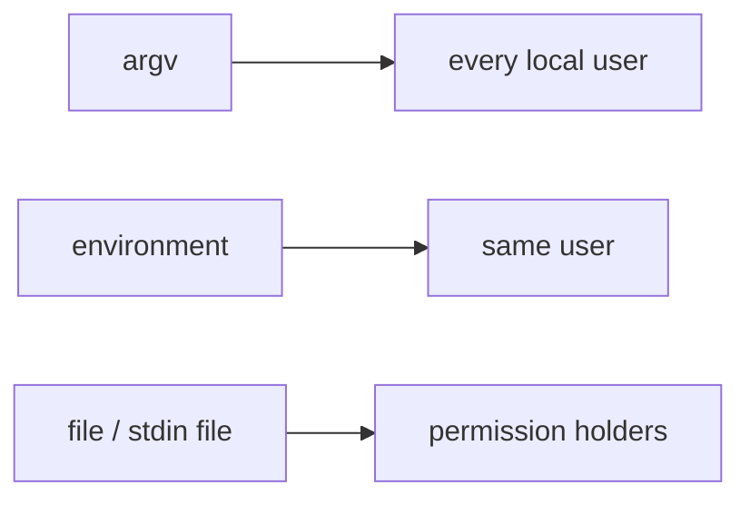

# ADR 0017: Secret Channels to Child Processes

Status: accepted (2026-09-30, introduced by `fix-docker-exec-env-argv`; its design D1–D7 took
these decisions, recorded here because a change's `design.md` archives with the change and
governs nothing afterwards)

## Context

The factory starts child processes that need secrets: the agent CLI needs its AI credential, a
command check may need a tracker or provider token, an operator passthrough value may be one. A
parent can hand a child a value on four channels, and each is readable by a different set of
local accounts:

| Channel                    | Who else on the host can read it                                                                                                      |
|----------------------------|---------------------------------------------------------------------------------------------------------------------------------------|
| Command line (argv)        | every local user, for the life of the process: `ps` on macOS, `/proc/<pid>/cmdline` on Linux unless `/proc` is mounted with `hidepid` |
| Environment                | the same user (and root): `/proc/<pid>/environ` is owner-readable                                                                     |
| A file                     | whoever its permissions admit, for as long as it exists                                                                               |
| The child's standard input | whoever can read the file behind it, for the launch window (below)                                                                    |

The child's standard input is never a pipe the factory writes into (design D20 of
`fix-terminal-receipt-convergence`; ADR 0018 for the read side). The launch owner in
`:subprocess`, `GroupedLaunch`, writes the whole input to a file it creates with
`Files.createTempFile` in its input directory (`java.io.tmpdir` in production, through
`ProcessLaunch.grouped()`), owner-only `0600` on POSIX, redirects the child's stdin from it, and
deletes it once `start()` returns. So stdin is permission-readable for that window, and
afterwards reachable only through the descriptor the child inherited — owner-readable, like the
environment. It is not private.

Exposing a secret on the command line is CWE-214, *Invocation of Process Using Visible Sensitive
Information*. The 2026-09-30 live run found the factory doing exactly that: in container mode
every entry of an in-box process's environment reached the docker client as `-e NAME=value`, and
`ps aux | grep 'docker exec'` printed a GitHub token and a Claude OAuth token in clear. The
subprocess audit of the same day found it the only argv leak in the codebase.

## Decision

1. **A secret never travels on a command line.** No factory component renders a value into a
   child's argv. A docker exec forwards a variable by its name alone (`-e NAME`); the docker
   client resolves the value from its own environment and leaves the variable unset in the box
   when the name is absent there.
2. **A gnome-product child gets an environment the factory composes.** The process that runs
   gnome-controlled work — the agent CLI, a command check, in-box git — starts from nothing and
   receives exactly the three allowlist layers `ChildEnvAllowlist.compose` produces (the
   adapter's base set, operator passthrough, the factory-set fragment). The host adapter clears
   its child's environment and fills it from the composed map; the container adapter passes the
   same map's names on the exec argv and its values in the docker client's environment.
3. **A factory client gets its inherited environment minus the declared credentials, plus the
   exec's overlay.** The docker client is the factory's own tool, and its needs depend on the
   operator's install (`HOME`, `PATH`, `DOCKER_*`, certificate, proxy and `SSH_AUTH_SOCK`
   variables), so it is not given a cleared allowlist: it keeps what it inherited, loses every
   credential name the run declares (`ChildEnvAllowlist.credentialNames()`), and receives the
   composed map on top, which is where its `-e NAME` flags take their values. One function,
   `DockerClientEnvironment.compose`, does this for every streaming exec.
4. **Two extensions are queued in this form, not in another.** Management commands
   (`DockerCli.run`: `inspect`, `rm`, `network`, the scratch `mkdir`) keep their inherited
   environment until FR15 of `add-subprocess-access-log` extends the same subtraction to them.
   The git client's environment has one place, `GitInvocation.removedEnvironment()` in
   `:gittransfer`, which every factory git runner applies; it subtracts the invocation-policy
   variables today, and the declared credential names join that list there, not in a second
   place.

## Consequences

- **Residual exposure, stated.** A secret still sits in the factory JVM's environment and in the
  docker client's, readable by the same user and by root. That is the exposure the factory
  process has itself; this decision closes the cross-account channel, it is not a secrets vault.
- **`--env-file` is rejected.** It works, but it lands the secret on disk for the life of the
  file and needs creation, permissions and crash-safe deletion, for no gain over the client's
  environment.
- **Secrets as files inside the box are rejected.** The agent CLIs read environment variables,
  so a file needs an in-box wrapper to load it, and every in-box process already sees the round's
  environment: no exposure shrinks.
- **A credential no longer reaches docker CLI plugins or credential helpers** through the
  client's environment on an exec. Nothing in the factory's documented setup relies on it; the
  sandbox operator guide says so.
- **The docker CLI's value-less `-e` resolution is relied on.** It is documented behaviour of the
  flag, shared by `run`, `create` and `exec`; the container-mode credential end-to-end suite
  proves delivery on the CI client.

## Enforcement

- **Parameter types.** `DockerCommands.exec` takes a `Set<String>` of names, so no value reaches
  the argv builder. `DockerCli.start` accepts only a `DockerExecLaunch` (argv, environment,
  withheld names), produced by one owner, `ContainerExecLaunches.launch`, which derives the argv's
  names from the environment's keys; `DockerExecLaunchIdentitySpec` asserts the identity.
- **The boundary scan.** `DockerExecArgvBoundarySpec` in `:bootstrap` scans the production
  sources under `sandbox/`, comments stripped: the literal `"-e"` appears only in
  `DockerCommands.java`, `new ProcessBuilder` only in `DockerCli.java` and
  `HostTaskExecutionEnvironment.java`, and the scan asserts it reached the tree and each
  allowlisted file.
- **The effect.** `DockerCliSpec` observes the client's environment on a committed recording
  stand-in (ADR 0015): a declared credential unset, an inherited non-credential variable kept.
- **The requirement** is owned by the `sandbox/execution-environment` capability.
