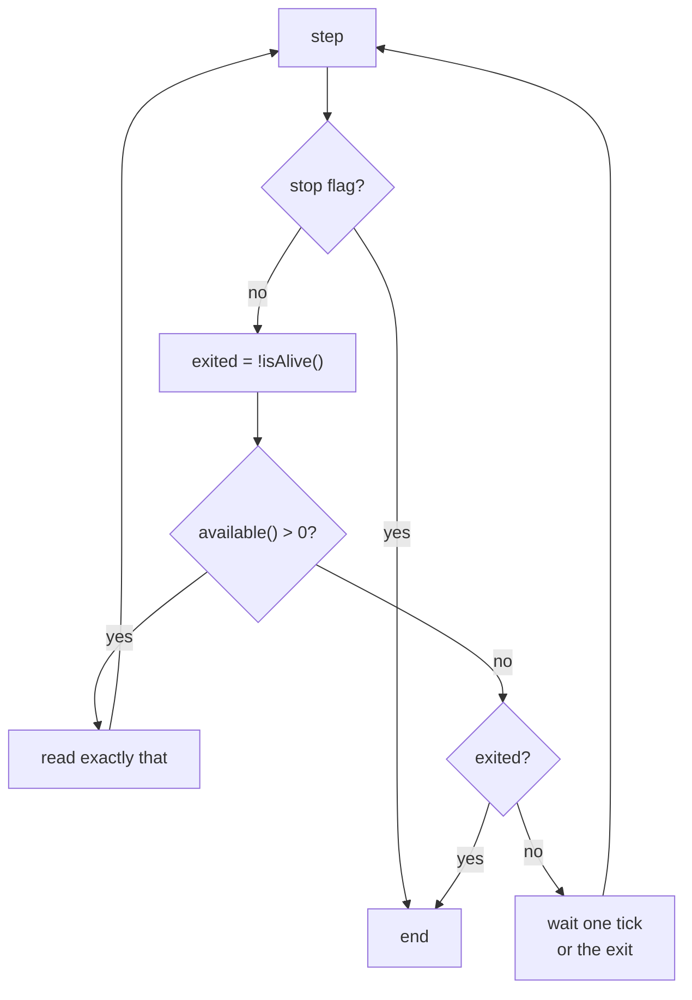

# ADR 0018: Non-Parking Pipe Reads

Status: accepted (2026-10-18, introduced by `make-pipe-reads-non-parking`; its design D1–D9 took
these decisions, D4 and D7 as amended 2026-10-18 after the real-process measurement — recorded
here because a change's `design.md` archives with the change and governs nothing afterwards)

## Context

Every reader of a child's output — `CaptureRunner`, `GitExec`, `ContainerFileChannel`,
`CapturedExec`, `BoundedTail`, `StreamDrain` — parked a thread in a blocking `read()` on the
child's pipe. When a descendant kept the pipe open after the child exited, design D15 of
`fix-terminal-receipt-convergence` ended that read by closing the stream at the post-exit bound.
The premise "a close from another thread ends a parked read" was measured on macOS only. The
first Linux CI run after that change (CI run 39117545428) was red on `DrainCloseReleaseSpec`.

Measured on Temurin 25.0.3 (macOS and `eclipse-temurin:25-jdk`), 2026-10-18:

| Experiment                                            | macOS               | Linux                                                           |
|-------------------------------------------------------|---------------------|-----------------------------------------------------------------|
| `close()` from another thread ends a parked `read()`  | 0 ms                | never (virtual and platform threads alike, > 3 s)               |
| `Thread.interrupt()` wakes it                         | no                  | no                                                              |
| A holder's first write after the close                | holder gets SIGPIPE | write succeeds, wakes the read with "Stream closed", bytes lost |
| A silent holder                                       | read released       | thread parked until the holder dies                             |

Linux's `close(2)` leaves a blocking read holding the open file description, and an interrupt
does not reach a `FileInputStream` read. Every spec on a test double stayed green on Linux,
because the doubles modelled macOS: `FakeProcess` built its stdout on a NIO `Pipe`, whose close
wakes a reader on every OS.

In production the defect was a leak, not a stall: every join is bounded and the group sweep ends
holders inside the child's process group. A holder that left the group (`setsid`, `setpgid`) —
the sweep's named limit — pinned on Linux the drain's thread and the JDK's reaper thread, parked
in the `synchronized` `processExited` (JDK-8169565), for the holder's lifetime; in `serve` these
accumulate.

The JDK 25 facts the decision rests on (`ProcessImpl.ProcessPipeInputStream`): the stream is a
`BufferedInputStream`, so `read()` and `available()` are `synchronized` on it; `processExited()`
is `synchronized` too, drains `while (available() > 0)`, closes the descriptor and swaps in a
`ByteArrayInputStream` of the stragglers; `close()` takes a separate lock.

## Decision

### The rule

**A factory thread never parks in a blocking read of a child's pipe, and the factory closes no
pipe of a child.** A reader asks whether the child is alive, then how many bytes the pipe reports
available, reads exactly those, and otherwise waits one tick on its own thread (1 ms after bytes,
doubling while idle, capped at 5 ms) — a wait the child's exit ends at once. It ends at the first
query that finds the child exited and nothing available, with no tick after it; it ends early
when its stop flag is set. No grace is needed: the JDK reports the exit only after it reaped the
child, so the child's own output is all in the pipe, or in the reaper's buffer, by then (amended
2026-10-19: the first form waited one more tick after the exit, and every launch paid it). Because no factory thread
holds the stream's monitor across a wait, the JDK's reaper drains and closes the pipe at the exit
itself. The shape is the one the JDK's own reaper, Go's `os/exec`, libuv, Python's
`communicate()` and Rust's `read2` take.

The exit is read before the availability query, so a byte written before the exit is always
seen by the query that follows; after the reaper's swap, the query reads its buffer.

### The post-exit bound stops, it does not close

The post-exit bound (kill grace plus margin) stays the safety net on the join. A drain still
running at the bound is stopped by its flag, observed within a tick, and the capture is flagged
as cut exactly as before (`CutCaptureException.refuses` unchanged). The stop is never a close and
never an interrupt of a read.

On a real process the reaper closes the pipe at the exit, so a holder that keeps writing yields
a complete, unflagged capture: measured 2026-10-18 with a holder that left the session and kept
writing, the invocation returned 18–35 ms after the exit on macOS JDK 25.0.3 and 4–17 ms on Linux
JDK 25.0.4.1, `truncated=false`, in-group and escaped, busy and 50 ms writers alike (on macOS a
holder that does not ignore `SIGPIPE` dies of it). The cut and its WARN are reached only on the
safety net: a holder that outwrites the reaper's own drain at the exit keeps the reaper inside
`processExited` until the bound expires. What a holder writes after the exit is dropped, as the
reaper already dropped it; a change that needs it gives the holder its own stream.

### One owner, enforced

`ChildOutput` (`:subprocess`) owns the readable side of a child's pipe. It is minted only from a
started `Process`, carries the process beside its stream so the exit signal is wired by
construction, and runs the steps above once, offered as a push form (`Drain`, chunks handed to a
sink on the drain's thread) and a pull form (`ChildOutput.stream()`, whose `read` runs the same
steps on the caller's thread and whose `close()` is the stop). Enforcement:

- **The parameter type.** `Drain` and `StreamDrain` start only from a `ChildOutput`, and the
  `ExecHandle` port's `output()` returns one; a bare `InputStream` no longer compiles there.
- **`ChildOutputOwnerGateSpec`** (`:bootstrap`, split from `DrainOwnerGateSpec`, which keeps the
  join): no production source but the owner obtains a child's stream (`getInputStream()`,
  `getErrorStream()`) or reads it, and none but `ThreadSleeper` calls `Thread.sleep(`; listed
  test-time exemptions, each
  asserted reached.
- **`RawCaptureOwners`**: the readers that no longer capture a stream left its list, and
  `ChildOutput` joined it.
- **`FakePipe`** (`:test-fixtures`) backs `FakeProcess`: `available()` is exact and closing the
  read end releases no parked reader — the Linux fact, so a reader that parks fails on a
  developer's macOS as it would on Linux CI.

The `lifecycle/subprocess-supervision` capability owns the requirement ("Post-exit output is
bounded without a parked read").

### Real time in a leaf

The tick is a bounded wait for the child's exit on the drain's own thread: `ChildOutput` obtains
`Process.onExit()` once per value and waits on it for the tick's length, like `Process.waitFor`
with a timeout, so an exit during a tick ends the tick at once. It is not a sleep: `:subprocess`
is a dependency-free leaf (`module-layering`) and may take no `Sleeper` or `TimeEquipment`, and the
wait is a property of the medium — as `ProcessSupervisor`'s `waitFor` is — not a schedule a spec
would drive on virtual time. `waitFor(timeout)` itself is not used: on `FakeProcess` it runs the
spec's one-shot wait-return step, which belongs to the supervisor's wait. Specs drive real
processes and `FakePipe`, whose byte count the spec controls, and record ticks through a
package-private seam instead of timing them, so no spec sleeps for an order.
`ChildOutputOwnerGateSpec`'s sleep detector allows `Thread.sleep(` in production only in
`bootstrap/.../app/ThreadSleeper.java`. Everything else takes `TimeEquipment` (ADR 0014); a leaf
wait of real time is the medium's own bounded wait, never a sleep.

### The method rule

**A JDK or OS fact a design rests on is measured on every platform CI runs — Linux and macOS —
before it is written down.** D15 of `fix-terminal-receipt-convergence` measured close-wakes-read
on macOS only, wrote it into a requirement, a rule and fifteen sentences of docs, and the first
Linux CI run was red (CI run 39117545428). The measurement goes into the design with the JDK
build and OS it was taken on.

## Consequences

Positive: no thread of the factory waits on a descendant on any OS; an escaped holder costs
nothing; a pipe holder no longer produces a cut on a real process; the doubles are at least as
strict as the stricter platform; adding a reader cannot reintroduce a parked read.

Negative: up to one tick (≤ 5 ms) of added latency per live line; an idle stream costs one
`available()` call per tick, about 200 per second at the cap; the holder line of a cut capture
now fires on the safety net only, an in-group holder is visible through the group sweep's DEBUG
survivor line, and an escaped holder lives on unseen (ending it is out of scope).

## Alternatives Considered

- **Close the stream at the bound** (D15 of `fix-terminal-receipt-convergence`): on Linux
  `close(2)` does not wake a parked read; a holder's first write after the close succeeds and
  wakes the read with "Stream closed", losing that chunk. Kept as belt and braces it would
  reintroduce the one path on which `available()` throws.
- **Kernel wake-ups: `poll(2)` through FFM, or `O_NONBLOCK` on the descriptor**: the descriptor
  is private to `FileDescriptor` and reachable only through `--add-opens`, and `O_NONBLOCK` sits
  on the open file description the reaper's own drain shares, so the reaper's `read` would see
  `EAGAIN`. A change that adopts FFM for process control may revisit it.
- **Redirect a live stream to a file**: the agent round parses stream-json line by line as it
  arrives; a file loses back-pressure and still needs a tail poller.
- **Abandon the parked thread**: leaks a drain thread and, on Linux, the reaper thread
  (JDK-8169565) per escaped holder, for the holder's lifetime.
- **Flag a capture whose reaper buffer held stragglers**: every ordinary child whose output was
  still in the pipe at its exit would be refused — a false `CutCaptureException` on any
  `git rev-parse`.
- **Keep the parked read and delete only the close** (alternative zero): leaves the bound and the
  sweep; an escaped holder then pins two threads and the reaper on both OSes.
- **A wrapper stream over the bare stream, API unchanged**: any caller could still start a drain
  on an unwrapped stream, and a double's stream would pass while reporting nothing available.

## See also

- `.claude/rules/lock-scope.md`, "A lock inside the JDK" — the write side's counterpart (no pipe
  into a child)
- `.claude/rules/testing.md`, "A scheduling order is never a premise"
- `docs/glossary.md`: child output, drain, post-exit bound, cut capture
- ADR 0014 (one time source; the leaf wait above is its one recorded deviation)
