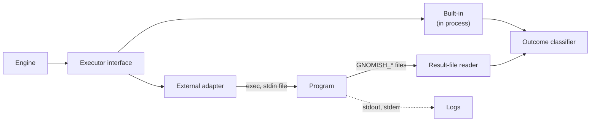

# ADR 0020: The Executor Contract

Status: accepted (2026-10-29, introduced by `define-executor-contract`; its design D1–D7 and
D13–D15 took these decisions, recorded here because a change's `design.md` archives with the
change and governs nothing afterwards); amended 2026-11-01 (D2, D3 and D18 of the same change,
as revised: the poll wire form of a program, and `cancel` as a declared capability without an
operation)

## Context

An **executor** is any mechanism that does work for the engine: the agent CLI that changes the
working copy, a command check, an external CI poll, an LLM judge, and soon an arbiter. Before
`define-executor-contract` the engine held five role ports (`StageExecutor`,
`BuiltinCheckRunner`, `CommandCheckRunner`, `ExternalCheckClient`, `JudgeVoter`), each with a
result type of its own; the only agent integration was hard-wired to one vendor's event stream,
the round mechanics were duplicated per role, and the failure class of a run was decided in
seven files. A second agent CLI, a new verifier or a new role each meant a new port, a new
adapter pair and a new place to classify failures.

The round record had the same shape of problem. A round entry of the state file carried no task
id, stage or round identity, so `gnomish usage` guessed a round's stage from the shape of the
attempts list and misattributed every stage that passed on its first round. Usage sat in
role-named slots (the executor's, the judge's), the recorded totals folded only the executor's
share, three DTO trees serialized the same usage, and the usage report was re-aggregated by a
shell script with no test, which collapsed the sum on a live task (2026-10-09).

Mature orchestrators converged on one answer: one unit-of-work contract with a declared failure
taxonomy, executors that declare their capabilities, and a process boundary for third-party code.

## Decision

1. **A mixed plugin model: the boundary is the process, the contract is JSON.** Built-in
   executors are a closed set compiled into the factory. Every other executor is a program,
   spawned only through `TaskExecutionEnvironment.exec` (the one process seam, host and
   container) and spoken to over a versioned JSON contract whose schema files in the repository
   are the single source of truth. A process boundary buys language independence, crash
   isolation and a contract that evolves by schema rather than by Java signature. Trackers are
   not executors and keep their in-process plugin interface.
2. **Built-ins implement the mirror interface of the JSON contract.** One DTO set — request,
   result, describe — is the only Java image of the schema. A built-in implements `Executor`
   (`describe`, `start`, `poll`) over those DTOs; the external adapter implements the same
   interface by spawning the program. The conformance kit drives an `Executor`, so one kit
   covers both kinds, and no built-in has a result type of its own.
   *(Amended 2026-11-01.)* A program whose `describe` declares `poll` is polled the way it is
   started: the declared argv with the word `poll` appended, the same request on standard input,
   the pending key in the variable `GNOMISH_PENDING_KEY`, the result in the file
   `GNOMISH_RESULT_FILE` names, read under the result-reader rules, under the same bounds
   (`ProgramChannel` owns the words and the variable names). The request schema does not change:
   the key travels in the environment, as the result paths do, so one request document serves
   every operation. A poll of a program that declares no `poll`, or with a key this executor did
   not receive from its own `start`, is `failed/infrastructure` and spawns no process; pending
   keys are not persisted, so a poll across factory instances has nothing to resume. For a
   `verdict` or `decision` run that goes pending, the working-copy check of decision 6 is judged
   at the poll that ends the run, against the view taken before its `start`; a pending answer is
   not judged. Before this amendment `ProgramExecutor.poll` answered `failed/infrastructure` for
   every call, and the kit's pending-then-poll case had no wire form to pass through.
3. **Results travel in factory-named files; stdout and stderr are logs.** The request is the
   child's standard input, handed to the launch owner as a file the child inherits — never a
   pipe a factory thread writes into (ADR 0018, `lock-scope.md`). It carries no secret:
   credentials reach the child only through the environment the factory composes (ADR 0017),
   as the executor's own layer built from the names its `describe` declares. The result and the
   answer are written to paths the factory names and hands over as `GNOMISH_*` variables. Stdout
   is read through the one bounded child-output reader with a byte and a line cap and never
   parsed, except NDJSON progress lines when `streams_progress` is declared; stderr goes to a
   file. One result-file reader owns every read of a factory-named result path: size cap,
   truncation marker, inert bytes, every text field wrapped as untrusted text.
4. **A result is a status plus an optional answer.** The status is closed: `completed`;
   `failed` with class `quality`, `infrastructure` or `limit`; or `pending` with an opaque key.
   The answer is one of `verdict` (SARIF 2.1.0 findings; pass or fail is derived by the engine
   from the result levels and the check's threshold, never declared), `select` (the chosen
   option, an optional ranking, a rationale) or `decision-request` (a question, at least two
   options, a continuation key). A result also carries usage with its provenance and the
   denials met. One engine component, `ExecutorOutcomeClassifier`, maps status to attempt
   accounting: `quality` burns an attempt, feeds the findings forward and skips verification;
   `infrastructure` burns none and escalates after retries; `limit` burns none and ends the
   stage with a budget-exhausted escalation. An unknown status token, a malformed answer and a
   `pending` from a role whose caller cannot poll are each `failed/infrastructure` (for a
   `verdict`, cannot-verify), never a pass. Vendor exit codes carry no meaning to the engine.
5. **A describe handshake, validated in two phases.** `describe` returns an integer protocol
   version (bumped only on a breaking change), roles, capabilities (`poll`, `cancel`,
   `streams_progress`, `resumable`), a JSON Schema for the settings, credential names, egress
   hosts, the config-directory variable, the flags that disable repo-local policy sources, and
   the policy enforcement level. Unknown fields are ignored on both sides; a field is never
   renamed, retyped or removed within a version. *At law load* the `executors:` section is
   checked structurally, and no process runs: the law is bound before any execution environment
   exists. *In the describe preflight* — once the task's execution environment is live and
   before the engine starts, the point ADR 0019 (decision 2) names — `describe` runs once per
   declared program executor through the process seam, its output read under the result-reader
   rules, cached for the run by law commit. It is invoked as the declared argv with `describe`
   appended, no request on stdin, the answer in the file `GNOMISH_RESULT_FILE` names. Every
   failure of the preflight is the task's, never the daemon's (ADR 0019, decision 5: the law
   names the program): a program that is absent or cannot answer, and a `describe` that
   disagrees with the law — version, role, settings schema, credentials, egress, a money bound
   on an executor that reports no usage — are located configuration errors that park the task
   as an invalid law does, no attempt burned; a program the environment cannot start, or that
   does not answer within the bound, parks it the same way as an external failure.
   The engine never sees a describe failure as a round. The describe version is recorded by the
   round that ran the executor; a later `describe` reporting another version escalates as a
   pipeline mismatch.
   *(Amended 2026-11-01.)* `cancel` is a capability a `describe` may declare, not an operation:
   this version defines no request or result shape for it, no program operation word and no
   conformance case. No factory path sends a cancel — an expired bound kills the process tree —
   and the mirror interface (decision 2) has no cancel, so a cancel case could be driven neither
   through `Executor` nor in process. The operation is added by the first change whose engine
   path prefers a cooperative stop to a kill. The conformance kit keeps twelve cases; an
   undeclared role took the place of `cancel`: the kit requests a role the `describe` does not
   list, and the case passes when the candidate writes no `completed` result for it.
6. **Policy is abstract, compiled by the executor, verified by the factory.** The request
   carries `readOnly`, `writeExactly(path)` or `workspaceWrite`, never a vendor tool name; the
   executor compiles it into its own mechanism and declares in `describe` how strongly it
   enforces it (`OS_SANDBOX`, `TOOL_GATE`, `AGENT_ASKS`, `PROMPT_ONLY`). The declaration is not
   trusted alone: after a `verdict` or `decision` run the factory checks through the execution
   environment that the working copy is unchanged and refuses the answer on a change.
7. **Mid-round permission prompts are answered by the executor from the policy.** No
   `decision-request` is raised for a tool-permission question. Revisit when any of these holds:
   - a backend arrives whose best enforcement level is `AGENT_ASKS`;
   - a law needs a policy that cannot be expressed statically;
   - the ACP adapter arrives;
   - the arbiter is asked to answer tool questions.

### Usage principles

8. **A round record carries the identity its writer held; readers never infer.** Every round
   record carries `taskId`, `stage` and `roundToken` (the tip the round opened on), stamped by
   the engine from the run's current round; the round commit's subject is rendered from the
   record. Rounds mint a round token in both modes, host and container, through the same parse.
   No reader derives a round's stage or task from its position, the shape of the list or a
   neighbouring record; `gnomish usage` walks only the task's own history (`baseCommit..tip`,
   first parent) and rejects, with a warning, a record whose `taskId` is not the task's.
   This is `crash-consistency.md` items 13–14 applied to the round record.
9. **One usage entry per executor invocation, keyed by the contract role.** A round holds one
   `usage[]` list: role (`transform`, `verdict`, `decision`, `effect`), executor name, vote
   index for a `verdict`, provenance (`REPORTED` or `ABSENT`; absent never renders as zero),
   optional wall time and tool aggregates, and per model the four token counts with an optional
   cost in USD. "Gnome", "judge" and "arbiter" are render labels for roles, not record
   vocabulary. One usage wire vocabulary serves the state file, the status report and the usage
   report.
10. **`totals` is a checked snapshot of one fold, with a position.** One pure function,
    `UsageFold`, folds every participant of every round into role × model × token kind, cost as
    a lower bound (priced, unpriced tokens per role × model, complete), and the snapshot's
    position (`rounds` folded, `through` — the last folded round token). The state writer stores
    the snapshot on every round; folding a round whose token equals `through` is a no-op, so a
    round persisted again after a kill cannot be counted twice. `gnomish usage` re-folds the
    rounds it walked and refuses a mismatch with the tip's `totals`, naming both figures. No
    other code — script, renderer or aggregator — sums tokens or cost; a display over
    already-folded snapshots is the one named exception.

## Ownership

- The `executor/wire-contract` capability owns the request and result shape, the status
  taxonomy, the answers, the describe handshake, additive evolution and the abstract policy.
- The `executor/result-channel` capability owns the stdin request, the result files, the
  stdout and stderr rule and the one result reader.
- The `executor/conformance-kit` capability owns the kit and the schema files as source of
  truth.
- The `pipeline/stage-engine` capability owns the failure-class mapping and the totals fold;
  the `git/git-task-persistence` capability owns the round record's identity and usage list;
  the `cli/task-inspection` capability owns the walk and the re-fold check of `gnomish usage`.

## Consequences

- A new external executor changes no factory source file: a program, its `describe` output and
  a law declaration. A new agent CLI is one such program, not a Java module.
- A new role or status is added once, in the schema and the engine; every executor inherits it.
- Until the follow-ups named in the change land, the verify checks and the agent executor keep
  their own result construction as exemptions listed by name; they are a transition, not a
  second taxonomy the contract accepts.
- A declared program costs one `describe` process per claimed run, bounded by the startup read
  timeout.
- Every usage figure the factory prints is a consumer of one fold, and a wrong row is
  detectable: the recorded snapshot and the re-fold must agree.

## Alternatives rejected

- **An in-process plugin interface, like the tracker's** — couples every executor to the
  factory's release cadence and loads third-party code with the factory's credentials.
- **Everything is a process** — loses in-process egress control of the HTTP client for the SCM
  and HTTP built-ins and spawns a process for a file-existence check; the one idea borrowed from
  it is decision 2.
- **Role-specific Java interfaces for built-ins** — brings back five result types.
- **The result as NDJSON on stdout** — every stdout protocol has stray prints as its first bug,
  and the factory's checks emit megabytes; every executor would have to capture its children.
- **`DecisionNeeded` as a status** — the answer slot and the outcome would overlap, and an
  arbiter would hook into a status transition instead of "an answer is present".
- **Semver or date strings for the protocol version** — range logic for no benefit at this
  scale.
- **`describe` at law load** — the program exists only in the box, which does not exist yet
  when the law is bound; running it on the host instead runs a program the image ships from a
  machine that may not have it. A second classifier for describe failures would be a second
  spelling of ADR 0019's one class.
- **Trusting the declared enforcement level** — a self-declared passport is what the sandbox
  port already refuses.
- **Pausing and asking a human or arbiter on permission prompts now** — needs continuation to
  work first and doubles the decision path before the arbiter exists.
- **Repairing the stage inference** instead of recording the stage — right today, but derived
  from an invariant another component owns; the next write that moves the position without a
  commit breaks it silently.
- **Role-named usage slots** — one more field and one more DTO tree per role; **a stage-visit
  counter as the identity** — a new identity to mint where the round token already is one;
  **task, stage, round number and start time** — the round number restarts per visit, and a
  timestamp is not an identity the orchestrator minted.
- **Derive totals only** — `status`, a resume on another instance and the budget check read
  only the tip; **record totals only** — the unchecked figure that let the collapsed sum pass.

## See also

- ADR 0003 (crash consistency), `.claude/rules/crash-consistency.md` items 8, 13 and 14
- ADR 0016 (JSON contract versioning — the status report, which carries the usage list)
- ADR 0017 (secret channels), ADR 0018 (non-parking pipe reads), ADR 0019 (operator
  preconditions)
- `docs/glossary.md`: executor, executor role, describe, status, answer slot, pending key,
  conformance kit, participant usage, usage snapshot, usage fold
