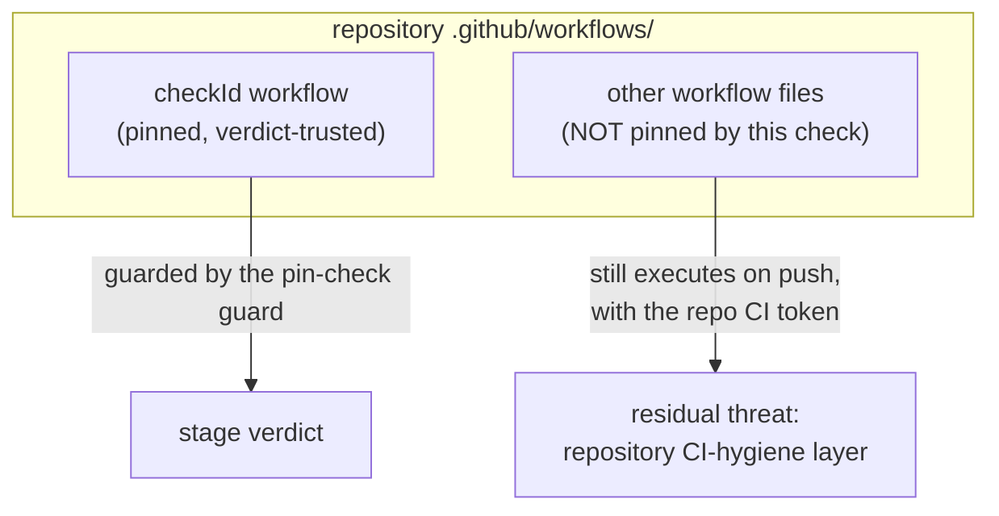

# Operator Guide: GitHub Actions Check

<!-- implements UX1, UX2, NG6, FR9 of add-external-check-github-actions; FR6, FR8, FR13, NFR-S2 of migrate-verify-to-executor-contract -->

This is the reference for the `github-actions` verdict executor: the
platform-authored verdict source for a stage's Quality Control
(`.claude/rules/stage-description.md` §6), which reads the GitHub Actions
workflow runs of the commit under verification. It is a built-in executor,
compiled into the factory and answering the executor contract like any verdict
program ([ADR 0020](../adr/0020-executor-contract.md)); it does not come from
the github vendor bundle, and removing that bundle does not remove it. This
guide assumes the single-task workflow in [`operator-guide.md`](operator-guide.md)
and covers what the check needs from the operator and the CI-hygiene trade-offs
it does not cover for you.

A stage declares the check in its `verify` list. An `external` check with no
`provider` names `github-actions`; its `checkId` is the workflow file:

```yaml
verify:
  - type: external
    checkId: .github/workflows/build.yml   # the workflow file, repository-relative
    interval: 30s
    timeout: 20m
```

The executor answers `pending` while the workflow run of the attempt commit is
in progress, its pending key being that commit; the engine records the key on
the task branch and polls it every `interval` until the run ends or the
`timeout` passes, and any factory instance resumes the poll from the recorded
key. A finished run is the verdict: one `error` finding per failed job, with the
run link and the job log's tail, none for a green run.

## Token scope

The check reads its credential from `GNOMISH_GITHUB_ACTIONS_TOKEN`, a
**separate** environment variable from `GNOMISH_GITHUB_TOKEN` (the tracker
token). Two tokens, not one, is a deliberate blast-radius boundary: the
tracker token can write issues and labels, while the check token needs to do
nothing but read workflow runs. If a build log or a misconfigured process
ever leaks the check token, the leak cannot be used to write to the tracker
or forge a task's escalation state — the worst it can do is read CI history.

**Required scope (NFR-S1):** read-only, enough to list workflow runs and job
logs, nothing more:

- **Fine-grained PAT (recommended):** GitHub → Settings → Developer settings
  → Personal access tokens → Fine-grained tokens → Generate new token. Scope
  it to the target repository, and under Repository permissions grant
  **Actions: Read-only**. No other permission is needed — specifically, do
  not grant Contents or Issues write access to this token.
- **Classic PAT (fallback):** the `repo` scope, used read-only — GitHub's
  classic tokens have no narrower read-only Actions scope. Because a classic
  `repo`-scoped token is technically capable of writes, keep it strictly out
  of any path the gnome or its sandbox can read; treat it as no safer than
  the tracker token from a blast-radius standpoint, only cheaper to obtain.

Set the token on the machine running the factory exactly like
`GNOMISH_GITHUB_TOKEN` — a file named `GNOMISH_GITHUB_ACTIONS_TOKEN` in the
project's or the host's secrets folder, or an environment variable (see
[`operator-guide.md` → *Setting up a project*](operator-guide.md#setting-up-a-project))
— never in `.gnomish/` (anything under `.gnomish/` is gnome-writable and lands
on the task branch). The factory resolves it through its secrets port, under
`GNOMISH_GITHUB_ACTIONS_TOKEN` or under the name the connection's `credential`
key gives (below), never through the tracker's subsection. It is resolved when
the task's run is assembled, never logged, and it enters no box: the check runs
in the factory process. Listing the token's name as a child-environment
passthrough variable is refused at startup.

## Base URL config: the `factory.check.github-actions` connection

<!-- implements FR13, FR17, NFR-S2 of migrate-verify-to-executor-contract -->

The check's base URL, repository and token name are the operator's
connection, never the target repository's: the subsection `factory.check.github-actions` in the project file
(`~/.gnomish/projects/<name>/project.yaml`), never `.gnomish/` in the target
repository.

```yaml
factory:
  check:
    github-actions:
      api-url: https://api.github.com   # GitHub Enterprise: https://ghe.example.com/api/v3
      repo: acme/widgets                # owner/name the workflows run in
      # credential: GHE_ACTIONS_TOKEN   # optional: the token's name, when not the default
```

The subsection may instead reference a shared connection profile with
`connection: <name>`, the same profile a github tracker may reference
(`factory.connections.<name>`); a key declared both inline and in the profile
is a configuration error.

**Egress.** Every call the built-in makes passes the factory's HTTP egress
guard, and a redirect is judged like a first request. A connection's
admitted hosts are the union of:

- the host of its `api-url`;
- the built-in's own declared hosts: `api.github.com`,
  `results-receiver.actions.githubusercontent.com` and
  `*.blob.core.windows.net` — the hosts GitHub serves job logs from, which the
  API redirects a log download to;
- the connection's own `egress` list, in the factory's egress entry grammar;
- `factory.egress.in-process`.

A GitHub Enterprise Server stores job logs on a host of its own; name it in
the connection's `egress` list, inline or in the profile:

```yaml
factory:
  connections:
    ghe:
      api-url: https://ghe.example.com/api/v3
      credential: GHE_ACTIONS_TOKEN
      egress:
        - store.ghe.example             # the enterprise's job-log store
  check:
    github-actions:
      connection: ghe
      repo: acme/widgets
```

A redirect to a host no admitted set names is refused before any connection
to it, and the check is `failed/infrastructure` with a reason naming the
refused host and the connection's key (`factory.check.github-actions…`) — the
place to grant it. A refusal is a configuration fault: it is not retried and
burns no stage attempt. A job log larger than the GitHub client's 16 MiB
response bound is read as its last 16 MiB, so the finding still carries the
log's tail and the check still reaches its verdict.

The connection is read only from `factory.check.github-actions`: the former
`factory.check.github` key connects nothing, and startup refuses it as a
subsection no built-in reads. A check naming `github-actions` with no
connection configured is refused when its task's run is assembled — the task
is parked (`take`, `serve`) or the run exits as for an invalid law (`run`) —
with a located error naming the check and `github-actions`.

## CI hygiene for the residual threat (NG6)

The executor's describe declares that its `checkId` is a pinned path, so the
pin-check guard keeps the one workflow file the check names byte-identical to
the base branch, with no pin path in the manifest: a gnome that edits that
file fails the check before any call to GitHub. The pin is narrow by design:
any *other* file under `.github/workflows/` is outside it. If a gnome edits or
adds another workflow, that workflow still runs on push with the repository's
CI token, unpinned and unwitnessed by any check — the executor never reads it
and cannot detect a substitution there.



This is deliberate: pinning the whole `workflows/` directory would
permanently fail any task whose job is legitimately editing CI. The
trade-off is documented for operators rather than closed by the check
(proposal NG6, design D3's residual-threat paragraph). Mitigate it at the
repository level:

- **Minimal CI token permissions.** Whatever token GitHub Actions injects
  into your workflows (`GITHUB_TOKEN` or a PAT referenced by `secrets.*`)
  should carry the least privilege the workflow needs — read-only where
  possible, and never write access to the tracker, deployment credentials,
  or anything a gnome-authored change could exfiltrate or abuse.
- **No privileged secrets reachable from a gnome branch or PR.** Secrets
  used by workflows that a gnome's branch can trigger (in particular
  anything running on `pull_request` or `push` from a task branch) must not
  include deploy keys, cloud credentials, or tokens with write access
  outside CI itself.
- **Treat `.github/workflows/*` as sensitive even outside the pinned
  check.** A change to any workflow file is worth the same scrutiny as a
  change to sandbox policy — it runs with ambient CI credentials regardless
  of which stage's pin set covers it.

This guidance is the repository-hygiene half of a threat that
`add-sandbox-core` addresses from the sandbox side (task 9.5: sandbox
config, host-mode passport honesty, allowlist maintenance, and — as its
step 0 of the Docker-inside ladder — routing `gnomish/*` workflows without
privileged secrets to CI instead of running them inside the box).
`add-sandbox-core` is not implemented yet, so there is no linked operator
doc for it today; treat this as a forward reference to that task by number
until it lands.

## Timeout class: `quality` vs `infrastructure`

An `external` check declaration may set `timeout-class`, alongside its
`checkId`, `interval`, and `timeout` fields:

```yaml
verify:
  - type: external
    checkId: .github/workflows/build.yml
    interval: 30s
    timeout: 5m
    timeout-class: infrastructure   # optional; default is `quality`
```

When the `timeout` passes while the executor still answers `pending`, the
stage engine's poll ends the check per the declared class:

- **`quality` (default, unchanged behavior).** A timeout becomes a quality
  `Fail` carrying a timeout finding — it burns a stage attempt, exactly like
  any other failed check. Keep the default when the check is fast and its
  runner queue is reliable: a genuine timeout there usually means the
  workflow itself is stuck (an infinite loop or a hang introduced by the
  gnome's change), which *is* a quality signal worth burning an attempt
  over.
- **`infrastructure`.** A timeout becomes a cannot-verify, naming the elapsed
  timeout — no stage attempt is burned, and the task escalates to a human
  immediately instead of retrying.

**The trade-off:** `infrastructure` protects attempts at the cost of an
immediate escalation on every timeout, even when the run would have
finished a minute later. Use it when the check's own runner queue is known
to be slow or variable enough that a timeout carries no information about
the gnome's change — shared/contended runners, or pipelines with
heavy cold-start variance. In that setting, `quality`'s default retry burns
an attempt on pure infrastructure noise and gives the gnome nothing
actionable to fix, which is exactly the case add-stage-engine's NG6 left
open for "a consumer" to configure (design D7) — this check is that
consumer. If the check is fast and reliable, leave the default: a timeout
there is worth treating as the gnome's problem.

## When the check can't be verified

Separate from a timeout, a poll can fail to reach a verdict at all. The
executor then answers `failed` with the failure class `infrastructure`, which
the engine reads as a cannot-verify: the task escalates to a human and **no
stage attempt is burned**. The two shapes below differ in how the executor gets
there, and the escalation reason tells them apart.

<!-- implements NFR-R1, NFR-R3 of add-external-check-github-actions -->

- **Infrastructure failure (transient).** A network error, a `5xx`, a `429`,
  or a `403` carrying GitHub's rate-limit signal (primary or secondary
  limit). The GitHub client retries these with backoff first; only after
  the retry budget is exhausted does the poll report a cannot-verify with a
  generic "runs query failed" reason (NFR-R1). Waiting and re-running the task
  later is the right response — the platform was momentarily unavailable.

- **Misconfiguration (permanent).** A `401` (the token is invalid or
  expired), a non-rate-limited `403` (the token lacks **Actions: Read** on
  this repo — see [Token scope](#token-scope)), or a `404` (no workflow by the
  `checkId` file name exists). These are **not** retried and **not** polled to
  the timeout: the executor fails fast, reporting a cannot-verify immediately
  with a reason that names the check and the likely cause (NFR-R3). The fix is
  a config change — correct the token or the `checkId` — not a re-run.

**The `404` caveat.** The executor resolves `checkId` by workflow **file
name**, and treats a `404` as "that workflow does not exist." A workflow that
simply hasn't run for this commit yet returns an empty list (`200`), which
reads as still `pending` — so a `404` genuinely means the file name is wrong
*or* the workflow isn't registered on the platform. GitHub registers a
workflow by filename only once it exists on the repository's **default
branch**. If you add a brand-new CI workflow inside a task branch and never
merge it to the default branch, a check referencing it will escalate as a
`404` misconfiguration rather than wait for it — keep any workflow a check
names on the default branch. This is the deliberate trade-off for fast, clear
feedback on a mistyped `checkId`: a typo is diagnosed on the first poll
instead of after a full `timeout` of silent polling.
