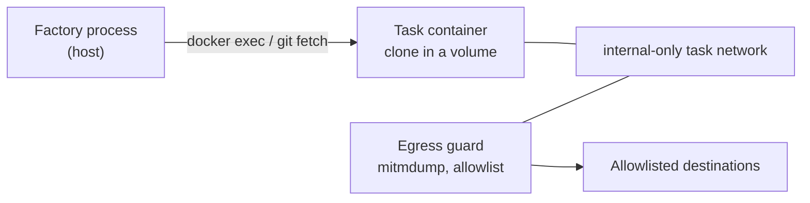

# Operator Guide: The Sandbox

<!-- implements UX1, UX2, UX3, UX4, UX5, UX6, NG5, NG7 of add-sandbox-core -->
<!-- implements UX3, UX4 of add-serve-sandbox-lifecycle -->
<!-- implements FR6, UX2 of fix-image-declared-volumes -->

This guide is for the operator configuring where gnome processes actually run.
Since add-sandbox-core, every gnome-product process — agent rounds, judge
votes, command checks — executes through a task execution environment: either
the **container adapter** (an ephemeral Docker box per task) or the **host
adapter** (the pre-sandbox behavior, explicit opt-in). Sandbox setup is factory
config only — no target-repo changes are needed to sandbox an existing
pipeline (UX1).

Every setting on this page lives in the factory home (see
[`operator-guide.md` → *Setting up a project*](operator-guide.md#setting-up-a-project)).
The ones that shape the sandbox — `factory.bindings.*`, `factory.sandbox.image`,
`factory.sandbox.egress-allowlist`, `factory.sandbox.env-passthrough` — are
**sandbox-boundary keys**: they are read from the project's own
`~/.gnomish/projects/<name>/project.yaml` and nowhere else. Set on the command
line, in the host file or as a `FACTORY_*` environment variable, they stop
startup with a line naming the project file to move them to, so a project's
whole boundary is in one file you can review.

## Quick start (container mode)

Container is the default binding. On a machine with Docker, two keys in the
project file are enough:

```yaml
# ~/.gnomish/projects/<name>/project.yaml
factory:
  sandbox:
    image: my-project-sandbox:1
    egress-allowlist:
      - api.anthropic.com
      - repo.maven.apache.org
```

Build the image `FROM` the sandbox base image, as the reference recipe in
`docs/examples/sandbox-image/` does (see [Building your sandbox
image](#building-your-sandbox-image)): the base carries the image contract the
factory assumes (git 2.56.0 or newer, curl, a non-root `gnome` user owning
`/gnomish/**`, root-owned control surfaces and home), and your layer adds your
project's toolchain and the agent CLI. The factory has one
git floor, 2.56.0: it applies to the git the factory itself runs and to the
image's git alike. The sandbox base image the recipe builds on carries a git at
that floor, so keep it rather than installing another ahead of it on `PATH`. The
image's git is checked before every seed clone: the seed clone reads the factory clone, which is
on the reftable ref backend, with the image's own git, and an image whose git is
older is refused with a message naming it — under `serve` once at startup (`[GF173]`) or,
for an image rebuilt under a running daemon, as the box-git-floor daemon condition
(`[GF180]`); `take` and `run` exit 8. Without Docker the factory
refuses with an error naming the two ways out — install Docker, or explicitly
bind host — and never falls back to host silently.

What each task then gets:



Before the first gnome process in every box, a fail-closed **self-check**
proves the box's isolation from inside: direct egress fails, a non-allowlisted host is
denied, an allowlisted host passes, and the isolation in effect matches the
adapter's passport. A failed probe rejects the environment as an
infrastructure failure naming the probe (UX2) — no round executes in a box
whose protection cannot be demonstrated.

## Building your sandbox image

<!-- implements FR5, FR9, FR12, NFR-O1, UX1, UX2 of add-sandbox-base-image (design D6, D11–D14) -->

The **image contract** is everything the factory assumes about a box image: the
`gnome` user (uid 1000) owning `/gnomish/**`, the root-owned control surfaces
and home, the egress guard's proxy in the environment, `git` at the factory's
floor, `curl`, and the helper commands. You do not copy it by hand: the
**sandbox base image**, `ghcr.io/oinsio/gnomish-sandbox-base`, carries all of
it, and your Dockerfile builds `FROM` it and adds only your toolchain and the
agent CLI. The reference recipe, `docs/examples/sandbox-image/Dockerfile`, is
that Dockerfile for a JDK and Node project; its instructions, without the
recipe's comments:

<!-- recipe: docs/examples/sandbox-image/Dockerfile -->
```dockerfile
ARG GNOMISH_BASE_TAG=0.1
# Downloads happen in stages of their own (see "Download in a stage of your own").
FROM eclipse-temurin:25-jdk-noble AS jdk
FROM ubuntu:24.04 AS node
ARG TARGETARCH
ARG NODE_VERSION=24.22.1
ARG NODE_DIST_URL=https://nodejs.org/dist
ARG NPM_REGISTRY=https://registry.npmjs.org/
ARG AGENT_CLI_PACKAGE=@anthropic-ai/claude-code
RUN apt-get update && apt-get install -y --no-install-recommends ca-certificates curl xz-utils \
 && case "${TARGETARCH}" in \
      amd64) arch=x64 sum=6c172a9ab6718f7b801fb5a7bd486af2ee5e32758086a04b84fcce2aa77095e6 ;; \
      arm64) arch=arm64 sum=dbabf7a1cbf947e6059ffad2c27b80041db97dea1e553b62afdee7f13fca336e ;; \
      *) echo "no Node build for ${TARGETARCH}" >&2; exit 1 ;; esac \
 && curl -fsSL -o /tmp/node.tar.xz "${NODE_DIST_URL}/v${NODE_VERSION}/node-v${NODE_VERSION}-linux-${arch}.tar.xz" \
 && echo "${sum}  /tmp/node.tar.xz" | sha256sum -c - \
 && mkdir /opt/node && tar -xJf /tmp/node.tar.xz -C /opt/node --strip-components=1 --no-same-owner \
 && PATH="/opt/node/bin:${PATH}" npm install -g --registry "${NPM_REGISTRY}" "${AGENT_CLI_PACKAGE}"
# The final stage: the base, plus what the stages above fetched.
FROM ghcr.io/oinsio/gnomish-sandbox-base:${GNOMISH_BASE_TAG}
USER root
COPY --from=jdk /opt/java/openjdk /opt/java/openjdk
COPY --from=node /opt/node /opt/node
ENV JAVA_HOME=/opt/java/openjdk \
    PATH=/opt/java/openjdk/bin:/opt/node/bin:${PATH}
COPY --chmod=0644 ca/ /etc/gnomish/ca/
# As root, after every other step: declare home directories, import CAs, verify the contract.
RUN gnomish-home-dir .m2 .gradle .npm && gnomish-trust-ca && gnomish-verify-image
USER gnome
```

Swap the JDK image or add your own toolchain the same way, and keep the end:
one `RUN` as root that declares your toolchain's home directories, imports the
certificates in `/etc/gnomish/ca` (`gnomish-trust-ca`) and checks the whole
contract (`gnomish-verify-image`, which fails the build naming every violation
it finds), then `USER gnome`. The recipe's
[README](../examples/sandbox-image/README.md) lists its build arguments.

### Which base tag

The base is published with every factory release. The **base tag** is the tag
a factory release names for it — in the recipe's `GNOMISH_BASE_TAG` default
(the release archive stamps its own) and in the contract refusal below:

| Release                   | Tags pushed         | Base tag the release names |
|---------------------------|---------------------|----------------------------|
| final, `0.4.1`            | `0.4.1` and `0.4`   | `0.4`                      |
| pre-release, `0.5.0-rc.1` | `0.5.0-rc.1` only   | `0.5.0-rc.1`               |

- `X.Y.Z` (and a pre-release's full version) is never pushed again: it is the
  image the release's notes and attestation name.
- `X.Y` moves: a final release moves it to its own build, and a weekly rebuild
  of the highest final release refreshes it with Ubuntu's security updates. A
  pre-release never moves `X.Y`.

`FROM …:X.Y` gives you those updates on your next build. For an image that
never changes under you, pin `X.Y.Z` or a digest
(`ghcr.io/oinsio/gnomish-sandbox-base@sha256:…`) and move the pin yourself.

### The contract refusal

The base carries the label `io.gnomish.image-contract=<N>`, the contract
version it was built for. Before it creates a box, the factory reads the
label of `factory.sandbox.image` and refuses an image whose label is missing
or names another version, with an error that ends in the fix — written once by the layer
that decides (`serve` at startup `[GF173]`, a running daemon's image-contract condition
`[GF178]`, `take` `[GF171]`, `run` `[GF172]`):

```text
the sandbox image "my-project-sandbox:1" has io.gnomish.image-contract=1, this factory needs 2; rebuild: FROM ghcr.io/oinsio/gnomish-sandbox-base:0.4
```

A missing label reads `is not built on the base (no io.gnomish.image-contract=2
label)`. The fix is the same either way: rebuild your image `FROM` the base
tag the line names, with your factory's recipe. A development build of the
factory has no published base, so its line names a base built from the same
checkout's `sandbox-image/Dockerfile` instead.

### Download in a stage of your own

The base's proxy variables name the egress guard, which exists only on a
box's task network. At build time there is no guard, so a `curl`,
`npm install` or `apt-get` in a stage `FROM` the base fails. Fetch in a stage
built on another image and graft the result with `COPY --from`, as the
recipe's `jdk` and `node` stages do.

Operating-system packages are the one exception: `apt` spreads a package
across the filesystem, and no single `COPY --from` carries it. Install them in
the final stage with the proxy variables unset for that one command, inside
one `RUN`:

```dockerfile
RUN env -u http_proxy -u https_proxy -u HTTP_PROXY -u HTTPS_PROXY \
      sh -c 'apt-get update && apt-get install -y --no-install-recommends jq && rm -rf /var/lib/apt/lists/*'
```

`env -u` changes only that command's environment: the image keeps the base's
proxy variables, `JAVA_TOOL_OPTIONS`, `GRADLE_OPTS` and `MAVEN_ARGS`, which
the box needs. Never set or clear a proxy variable with `ENV`. No check
catches an image that does, but it fails closed: the task network has no
other route out, so a tool left without the proxy reaches nothing.

### The Maven mirror

The base's root-owned Maven `settings.xml` reads its mirror from the variable
`GNOMISH_MAVEN_MIRROR`, which the base sets to Maven Central. Select your own
mirror with one line after `FROM` the base; the settings file stays as the
base wrote it:

```dockerfile
ENV GNOMISH_MAVEN_MIRROR=https://maven.example.com/maven2
```

The mirror's host must still be on `factory.sandbox.egress-allowlist`: the
mirror chooses where Maven asks, the allowlist decides whether the box may
reach it.

### The root-owned home and `gnomish-home-dir`

A box lives for the whole task and every round runs in it, so anything a
round writes into the gnome's home could run in a later round. The base
therefore keeps `/home/gnome` root-owned: `.bashrc`, `.profile` and
`.bash_logout` are root-owned stubs with no code, and the gnome can create
nothing directly under the home — no `.bash_profile`, `.gitconfig`, `.curlrc`
or `.npmrc`. The only gnome-writable entries are the declared directories:
the base declares the agent CLI's `.claude` and `.cache`, and you declare
every other directory your toolchain writes under the home, as root:

```dockerfile
RUN gnomish-home-dir .m2 .gradle .npm
```

`gnomish-home-dir` creates each directory owned by the gnome and records its
name in the root-owned `/etc/gnomish/home-dirs`; `gnomish-verify-image` fails
the build on any gnome-writable entry of the home that file does not list. A
tool that writes an undeclared path under the home fails visibly in the box:
declare its directory and rebuild.

### Your own agent policy

The base's agent policy, `/etc/claude-code/managed-settings.json`, is
`{"allowManagedHooksOnly": true}`: no hook from the gnome's
`~/.claude/settings.json` or from the working copy's `.claude/settings.json`
runs. You may replace the file, as root, with a managed policy of your own;
keep `"allowManagedHooksOnly": true` in it. `gnomish-verify-image` fails the
build when the key is missing or not `true`, and the file stays root-owned.

### An image not built on the base

The factory checks the label, not where the image came from, so a non-Ubuntu
or otherwise custom image can run in a box, but it must provide the whole
contract itself: everything listed at the top of this section, with `git` at
the factory's floor. Check it with the base's own verifier before you set the
label — copy the helpers from the base, run the check as the last step as
root, and only then declare the contract version your factory needs:

```dockerfile
COPY --from=ghcr.io/oinsio/gnomish-sandbox-base:0.4 /usr/local/bin/gnomish-home-dir /usr/local/bin/gnomish-verify-image /usr/local/bin/
RUN gnomish-verify-image
LABEL io.gnomish.image-contract="<N>"
```

The helpers are POSIX `sh` scripts. `<N>` is the `contract-version` of
`sandbox-image/image-contract.properties` at your factory's release tag — the
number a refusal says "this factory needs". A label you set without passing
the verifier only moves the failure into the box.

### What the root-owned home does not cover

Two things a round writes still carry into later rounds of the same box:

- **The agent CLI's own configuration under `~/.claude`** — its `CLAUDE.md`,
  `rules/`, and the `env` and `permissions` of its `settings.json`. The CLI
  must write there, so the directory stays gnome-writable. A factory-owned
  configuration directory per round is planned (NG7 of
  `add-sandbox-base-image`); until then, threat row #5 of
  [`sandbox-threat-registry.md`](../sandbox-threat-registry.md) records it.
- **The content of your declared toolchain directories** — a Gradle init
  script under `~/.gradle/init.d`, a `~/.gradle/gradle.properties`, an
  `.npmrc` under a declared directory — and processes a round leaves running.
  A reset of the box at the round boundary is planned (NG8 of
  `add-sandbox-base-image`); until then, threat row #39 records it.

`verify-in: fresh-box` (below) is the answer for the final gate today: its
check runs in a new box built from the attempt commit, where neither survives.

## Binding stages

```yaml
# ~/.gnomish/projects/<name>/project.yaml
factory:
  bindings:
    default: container    # the default even when unset
    stages:
      review: container   # per-stage override, operator-only
```

A per-stage override may not mix modes today: every stage of one pipeline must
resolve to the same adapter, so `stages.review=host` beside a `container`
default is refused when the slot starts ("mixed host/container stage bindings
within one pipeline are not supported"). There is no stage-by-stage migration
into container mode yet — the image has to satisfy every stage from its first
run. See the boundary stated at the end of this section.

<!-- implements FR17 of fix-operator-blockers -->

The target repo can declare *needs* in a stage's `Mechanism` (e.g. requiring
egress control) — needs may only tighten. Binding an adapter, and any
weakening, is yours alone: a repo can never request host mode. When a stage's
needs exceed the bound adapter's passport, the stage refuses fail-closed with
one error naming the unmet need (UX2).

### Which bindings exist

The binding names you can write are **discovered**, not fixed in the factory
core: each sandbox backend module ships its own binding and capability
passport, and the set that is available is the set the distribution's classpath
carries. At startup the factory reports every discovered binding — its config
name, the artifact it came from, and its full passport — before any stage runs,
so `host` and `container` (and anything else installed) are visible up front
rather than inferred from a stage's behaviour. Naming a binding nothing
contributes fails at startup, listing what *was* discovered.

Discovery is **first-party only**, and gated: the factory core owns a trust
table mapping each trusted binding id to the passport it is expected to
declare. A provider whose id is not in that table, or whose declared passport
differs from the expected one, is refused at startup rather than registered —
a backend proposes a passport, the core decides it. That matters because the
passport is precisely what needs-reconciliation trusts. There is no plugin path
for third-party sandbox backends; the sandbox is a trust boundary, and the
classpath your build assembles is the trust domain. Closing the remaining gap —
a jar impersonating a trusted id — is a build-time concern, handled by pinning
the classpath (dependency verification), not something the running factory can
detect.

One consequence worth knowing: `container` is contributed by the Docker backend
module. In a distribution built without it, the default binding is
unsatisfiable, and startup says so — naming the bindings that *are* available
and your two ways out (restore the module, or set
`factory.bindings.default: host` in the project file deliberately). It never quietly falls back to
host: silently weakening isolation is the one thing binding resolution will not
do.

One current boundary, stated honestly: mixed host/container bindings within
one pipeline are refused (the round protocol is mode-wide; bind every stage
alike). Container mode is supported across all three entry points — `gnomish
run`, `gnomish take` (single and batch), and `gnomish serve` slots — reusing
the same container assembly and the same ownership-based cleanup described
below (UX3).

## Host mode honestly

The host adapter's passport declares **isolation: none**, and that is exactly
what it means:

- Processes run on your machine as your user; every file you can read, they
  can read — on-disk SSH keys, cloud configs, browser profiles.
- The environment allowlist bounds **environment variables only**, not
  filesystem access. It stops a leaked `AWS_SECRET_ACCESS_KEY` from appearing
  in `env`; it does not stop a process from reading `~/.aws/credentials`.
- There is no egress control: any process can reach any destination.
- The task branch's record is not protected from the gnome. In container mode
  the factory's record of a task — its outcome, its position, a checkpoint's
  approval, the base pin, the cleanup that marks it delivered — is read only
  at the commit the factory register `refs/gnomish-factory/<task>` names, and
  the gnome's commits enter the branch only after the harvest admission has
  inspected them, so a gnome cannot forge that record. On the host the gnome
  works in the clone's own `.git` and can move the register itself, so host
  mode makes no such claim (threat #49 of the
  [threat registry](../sandbox-threat-registry.md)). What remains are
  signals: a branch whose top does not descend from its register, or whose
  registered commit carries no factory shape, reports `Unknown` with a
  diagnosis instead of being trusted.

Host mode remains fully supported for trusted setups — running the factory on
this project's own repository, licensed toolchains, iOS/GPU builds — but treat
it as running the gnome with your own hands. Mode-independent process discipline (stdin prompts, the findings
funnel, law binding, the git invocation policy) still applies.

## Environment passthrough

The child environment of every process is a positive allowlist: the adapter's
base set (host: `PATH`, `HOME`, `TMPDIR`, locale, `TERM`, `USER`, `SHELL`;
container: empty — the image's own `ENV` supplies the runtime), plus the
variables you pass through by exact name:

```yaml
# ~/.gnomish/projects/<name>/project.yaml
factory:
  sandbox:
    env-passthrough:
      - JAVA_HOME
      - SSH_AUTH_SOCK
```

Values are read live from the factory's environment at exec time — the config
stores names, never values. No patterns: one `AWS_*` would drag keys in
wholesale. Credential names (the tracker token, the external-check token) are
refused in passthrough at startup. The applied names (never values) are logged
at debug per exec, so "my build can't see X" is one log read (UX6).

**How values reach the box (container mode).** A value never travels on the
`docker exec` command line, which every local user can read. The command line
carries only the names, as bare `-e NAME` flags; the values sit in the docker
client process's own environment, which only your account and root can read
(see [ADR 0017](../adr/0017-secret-channels-to-child-processes.md)). So a `ps`
during a round shows names only. The docker client of an exec keeps the
factory's whole inherited environment — `HOME`, `PATH`, `DOCKER_HOST`,
`DOCKER_CONTEXT`, the TLS and proxy variables, `SSH_AUTH_SOCK` — so a custom
docker context or daemon address works as before. It loses one thing: the
run's declared credential names (the tracker token, the external-check token)
are removed from it. Management commands (`docker run`, `inspect`, `rm`,
network and volume commands) keep the inherited environment unchanged. The
docker client forwards into the box only the variables named by a `-e` flag,
so a variable the client merely holds, such as an AI-seam credential on a
command check's exec, does not reach that process.

**`SSH_AUTH_SOCK`** is deliberately outside the host base set: on-disk keys
are already exposed by host mode's absent filesystem isolation, but the agent
socket is the only route to locked or hardware-backed keys. A project with
private SSH dependencies adds it back as the one line above.

**Reward-hacking caution.** A missing variable does not crash the stage — the
build fails, the check fails, and that is a *quality failure* the gnome gets
as feedback. A gnome starved of a variable its build needs may "fix" the build
by routing around the dependency instead of asking. If a toolchain variable is
load-bearing, pass it through before the first run rather than diagnosing the
workaround afterwards.

## Agent authentication in the box

<!-- implements FR9, UX1, UX3, NFR-S3 of fix-operator-blockers -->

The agent CLI inside the box logs in with a credential from the factory's own
environment. Set one of these where the factory process starts, and allow the
provider host:

```bash
# once, on a machine where you are logged in to Claude: prints a long-lived token
claude setup-token

# in the factory's environment (a subscription token, or an API key instead)
export CLAUDE_CODE_OAUTH_TOKEN=...   # from `claude setup-token`
# export ANTHROPIC_API_KEY=...       # pay-as-you-go API key
```

```yaml
# ~/.gnomish/projects/<name>/project.yaml
factory:
  sandbox:
    egress-allowlist:
      - api.anthropic.com
```

That is the whole setup. `CLAUDE_CODE_OAUTH_TOKEN` and `ANTHROPIC_API_KEY`
travel through the factory's AI seam, beside `ANTHROPIC_BASE_URL`,
`ANTHROPIC_AUTH_TOKEN` and `ANTHROPIC_MODEL`: each is read live from the
factory environment at exec time and set on every agent round and judge vote
when present, in container and host mode alike. They need **no**
`factory.sandbox.env-passthrough` entry, and they never reach a `command`
check or any other exec — a build script or test run by a check cannot read
them.

Listing one of them in `env-passthrough` as well still works, but widens its
reach deliberately: passthrough names reach every process, command checks
included. Remove such an entry once the seam carries the token.

Without the provider host on the allowlist, the round cannot reach the
provider and ends without a result; the `egress denial:` line of
`gnomish status` names `api.anthropic.com`.
A gateway or a local model server set through `ANTHROPIC_BASE_URL` needs its
own host on the list instead.

The agent CLI is launched as the stock `claude` binary: the factory itself
passes the permission mode each role needs (file edits auto-approved inside
the working copy for the executor; everything outside the read-only tool set
denied without a prompt for the judge) and excludes every MCP server. No
image-side script and no per-binding `factory.agent-cli-binary` is needed to
make a round edit files.

One threat note: auto-approved edits cover every file under the working copy,
`.claude/settings.json` included, which the agent CLI reads as project
settings. The base's agent policy stops the hooks of that file from running
(see [Your own agent policy](#your-own-agent-policy)), but nothing else of it:
isolating the CLI from settings files in the working copy is not done yet, so
treat a change to that file in a gnome's diff as a finding.

## Egress allowlist maintenance

The allowlist is default-deny and operator-owned; a repo may *ask* for
entries in its docs, only you grant them:

```yaml
# ~/.gnomish/projects/<name>/project.yaml — a list is replaced whole, never merged
factory:
  sandbox:
    egress-allowlist:
      - api.anthropic.com
      - repo.maven.apache.org
      - registry.npmjs.org
```

Every denial is logged as structured metadata (host, path, method — never
bodies) and attached to the round that caused it. Where to look:

- `gnomish status` — an `egress denial:` line under the round's summary
- `status.json` / the task branch's `state.json` — `attempts[].denials[]`,
  one entry per denial, in the same shape a failed check's `findings[]` uses
- `status.json` / the task branch's `task.json` — `lastEscalation.denials[]`,
  the denials of a round that never finished. A round killed on its
  `roundTimeout`, or one whose executor died, produces no attempt record at
  all, so what its guard blocked is under the escalation rather than under
  `attempts[]`. Read both: an exfiltration attempt is *more* likely on the
  round that hung than on the ones that completed

Denials are observability, never a gate: a round that denied something still
passes if its checks pass. Reading them (UX3):

- **A denied registry/tooling host right after a build step** — the toolchain
  needs a new entry. Add it and return the task.
- **A denied host you don't recognize, mid-round, unrelated to any tool** —
  treat as a possible exfiltration attempt or injected instruction; read the
  round trace before returning anything.

**Loss markers.** An empty `denials[]` means "nothing was blocked". Where the
factory can see that denial data was *lost* instead, it says so in the same
list, as an entry whose message starts with `egress denial log truncated` or
`egress denials may be lost` — so "no denials" is never confused with "no
data". Two cases produce one:

- *truncated* — the read filled its tail window, so the guard's own log
  dropped older lines of that window before anything parsed them. The entry
  names the window it can bound. Expect it after a denial storm; the denials
  you can see are a floor, not a total.
- *may be lost* — the box's guard container was replaced while denials of the
  previous one were already recorded, and its log went with it. The entry
  names the recorded source and the live one.

Neither gates anything, and neither means the task misbehaved — it means the
denial record for that stretch is incomplete. Treat an unrecognized-host
judgement call under a loss marker as unresolved, not as clean.

Keep the list minimal — every entry is a channel. Wildcards are supported by
the guard config but name no single destination, so the self-check's
allowlisted-pass probe skips when the list holds only wildcards.

## Resource limits

```yaml
# the host file ~/.gnomish/factory.yaml, or a project file to size one project
factory:
  sandbox:
    limits:
      cpus: 2        # default 2
      memory: 2g     # default 2g
      pids: 512      # default 512
      disk: 10g      # default 10g (volume size, see below)
```

A build that exceeds a limit dies inside the box and surfaces as an ordinary
quality failure with attempt mechanics — tune limits up when legitimate builds
hit them, not preemptively. The disk quota is opt-in
(`factory.sandbox.enforce-disk-quota: true`, in the host file): `--storage-opt size=` needs a
quota-capable storage driver (overlay2 on xfs with `pquota`) most dev daemons
lack, so defaulting it on would fail every container start.

## Declared volumes in your image

A `VOLUME` line in a Dockerfile declares a path the runtime would otherwise
back with an **anonymous volume**: an unlabelled, hash-named object that
outlives the container it was made for and that the factory's sweep and reaper
cannot recognise as theirs. So the factory does not let one be created. Before
every container start it reads the image's declared paths and mounts an
ephemeral in-memory filesystem (`tmpfs`) over each one it does not already
mount itself — the box's working copy and the guard's config directory keep
their explicit mounts. The paths that were overridden are named in the
"container environment … created" line, or stated as `none`.

What this means for an image you build:

- **The path starts empty.** Content the image ships under a declared path is
  not visible in the box — the ephemeral filesystem covers it, exactly as any
  explicit mount would.
- **It holds at most 64 MB**, charged to the container's own memory limit.
  Going over fails visibly inside the box (ENOSPC) instead of leaking onto the
  host.
- **It is gone with the container** — a stop/resume cycle re-materializes it
  empty. Declared paths hold no factory state; the branch is the durable one.
- **It is `root`-owned, world-writable with the sticky bit (`1777`)**, because
  the runtime mounts a `tmpfs` as `root:root` and offers no way to set an
  owner. Any user in the box can write there, which is what an image meaning
  its own non-root user to use the path needs.
- **It is mounted `noexec,nosuid,nodev`** (the runtime's own defaults).
  Binaries the image keeps under a declared path will not run from there.

If the image needs content at that path, there are two fixes — both of which
also remove the declaration's surprise:

1. **Bake it under a path the image does not declare** (drop the `VOLUME` line
   for it, or use a different directory). This is the answer for tooling,
   caches shipped with the image, and anything executable.
2. **Keep it under the working copy** (`/gnomish/work`), which is the factory's
   own named, labelled volume and the one durable place in the box.

The mode is honoured only by runc ≥ 1.1.8 (older runtimes silently restore the
image's mode and a non-root user loses its write access); the Docker-gated
spec `ContainerDeclaredVolumesSpec` is the gate that reports it.

Anonymous volumes already on a host predate this behaviour and are yours to
prune — they carry no factory label, so the factory cannot tell its own from a
neighbour project's:

```bash
docker volume ls -qf dangling=true    # may include other projects' volumes
```

## `verify-in: fresh-box` for the final gate

Recommend to repo authors: the final quality gate of a pipeline declares
`verify-in: fresh-box` in the stage manifest (UX5). The check then runs in a
new environment materialized from the attempt commit — exactly what a human
will merge — and doubles as proof that the branch is self-sufficient: nothing
uncommitted, no in-box residue, no PATH shims survive into the verdict.

## Docker inside the sandbox (the ladder)

The box cannot run Docker (Testcontainers-style tests fail in-box). The
supported ladder (NG5):

- **Step 0 — today:** run container-needing tests as a CI `external` check.
  The stage pushes the attempt commit; your CI (e.g. GitHub Actions) runs the
  test suite; the factory polls the platform-authored verdict. Keep such
  `gnomish/*` workflows free of privileged secrets — they execute
  gnome-authored code.
- **Step 1 — change D:** factory-run neighbor-service stacks from a filtered
  declaration (no privileged, no host mounts outside the workspace, no
  published ports).
- `factory.sandbox.runtime: sysbox-runc` (host file) exists for Linux operators who accept
  running nested-Docker runtimes themselves; the factory passes it through
  without endorsement.

## Provider-side web tools (open threat #45)

Until change B's gateway, a model with provider-executed web tools (web
search / URL fetch run on the provider's infrastructure) can reach arbitrary
URLs *around* the guard — the request never crosses the task network.
Interim guidance: **disable provider-side web tools** for the keys the
factory uses, where the provider allows it (NG7). The threat registry keeps
this honestly open until the gateway lands.

## Keep, resume, cleanup

Escalated/paused tasks keep their environment: the container is stopped,
volume and network retained, so any instance can salvage and resume from the
branch alone. Completed tasks dispose everything. Nothing in a box is
precious: the branch is the durable state.

Every factory-created Docker object is labelled, atomically at creation, with
the task's environment key, its **ownership mode** (`tracked` — claimed
through the tracker, the `take`/`serve` path — or `manual` — `gnomish run`,
which has no tracker), and the **project identity** (a stable digest of the
clone's *normalized* `origin` remote URL, or your explicit override below). `run`, `take`,
and `serve` all run one shared sweep-and-reap pass through this labelling
(`sandbox-lifecycle`, `add-serve-sandbox-lifecycle`): `run` and `take` run it
once at startup, `serve` runs it on a recurring tick for the daemon's whole
lifetime.

- A `tracked` object is alive iff its task's tracker claim has a fresh
  heartbeat. A crashed or hung instance's stale claim makes its objects
  unowned: a running main box is **stopped** (never disposed outright — volume
  and network stay, so a sibling instance's resume still salvages the
  un-harvested work), while guard/judge/verification/seed-helper objects are
  disposed immediately — they hold no durable work and are trivially
  reconstructed on the next attempt.
- `manual`-mode objects (`gnomish run`) have no tracker to ask, so they are
  governed by age alone: a running manual box is stopped only after
  `factory.sandbox.manual-running-stop-age` (default 24h) since it started.
- Any stopped or container-less object — kept deliberately or left behind by a
  crash — is disposed once its age exceeds `factory.sandbox.kept-reap-age`
  (default 7 days). Escalation is one-way: running → stopped → disposed, never
  a shortcut.
- An object younger than `factory.sandbox.minimum-age` (default 2 minutes) is
  never touched, however it classifies — the grace window for a slot that is
  still mid-launch.
- The sweep is scoped to its own project identity (`factory.sandbox.project-id`,
  or the derived default): a second project sharing the same Docker host never
  sees, and never touches, this one's objects. The derived default is a digest of
  the clone's `origin` remote URL after normalization (see below), or — for a clone
  with no `origin` — a digest of the clone's own absolute path, so two origin-less
  checkouts on one host stay in separate scopes rather than sweeping each other. Set the override explicitly
  when several clones of the *same* project must share one scope. The override
  must match `[A-Za-z0-9._-]+`: it is stamped verbatim into a Docker label whose
  read-back format is comma- and equals-delimited, so any other character is
  rejected at startup rather than corrupting the label machinery.

```yaml
# the host file ~/.gnomish/factory.yaml — the sweep ages are host-wide
factory:
  serve:
    sandbox-sweep-interval: 5m     # default 5m — serve's tick cadence (any file)
  sandbox:
    minimum-age: 2m                # default 2m
    kept-reap-age: 7d              # default 7d
    manual-running-stop-age: 24h   # default 24h
```

```yaml
# ~/.gnomish/projects/<name>/project.yaml — the scope override is per project
factory:
  sandbox:
    project-id: my-project         # [A-Za-z0-9._-]+; default: derived (see above)
```

**Which `origin` URLs count as the same project.** The derived identity is a
digest of the remote URL *after normalization*, not of the string in
`.git/config` verbatim. Without that, rotating a token embedded in
`https://<token>@host/owner/repo.git` would change the identity, and every box,
volume, and network created before the rotation would drop out of the sweep's
scope permanently — still holding disk, and still running.

Normalized away — these all name one project and share one sweep scope:

| Difference                    | Example                                             |
|-------------------------------|-----------------------------------------------------|
| URL userinfo (user, token)    | `https://ghp_A@host/o/r` = `https://ghp_B@host/o/r` |
| Scheme and host letter case   | `https://GitHub.com/o/r` = `https://github.com/o/r` |
| The scheme's own default port | `https://host:443/o/r` = `https://host/o/r`         |
| One trailing `/`              | `https://host/o/r/` = `https://host/o/r`            |
| A trailing `.git`             | `https://host/o/r.git` = `https://host/o/r`         |
| The scp-style form            | `git@host:o/r.git` = `ssh://host/o/r`               |

Kept distinct — these are different projects, each with its own scope:
a different host, a different path, a **non-default** port (`https://host:8443/…`
is not `https://host/…`), and a different scheme (`http://` is not `https://`).

Two deliberate consequences:

- Two checkouts of one repository cloned over different URL forms — one over
  `https://…/repo.git`, one over `git@host:owner/repo` — now share one sweep
  scope, and each sees the other's objects as its own project's. Set
  `factory.sandbox.project-id` explicitly on one of them if you need them
  isolated; the override still wins over everything.
- The scp fold is lossy in git's terms: `host:path` names a path relative to the
  remote login's home directory, while `ssh://host/path` names the absolute
  `/path`. The factory treats them as one identity. The error direction is a
  *wider shared scope*, never a lost object — but if you genuinely run two
  distinct remotes that differ only that way, set the override.

A remote URL in a shape neither form matches (a bare local path, an `ext::`
transport, a bracketed IPv6-literal host such as `ssh://[::1]/repo`) is digested
as written. It still gets a stable identity; it just
loses the stability guarantees above.

**Upgrading across normalization.** Objects created by an earlier build carry a
digest of the un-normalized URL. A sweep whose identity derives from `origin`
lists that **legacy identity** alongside its own for as long as the two differ,
so nothing created before the upgrade is orphaned by the upgrade. The first
sweep after it logs one INFO naming how many legacy-labelled objects it found;
that count drains to zero on its own as those objects are reclaimed, because
everything created after the upgrade carries the normalized identity only. No
object is ever relabelled — a Docker label is immutable for a live object.

This also defines the **rollback window**: reverting to a pre-normalization
build is safe only while it can still find the objects the new build stamped —
which it cannot, since the old build knows only the raw digest. Roll back
promptly, or reclaim the normalized-identity objects by hand first (same
`--filter label=` commands as below).

Objects orphaned by a rotation that happened *before* the upgrade are not
recovered: their label carries a digest of a URL nobody has any more. Clean them
up once, by hand, with the factory-ownership label:

```bash
docker ps -a     --filter label=com.github.oinsio.gnomish.factory --format '{{.Names}}\t{{.Labels}}'
docker volume ls --filter label=com.github.oinsio.gnomish.factory --format '{{.Name}}\t{{.Labels}}'
docker network ls --filter label=com.github.oinsio.gnomish.factory --format '{{.Name}}\t{{.Labels}}'
```

Compare each object's `com.github.oinsio.gnomish.project` value against the two
your factory currently owns (the sweep's INFO line names the legacy one; both
appear in the `--filter label=com.github.oinsio.gnomish.project=<id>` listings).
Anything matching neither, and holding no work you still want, is removed with
the ordinary `docker rm` / `docker volume rm` / `docker network rm`.

**Label compatibility.** An object carrying the project label but no ownership
mode (a build older than the mode label) is treated as `tracked`, age-protected
the same as any other object, and never insta-disposed — a mixed-version host
degrades safely on the first post-upgrade sweep.

An object older than the **project** label is a different case: the sweep lists
by factory label AND project label, so such an object appears in no listing and
is never swept — not now, not later. This is deliberate. A label-less object
says nothing about which project owns it, and sweeping it anyway would break the
guarantee above for everyone sharing the daemon. Clean them up once, by hand,
after upgrading:

```bash
docker ps -a  --filter label=com.github.oinsio.gnomish.factory
docker volume ls --filter label=com.github.oinsio.gnomish.factory
docker network ls --filter label=com.github.oinsio.gnomish.factory
```

Anything in that listing without a `com.github.oinsio.gnomish.project` label is
a pre-upgrade leftover; check it holds no work you still want, then remove it
with the ordinary `docker rm` / `docker volume rm` / `docker network rm`.

The daemon reports the last tick's breakdown, the kept-environment inventory,
and recent sweep actions on `gnomish dashboard`; a `tracked` stopped-orphan
event there reads as an incident (an instance died or hung), never as routine
cleanup — routine manual age-stops are counted separately.

This ownership-labelled, claim-heartbeat-derived cleanup covers the Docker
container/volume/network/guard namespace only (`sandbox-lifecycle` of
add-serve-sandbox-lifecycle). Non-Docker execution surfaces — Colima VMs, GHA
runs, provisioning snapshot images — are not covered here; their own changes
adopt this same ownership precedent (labelled ownership, age-scoped fallback,
no reverse liveness lookups) rather than reinventing cleanup from scratch.
