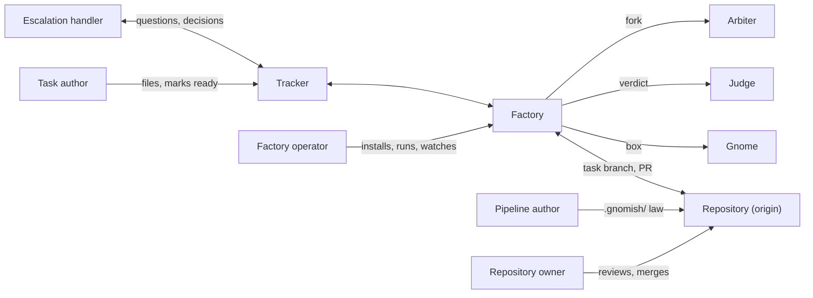

# Stakeholder register

Who has an interest in the factory (`SH-*`), who interacts with it without one (`AC-*`), which
external systems it depends on and which adversarial sources it defends against; keys and
prefixes are explained in [`README.md`](README.md). Each entry says who the party is, what it
needs, how far it is trusted, and what the proposals and guides call it today.

## Stakeholders

### SH-FACTORY-OPERATOR — Factory operator

- **Who:** the person who installs the factory, registers projects, keeps secrets and
  settings under `~/.gnomish`, starts `take` or the `serve` daemon, watches it, upgrades it.
- **Needs:** an unattended daemon that keeps working or says clearly why it stopped; one place
  for configuration with the origin of every value; no damage to their machine or clones; a
  release they can verify and roll back; a quiet console and a diagnosable failure.
- **Trust:** full control of the host; the only party who may loosen a sandbox boundary.
- **Named today as:** operator (the dominant use), cron operator, "operator on a shared
  workstation", "the human on the other end of `gnomish take`".

### SH-TASK-AUTHOR — Task author

- **Who:** the person who writes a task in the tracker and authorizes it for autonomous work
  by applying the ready label.
- **Needs:** a task text the factory reads the way they meant it; feedback in the tracker
  thread, not in logs; one clear answer when the task cannot proceed.
- **Trust:** the ready label is authorization to run agent-written code, so this role requires
  write access to the tracker and is held only by a trusted human or an automation they gate
  (`operator-guide-autonomy-gate.md`). An author without that access is an untrusted source.
- **Named today as:** operator (second meaning), triager, "a trusted human with write access".

### SH-ESCALATION-HANDLER — Escalation handler

- **Who:** the person who answers an escalated question, approves a manual checkpoint, or
  returns a blocked task to work; often the task author, but a distinct duty. The last tier
  of the decision chain gnome → arbiter → human.
- **Needs:** a report they can decide from alone: the problem, the options considered, the
  findings history; a decision channel that any factory instance honours; no second
  question for a decision already given; a way to veto an arbiter's decision.
- **Trust:** their decision is accepted as the task's; it must be impossible for the gnome to
  forge one.
- **Named today as:** operator, reviewer (answering a question), escalation handler, human.

### SH-REPOSITORY-OWNER — Repository owner

- **Who:** whoever administers the target repository: merges pull requests, sets branch
  protection and CI, decides which base the factory works from and what it may deliver.
- **Needs:** finished work arrives as an ordinary pull request from an ordinary branch; the
  main branch never receives factory bookkeeping; nothing the factory does weakens the
  repository's own protections; cost and CI minutes stay visible.
- **Trust:** authority over the repository; the factory acts within it, never above it.
- **Named today as:** project owner, project user, repository owner, "maintainer merging a
  delivered branch". *Never:* product owner (a role of product management, not of a repository).

### SH-PIPELINE-AUTHOR — Pipeline author

- **Who:** the person (or agent) who writes the project's law under `.gnomish/`: stage
  manifests, instructions, acceptance criteria, decision rules, verify checks, executor
  bindings.
- **Needs:** a configuration error reported with file and line before any paid round; a way
  to dry-run a pipeline without a tracker or a model; verify artifacts the gnome cannot edit
  to pass; the law applied exactly as sealed at the commit the task started from.
- **Trust:** declares needs and may only tighten; loosening a boundary belongs to the
  factory operator (threat registry, "ownership asymmetry").
- **Named today as:** pipeline author, stage-manifest author, "operator configuring the
  project" (fourth meaning of operator).

### SH-REVIEWER — Reviewer of task output

- **Who:** the person who reads what a finished task produced: the diff, the reports,
  findings, guard denials, spend, before the repository owner merges.
- **Needs:** every attempt and verdict visible from the branch and the tracker thread;
  evidence of what the checks verified; what the gnome was denied; a cost figure per task.
- **Trust:** reads only; their judgement feeds the repository owner's merge decision.
- **Named today as:** reviewer, "a human reviews a finished task", analyst of cost.

### SH-SECURITY-OWNER — Security owner

- **Who:** whoever answers for secrets, egress and supply chain on the factory host and in
  the target repository; in a small team, the factory operator wearing another hat.
- **Needs:** to know where a secret can travel and that the gnome never holds one; a threat
  registry whose every row names its countermeasure and check; an access log of what left
  the box; fail-closed defaults.
- **Trust:** sets the boundary the operator enforces.
- **Named today as:** security reviewer, compliance reviewer.

### SH-FACTORY-MAINTAINER — Factory maintainer

- **Who:** a developer of the factory itself, human or AI agent, including the maintainer
  who cuts releases. The project develops itself with the factory, so this role is also the
  task author and the repository owner of this repository.
- **Needs:** one command that answers "is my change OK"; gates that fail at compile time
  rather than in review; specs linked to tests and to needs; a build that runs on a clean
  machine and on Linux CI the same way.
- **Named today as:** developer, maintainer, engine maintainer, implementing sub-agent.

### SH-CONTRIBUTOR — External contributor

- **Who:** someone outside the maintainers who opens a pull request or reports a problem.
- **Needs:** CI that runs the full gate without secrets; a one-step CLA; a documented way in.

### SH-EXTENSION-AUTHOR — Extension author

- **Who:** someone building a tracker adapter, a sandbox backend, a check provider or an
  executor against the published plugin contract, possibly closed-source.
- **Needs:** a contract that compiles alone and is versioned; a conformance kit; a guide
  that is sufficient without reading the factory's internals; license clarity.
- **Named today as:** adapter author, plugin author, executor author, integrator.

### SH-INCIDENT-ANALYST — Incident analyst

- **Who:** the person or agent who reconstructs, after a failure, what a run did and why it
  stopped: from logs, the ledger, the access log, the branch history.
- **Needs:** every boundary event logged with expected and actual, in the project's own
  vocabulary, so one search leads from the event to the code and the requirement.
- **Named today as:** post-mortem investigator, "operator debugging".

## Actors

### AC-GNOME — Gnome

- **What:** the AI agent that works one task inside a box: reads instructions, edits the
  working copy, runs the project's commands, commits, asks for a decision when it must.
- **Interacts through:** the working copy and its git; the decision file; the findings fed
  back on a retry; the egress allowlist.
- **Trust:** none. An untrusted tenant: deceivable by text, able to edit any file in its copy,
  assumed to try to pass checks by editing them. Every factory record must be out of its reach
  or verified after it.
- **Named today as:** gnome, "injected or deceived gnome", "gnome or a compromised build
  script".

### AC-JUDGE — Judge

- **What:** the LLM-as-judge check of a stage's verification: grades an attempt against the
  stage's acceptance criteria and returns a structured verdict, passed or findings. One
  judge may also grade a fixer's answer to a reviewer stage; that is still a verdict on work.
- **Interacts through:** a fresh environment built from the attempt commit; the acceptance
  criteria; the verdict, which feeds the gnome on a retry.
- **Trust:** a model's output is untrusted input; it must never grade its own work or see the
  implementer's reasoning.

### AC-ARBITER — Arbiter

- **What:** the automatic decision tier planned by `add-decision-arbiter`: when the gnome
  raises a fork it cannot resolve, the arbiter chooses among the options the gnome enumerated,
  under the stage's law-frozen decision rules, or hands the fork to the escalation handler.
- **Interacts through:** the structured decision request; the decision rules; read-only
  access to the work; the decision record with its author and scope.
- **Trust:** a model's output is untrusted input; it may select among given options, never
  rewrite instructions, criteria or checks, and its decision stays vetoable by a human.
- **Not:** a judge. A judge answers "is this work acceptable", an arbiter answers "which way
  should the work go".

### AC-FACTORY-INSTANCE — Another factory instance

- **What:** a sibling or successor instance of the factory: the one that resumes a task after
  a crash, reaps a dead claim, or shares a project with N slots on several hosts.
- **Interacts through:** the tracker (claims, leases) and origin (task branch, register).
- **Trust:** full, as the factory itself; two instances never need to trust each other's
  memory, only the shared media.
- **Named today as:** second instance, another machine, zombie, sibling, the fleet.

## External systems

| System | Role for the factory | Fails how |
|---|---|---|
| Tracker (GitHub issues; Jira planned) | coordination: tasks, claims, escalations, decisions | outage, eventual consistency, label misuse |
| Forge / origin | shared truth for code and factory records; pull requests; branch rules | rejects a push, deletes a merged branch, rate limits |
| Project CI | polled as an `external` check; also runs on every gnome push | slow, flaky, costly; red for reasons outside the task |
| Factory CI | the merge gate of the factory's own repository | Linux-only facts the developer's macOS did not show |
| Container runtime and registry | the box: images, volumes, exec | daemon wedged, image missing, credential helper prompts |
| Model vendor and agent CLI | the gnome's, judge's and arbiter's brain, by the token | hangs, refuses, changes version, costs |
| Scheduler and monitors | cron starting `serve --drain`; dead-man's-switch watchers | silent non-start |

## Adversarial sources

Named here so that a use case can state who is defended against; the threats themselves,
numbered and with countermeasures, are in `../sandbox-threat-registry.md`.

| Source | Reaches the factory through |
|---|---|
| Untrusted task source | anyone or anything that can get the ready label applied without being a trusted human: a fork's workflow, a bot, a webhook relay |
| Injected content | text in the gnome's context: issue body, repository files, fetched pages, tool output |
| Compromised dependency or tool | a package, action or image executed during build or tests inside the box |
| Another local account | the same host as the factory in host mode; process listings, shared files |
