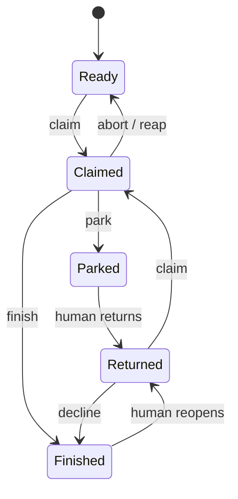
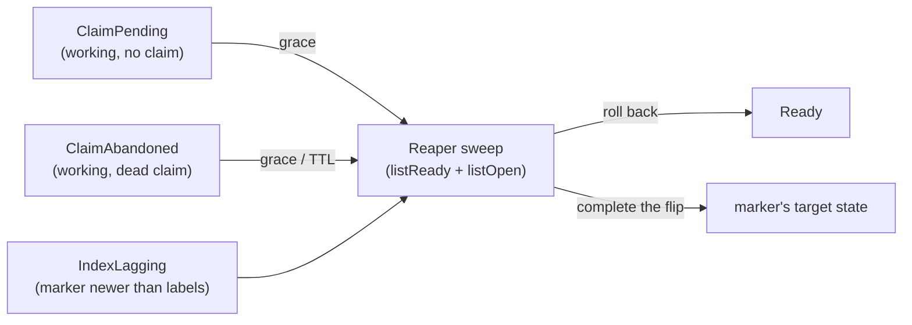

# Spec Delta: lifecycle/claim-heartbeat

## MODIFIED Requirements

### Requirement: Heartbeat maintains the claim in place
An instance SHALL run one heartbeat thread that, on the configured interval,
edits the existing claim comment of every `Working` task the instance holds —
one write per beat, the claim-comment identity (the lease anchor) unchanged, no
new comments. The payload SHALL carry human-readable progress derived from
engine events (current stage, attempt, alive-at time).
**Implements**: FR1 of add-claim-heartbeat; UX1 of add-claim-heartbeat
**Notes**: Claim liveness answers "is the holder process alive", not "is the work progressing".

#### Scenario: Beats continue through a long round
- **WHEN** a gnome round runs for hours while the slot thread is blocked on the
  executor
- **THEN** the claim comment keeps being updated on every interval with current
  stage and attempt, and its comment identity never changes

#### Scenario: No comment spam
- **WHEN** a task is worked for one hour at the default interval
- **THEN** the issue thread gains no new heartbeat comments — only the claim
  comment's body has changed

#### Scenario: The gnome never sees the tracker
- **WHEN** a gnome round runs under a claim its instance holds
- **THEN** every beat is written by the instance itself, and the gnome is given
  no access to the tracker

#### Scenario: A hung gnome under a live instance keeps its claim
- **WHEN** a gnome hangs mid-round while its instance stays alive
- **THEN** the beats continue and the claim never goes stale; the round is ended
  by the per-stage `roundTimeout` of the executor, not by this protocol

### Requirement: Staleness by local observation of claim versions
A live claim SHALL be considered stale only when its version — the pair
(claim-comment identity, last-update time) reported by the adapter — has not
changed for TTL measured on the observer's monotonic clock since the observer's
own first observation of that version. Instance and server clocks SHALL never be
compared and no `now − updated_at` arithmetic is allowed. TTL = multiplier ×
beat interval, both shared protocol constants.
**Implements**: FR2 of add-claim-heartbeat; NFR-R1 of add-claim-heartbeat; FR19, FR12 of harden-task-branch-contract

#### Scenario: Grace period by construction
- **WHEN** a fresh instance starts and observes a claim whose last update is
  older than TTL by server timestamps
- **THEN** the claim is not treated as stale before TTL has elapsed on the
  fresh instance's own clock from its first observation

#### Scenario: Beaten claim never goes stale
- **WHEN** the holder beats its claim at the configured interval while an
  observer watches for many TTLs
- **THEN** the observer sees the version change within every TTL window and
  never classifies the claim as stale

#### Scenario: Absent version does not hide a task from observation
- **WHEN** a listing reports a working-labeled task with a dead claim
  footprint (no live version) or no claim footprint at all
- **THEN** the task enters observation memory, its window grace is timed from
  the observer's first observation of that fact combination, and after the
  grace it is eligible for repair — never invisible to the sweep

#### Scenario: An index lag is repaired without a grace
- **WHEN** the sweep classifies a task as `IndexLagging`
- **THEN** the reaper repairs it on that tick, with no window grace — its marker
  is already the truth

#### Scenario: Core times the claims, adapters only report facts
- **WHEN** an adapter reports a task's claim facts
- **THEN** the observation memory, the TTL policy and the window grace applied
  to them live in core, and the adapter judges neither staleness nor grace

### Requirement: Reaper returns stale claims to circulation
The reaper's standing duty SHALL generalize from stale-claim removal to
tracker-shape repair, running for the whole run's lifetime — a `take` invocation
or the `serve` daemon — on its own thread, independent of how many claims the
instance currently holds, including zero. It SHALL NOT be gated on the beat
thread. The reaper SHALL NOT claim a task for itself; a repaired task re-enters
the ordinary queue.
**Implements**: FR4 of add-claim-heartbeat; NFR-R2 of add-claim-heartbeat; FR1, FR2, FR5 of fix-reaper-idle-liveness; NFR-R1, NFR-S1 of fix-reaper-idle-liveness; FR19, FR12 of harden-task-branch-contract
**Notes**: A running instance knows it is alive, so for the holder itself a bare "version unchanged" cannot mean "holder dead"; that is why its own beaten claims are excluded from its reaping.

#### Scenario: Reaping continues while the instance holds no claim
- **WHEN** an instance holds and beats no claim of its own while a foreign
  `Working` claim in the listing stays at an unchanged version for TTL on the
  instance's monotonic clock
- **THEN** the reaper still ticks on its own thread, removes the stale foreign
  claim, and returns the task to `Ready` — no held claim of its own is required
  for reaping to run

#### Scenario: A restarted daemon returns its previous life's claims with nothing to claim
- **WHEN** a `serve` daemon that held two claims is killed and restarted, and
  the ready queue is empty so the new instance claims nothing
- **THEN** the standing reaper still observes the two claims left under the old
  instance id, reaps them once their TTL elapses, and returns both to `Ready`,
  without the new instance ever holding a claim first

#### Scenario: A dead heartbeat stops shielding its instance's claims
- **WHEN** an instance's heartbeat thread dies abnormally while its slots keep
  working, so its claims' versions stay unchanged for TTL
- **THEN** the instance's own standing reaper returns those claims to `Ready`;
  a slot still working such a task is a zombie from that point on and is
  neutralized by the ordinary fence path — the non-fast-forward push refusal
  or the pre-write claim check — on its next write

#### Scenario: An instance never reaps its own claim
- **WHEN** an instance's beats fail for longer than TTL while its `listOpen`
  keeps returning its own claim at an unchanged version
- **THEN** the instance never removes its own claim while its heartbeat is still
  beating it, and a foreign stale claim in the same listing is still reaped

#### Scenario: A failed removal is retried, not silently dropped
- **WHEN** the reaper's `removeStaleClaim` for a stale claim fails with an
  infrastructure error
- **THEN** the same unchanged version is emitted and retried on a later tick
  instead of being suppressed until the version changes or the instance
  restarts

#### Scenario: Dead instance's task returns without a human
- **WHEN** instance A dies mid-task and instance B works another task longer
  than TTL
- **THEN** B's standing reaper returns A's task to `Ready` with an audit
  marker, without claiming it, and a later run picks it up normally

#### Scenario: Double reap converges
- **WHEN** two instances detect the same stale claim and both invoke removal
- **THEN** the task ends in `Ready` exactly once — no error, no duplicate
  state transition, and at most one set of audit artifacts the thread can
  carry coherently

#### Scenario: Killed reap leaves a shape the next tick resolves
- **WHEN** a reaper posts the removal boundary or deletes a dead claim comment
  and dies before flipping the working label back to ready
- **THEN** a later tick classifies the frozen state and returns the task to
  `Ready` — the kill costs one grace window, never a stuck task

#### Scenario: Suspension leftover is swept off a ready task
- **WHEN** a delayed claim comment lands on a ready-labeled task after the
  reaper rolled its incomplete claim back
- **THEN** the sweep enumerates the task through the feed's claim facts,
  classifies the mismatch, and repairs it — no permanently race-winning claim
  survives on a ready task

#### Scenario: The sweep enumerates both listings
- **WHEN** a kill window freezes a task under the ready label or under the
  working label
- **THEN** the sweep, which enumerates every open task carrying any state label
  (`listReady` plus `listOpen`), sees it — no frozen state is filtered out by
  the very label its sequence had not written yet

#### Scenario: Each non-steady shape is repaired by its own operation
- **WHEN** a tick classifies a stale `Working` claim, a graced `ClaimAbandoned`
  footprint, a graced `ClaimPending`, or an `IndexLagging` disagreement
- **THEN** the first two are repaired through the port's stale-claim removal and
  the last two through the port's index repair

#### Scenario: The heartbeat thread runs no reaping
- **WHEN** the heartbeat thread beats, under `take` or under `serve`
- **THEN** it runs no sweep and no repair; its sole duty is beating the
  instance's own held claims

#### Scenario: The reaper ticks on the beat interval from the factory's clone
- **WHEN** the reaper runs
- **THEN** it ticks on the heartbeat's beat interval, and the interval, TTL and
  window grace come only from the factory's own clone of `.gnomish/config.yaml`
  — no gnome-writable input

#### Scenario: A failed index repair is retried, not silently dropped
- **WHEN** the reaper's index repair of a graced `ClaimPending` or an
  `IndexLagging` shape fails with an infrastructure error
- **THEN** the shape is re-armed and repaired on a later tick instead of staying
  unrepaired until its facts change

### Requirement: The reaper thread survives abnormal faults
The standing reaper SHALL keep reaping for the whole life of the process after
any single abnormal fault. Only an intentional stop SHALL exit the loop.
**Implements**: FR3, FR4 of fix-reaper-idle-liveness; NFR-R2, NFR-O1 of fix-reaper-idle-liveness
**Notes**: The log is the exposure surface of the reaper's faults, deaths and restarts.

#### Scenario: An Error on one tick does not end reaping
- **WHEN** the reap tick raises an `Error` from deep in an adapter on one
  interval
- **THEN** the worker ends, the supervised loop respawns the reaper after one
  backoff, and the respawned reaper reaps a stale claim normally

#### Scenario: A throwing sleeper does not end reaping
- **WHEN** the interval sleeper throws on one wait
- **THEN** the fault is logged, the loop continues, and reaping resumes on the
  following interval

#### Scenario: A truly dead thread is respawned, an intentional stop is not
- **WHEN** the reaper thread dies from an unhandled failure while the run is
  still active
- **THEN** it is restarted with backoff and reaping resumes; **AND WHEN** the
  run stops it via `stop()` instead, no replacement thread is started

#### Scenario: A dead reaper's restart backoff is capped and reset
- **WHEN** the reaper thread dies repeatedly, and later a respawned reaper
  completes one full tick without dying
- **THEN** each restart waits an exponential backoff capped at 10 minutes, and
  the backoff resets after that full tick

#### Scenario: The reaper is restarted without limit
- **WHEN** the reaper thread keeps dying
- **THEN** it is restarted every time and never given up on, and its failure
  never kills the daemon

#### Scenario: Reaper faults are logged by severity
- **WHEN** one tick faults, and later the reaper thread dies and is restarted
- **THEN** the tick fault is logged at WARN; the death and each restart are
  logged at ERROR, each restart line carrying a monotonic restart count

### Requirement: Zombie fencing
The task branch SHALL NEVER be force-pushed by any party — the git
non-fast-forward refusal is the hard fence: of two writers holding the same
task, the late pusher gets a persist refusal and follows the normal `Aborted`
path. Tracker writes that git does not fence (park, finish, release) SHALL be
preceded by a cheap conditional "claim still ours" check; the residual
window may cost a stray label or comment, never data corruption, and
converges with the new holder's next write.
**Implements**: FR7 of add-claim-heartbeat

#### Scenario: Zombie push is rejected
- **WHEN** a reaped instance thaws and pushes its round while the new holder
  has already pushed
- **THEN** the zombie's push fails as non-fast-forward, its run ends via the
  normal abort path, and the new holder's branch is untouched

#### Scenario: Zombie park is stopped by the pre-write check
- **WHEN** a zombie attempts to park a task whose claim now belongs to another
  instance
- **THEN** the pre-write check detects the foreign claim and the park is not
  written

### Requirement: Beat failures are classified, not counted
A failed beat SHALL be handled by cause: on a network error or 5xx work
continues — the next round boundary resolves the situation; a
"claim marker gone" answer means the claim is lost — at the nearest round
boundary the run SHALL stop, salvage-push best-effort (the fence arbitrates),
free the slot, and write no tracker state for the task that is no longer ours.
**Implements**: FR8 of add-claim-heartbeat; FR13 of harden-task-branch-contract

#### Scenario: Transient outage does not stop work
- **WHEN** three consecutive beats fail with 5xx while the gnome works
- **THEN** the run continues, the first failure is logged as WARN and the
  repeats at DEBUG with a counted roll-up, and beats resume when the tracker
  recovers, one INFO closing the outage

#### Scenario: Lost claim ends the run at the boundary
- **WHEN** a beat reports the claim marker gone (task reaped or taken over)
- **THEN** at the next round boundary the run stops, pushes best-effort, and
  performs no tracker transition for the lost task

#### Scenario: Unconfirmed heartbeat freezes writes at the boundary
- **WHEN** every beat has failed for longer than the lost-detection threshold
  and the round reaches its boundary
- **THEN** the holder writes nothing — no push, no tracker write — until a
  re-verification confirms the claim is still its own; a confirmed claim
  resumes the run, a gone claim follows the lost-claim path

### Requirement: Tracker outage causes no false reaping
While the tracker is unreachable no staleness progress SHALL accrue: TTL is
measured between observations, and an observer that cannot read versions
observes nothing. Polls and beats SHALL retry with backoff and resume when the
tracker returns; after recovery every claim gets a fresh TTL window from its
next observation.
**Implements**: FR9 of add-claim-heartbeat
**Notes**: The design prefers a delayed reap of a dead claim to any reap of a live one (add-claim-heartbeat design, Risks / Trade-offs).

#### Scenario: Long outage, no casualties
- **WHEN** the tracker is down for several TTLs while holders keep working
- **THEN** after recovery no live claim is reaped: holders resume beating
  before any observer accumulates a fresh TTL of unchanged observations

#### Scenario: A recurring listing failure may delay reaping
- **WHEN** `listOpen` fails in a pattern that recurs faster than the TTL (for
  example every second poll)
- **THEN** the observation windows are forgotten before any dead claim accrues a
  full TTL, and reaping may be delayed for as long as the pattern holds — a live
  claim is still never reaped

### Requirement: Terminal outcomes reconcile through the branch
A terminal outcome SHALL be durable in the task branch before its tracker
write. When the tracker is down at the finish line, the instance SHALL hold
the task and retry the terminal write with backoff. Resume SHALL begin with a
reconcile step: a terminal outcome recorded at the branch's registered commit
without its tracker counterpart means the resuming instance completes the
deferred tracker write (finish or park) and runs zero engine rounds —
bookkeeping, never replay.
**Implements**: FR10 of add-claim-heartbeat; NFR-C1 of add-claim-heartbeat; NFR-S2 of tighten-spec-contract
**Notes**: "Recorded in the branch" means recorded at the factory register (task-branch-contract, "Classification reads the factory register"), never at a tip the gnome wrote.

#### Scenario: A gnome-written terminal outcome is not reconciled
- **WHEN** a resume finds `Completed` in a `task.json` the gnome committed above
  the register and `Working` in the tracker
- **THEN** no finish is posted and no cleanup is written; the run proceeds from
  the registered commit's shape

#### Scenario: Outcome survives holder death during retries
- **WHEN** an instance completes a task during a tracker outage, commits the
  outcome to the branch, and dies while retrying the finish write
- **THEN** the claim eventually goes stale, the task returns to `Ready`, and
  the next claimer's reconcile posts the deferred final report and delivers —
  without executing any stage

#### Scenario: Reconcile costs no tokens
- **WHEN** a resume finds `Completed` in the branch state and `Working` in the
  tracker
- **THEN** the run finishes the bookkeeping only — no executor call is made

### Requirement: Protocol constants come from the factory's clone
The beat interval and TTL multiplier are protocol constants shared by all
instances of a project and SHALL be read only from the factory's own clone of
`.gnomish/config.yaml` — never from any file the gnome can write. A gnome
MUST NOT be able to extend its own TTL or slow its holder's beat.
**Implements**: FR3, NFR-S1 of add-claim-heartbeat

#### Scenario: Gnome edits to config are inert
- **WHEN** a gnome modifies `.gnomish/config.yaml` inside its worktree during
  a round
- **THEN** the instance's beat interval and TTL are unaffected for the whole
  run

### Requirement: Total tracker-shape classification with one recovery owner
The tracker-side state of a task SHALL classify totally, in core, over
adapter-reported facts — the state labels present, the claim footprint (a live
claim, a dead footprint, or none), and the boundary markers — into a closed set
of ten named shapes, each with exactly one recovery owner. The shape set SHALL
be a sealed hierarchy; readers switch without a default branch.

The steady progression, by factory writes and human transitions:

The window shapes and their repair by the sweep:

**Implements**: FR19, FR12 of harden-task-branch-contract
**Notes**: Markers are the truth; labels are the index the listing queries filter on.

#### Scenario: Every fact combination yields exactly one shape
- **WHEN** tracker facts are generated over arbitrary label sets, claim
  footprints, and marker histories
- **THEN** each combination classifies to exactly one named shape — `Foreign`
  included — and no combination throws or is silently dropped

#### Scenario: Kill between claim label and claim comment is repaired
- **WHEN** an instance dies after the working-label transition but before its
  claim comment posts
- **THEN** the sweep classifies the frozen state as `ClaimPending` and, after
  the grace period, restores the task to `Ready` — never treating the shape
  as a human mislabel

#### Scenario: A boundary marker completes its own flip
- **WHEN** an instance dies after posting the finish marker but before the
  delivered-label flip
- **THEN** the sweep classifies `IndexLagging`, completes the flip to
  delivered, and no path re-executes the finished task

#### Scenario: A ready label with no live claim is Ready
- **WHEN** a task wears the ready label, carries no live claim, and has no park
  or finish history
- **THEN** it classifies `Ready`, and its recovery owner is the queue

#### Scenario: A working label with a live claim is Claimed
- **WHEN** a task wears the working label with a live claim and no boundary
  marker newer than its labels
- **THEN** it classifies `Claimed`; its holder beats it and the reaper reaps it
  on TTL

#### Scenario: A needs-human label is Parked
- **WHEN** an open task that does not wear the working label wears the
  needs-human label without the delivered label
- **THEN** it classifies `Parked` whatever its latest boundary marker, and its
  recovery owner is the human

#### Scenario: A delivered label is Finished
- **WHEN** an open task that does not wear the working label wears the
  delivered label without the ready label
- **THEN** it classifies `Finished`, a terminal shape, whatever markers it
  carries

#### Scenario: A ready label with park or finish history is Returned
- **WHEN** a task wears the ready label, carries no live claim, and has a
  recorded park or finish
- **THEN** it classifies `Returned` rather than `Ready`; its recovery owner is
  the queue, and a finished return routes to decline

#### Scenario: A closed issue is Revoked over every other fact
- **WHEN** the task's issue is closed, whatever labels, claim footprint or
  markers it carries
- **THEN** it classifies `Revoked`, a terminal shape; a human may move any open
  shape there at any time by closing the issue

#### Scenario: A working label with no claim footprint is ClaimPending
- **WHEN** a task wears the working label (a ready label may linger beside it)
  and carries no claim footprint
- **THEN** it classifies `ClaimPending`, and the reaper restores it to ready
  after the window grace

#### Scenario: A footprint no working tenure backs is ClaimAbandoned
- **WHEN** a working-labeled task carries a claim footprint with no live
  version, or a ready-labeled task still carries a live claim marker
- **THEN** it classifies `ClaimAbandoned` — the ready-labeled case before any
  other ready-labeled shape — and the reaper removes the footprint through
  stale-claim removal after the window grace

#### Scenario: A boundary newer than the labels is IndexLagging
- **WHEN** a boundary marker was recorded after the task's newest claim marker
  and the task still wears the working label
- **THEN** it classifies `IndexLagging` before any label-derived shape, and the
  reaper completes the label flip toward the marker

#### Scenario: Any other combination is Foreign
- **WHEN** a task's facts match none of the other shapes
- **THEN** it classifies `Foreign`, is surfaced with a diagnosis, and is never
  auto-repaired

#### Scenario: A dead footprint on a ready task is tenure history
- **WHEN** a ready-labeled task carries a claim footprint with no live version
- **THEN** the footprint does not change its shape: it classifies `Returned` or
  `Ready` by its park and finish history

#### Scenario: A boundary of an earlier tenure is not a lagging index
- **WHEN** a working-labeled task's latest boundary marker was recorded before
  its newest claim marker
- **THEN** it does not classify `IndexLagging`; its claim footprint decides the
  shape

#### Scenario: A park the human returned is Returned, not a lagging index
- **WHEN** a park marker is the latest boundary of a task the human has returned
  to the ready label
- **THEN** it classifies `Returned`

#### Scenario: Every window shape stays in the sweep universe
- **WHEN** a kill in the claim or boundary write order freezes a task as
  `ClaimPending`, `ClaimAbandoned` or `IndexLagging`
- **THEN** the task still wears an open-state label, so the reaper's sweep
  enumerates it

#### Scenario: An adapter reports every combination as facts
- **WHEN** an adapter lists tasks whose labels, claim footprints and markers
  form any combination
- **THEN** it omits and reinterprets none of them; the classifier decides the
  shape, and no factory-reachable shape is attributed to human mislabeling

#### Scenario: The classifier makes no time judgment
- **WHEN** a task's facts are classified
- **THEN** the shape depends on the facts alone; the staleness TTL and the
  window grace are judged by core's observation memory, never by the classifier
  or an adapter

### Requirement: Every (re)claim issues a monotonically increasing epoch
Each successful claim or reclaim of a task SHALL be issued an epoch strictly
greater than every epoch previously issued for that task; the epoch SHALL be
recorded with the claim and SHALL be available to the holder for stamping into
every commit and tracker write of that tenure.
**Implements**: FR13 of harden-task-branch-contract; FR7 of fix-claim-epoch-fence
**Notes**: The stamp is provenance on the branch and the holder's identity at the tracker.

#### Scenario: Reclaim after a reap advances the epoch
- **WHEN** a task claimed at epoch N is reaped and later claimed again by any
  instance
- **THEN** the new claim carries an epoch strictly greater than N, and any
  instance reading the claim can obtain that epoch

#### Scenario: Epoch is available for stamping
- **WHEN** a holder performs a commit or tracker write during its tenure
- **THEN** the epoch recorded with its claim is available to stamp into that
  write, unchanged for the whole tenure

#### Scenario: An earlier tenure's artifact is not stale to its reader
- **WHEN** a reader meets an artifact carrying an older epoch than the current
  claim
- **THEN** it does not classify the artifact as stale (the
  `task-branch-contract` capability, "Claim-epoch fencing")

### Requirement: Lost-detection strictly precedes reassignment
Reap timing SHALL keep two distinct thresholds: the holder's lost-detection
threshold (after which it self-fences) SHALL be strictly earlier than the
reaper's reassignment threshold, leaving a grace window during which the
original holder may re-verify and reclaim its own claim before the task is
returned to `Ready`. A self-fenced holder therefore stops writing before any
reaper can hand the task to another instance.
**Implements**: FR13 of harden-task-branch-contract

#### Scenario: Holder recovers within the grace window
- **WHEN** a holder's beats fail past the lost-detection threshold, it
  self-fences at the boundary, and connectivity returns before the
  reassignment threshold elapses
- **THEN** the holder re-verifies its still-live claim, resumes writing, and
  the task is never reaped

#### Scenario: Fencing wins the race against reassignment
- **WHEN** a holder's heartbeat is unconfirmed and the reassignment threshold
  is approaching
- **THEN** the holder has already stopped writing at its earlier lost-detection
  threshold, so no write of the old tenure lands after the reaper returns the
  task to `Ready`
