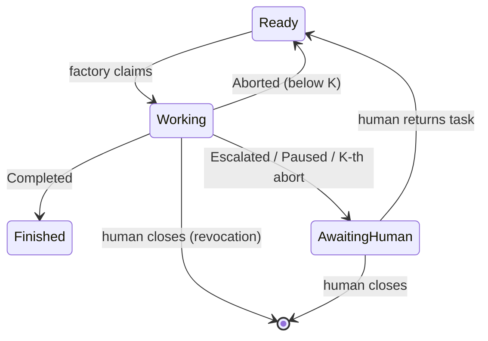

# tracker/tracker-port — delta for define-executor-contract

## MODIFIED Requirements

Layered on `Logical task-state dictionary and transition matrix` as it stands in the stable text:
this text adds `BudgetExhausted` to the escalation kinds parked as `ESCALATION` in the scenario
"Outcome-to-transition mapping" and changes nothing else; every other scenario is kept verbatim.

### Requirement: Logical task-state dictionary and transition matrix
Task coordination SHALL follow the state dictionary `Ready`, `Working(holder)`,
`AwaitingHuman(escalation | checkpoint | infra)`, `Finished`, with tasks failing
the readiness criterion or closed being outside the factory's world (`Gone`).
Transitions SHALL be initiated only by the factory or a human — never by the
gnome. The factory SHALL claim tasks only from `Ready`; the only exits from
`AwaitingHuman` are human actions — returning the task to `Ready` or closing it.

**Implements**: FR2 of add-tracker-port; FR7 of define-executor-contract
**Notes**: BudgetExhausted parks as `ESCALATION` because only a human can raise the bound or accept the stop; the factory has nothing to retry.

#### Scenario: Outcome-to-transition mapping
- **WHEN** an engine run ends with each of Completed, Escalated(report),
  Paused(passedStage), and Aborted
- **THEN** the resulting port calls are `finish`; `park` with the reason picked
  by escalation kind — `ESCALATION` for AttemptsExhausted, DecisionNeeded and
  BudgetExhausted, `INFRA` for CannotVerify, CannotExecute, and PipelineMismatch;
  `park(CHECKPOINT)`; and `recordAbort` (or `park(INFRA)` at the fuse threshold)
  respectively
- **AND** an infra park from an escalation leaves the abort counter untouched

#### Scenario: Parked task returns only through a human
- **WHEN** a task is `AwaitingHuman` and no human has returned it to `Ready`
- **THEN** no factory operation transitions it to `Working` — a claim is only
  attempted after a human return makes it `Ready`

#### Scenario: Gnome never transitions
- **WHEN** a gnome round runs to completion
- **THEN** no tracker operation was reachable from the gnome process — every
  transition originated in factory core

#### Scenario: The scheduler-slot state never reaches the tracker
- **WHEN** an instance's slots fill and free while it runs tasks
- **THEN** no tracker write records the slot state; the tracker sees only the
  task-state transitions and their markers
