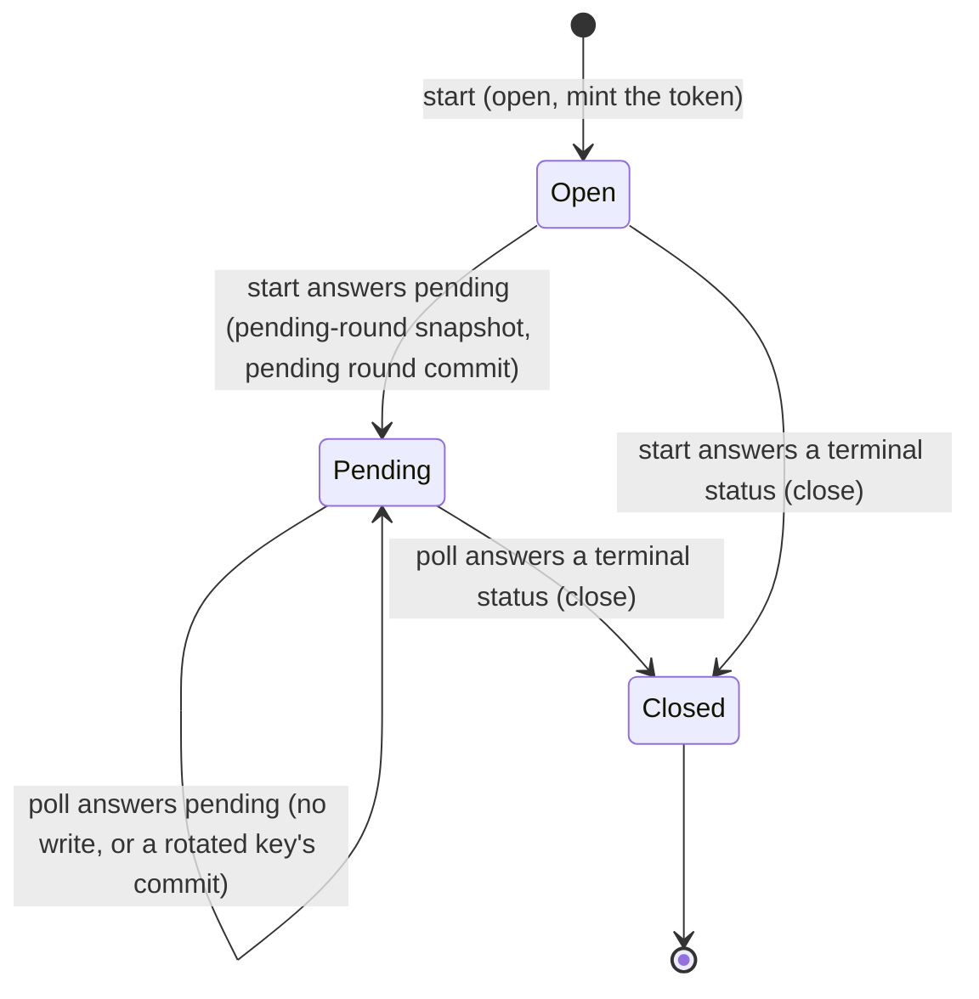

# Design: extract-agent-round-runner

## Context

See proposal.md — Why. Constraints:

- `adapters/agent` (44 files, 4,330 lines when this change was written; 80 files, 7,748 lines
  since the `program/` and `command/` executors landed, which this change does not touch): Claude dialect (`AgentCommandLine`,
  `AgentInvocationOptions`, `AgentAiSeam`, `StreamJson*`, `AgentEvent`, `ContentBlock`,
  `TokenUsageMapper`, `ToolTraceBuilder`, `AgentRoundResultExtractor`, `JudgeVerdictExtractor`,
  `ModelIdSyntax`) ~1,900 lines; generic mechanics (`ExecutorRoundExecution`,
  `JudgeRoundExecution`, `StreamDrain`, `RoundTimeout`, environment sources,
  `FreshJudgeEnvironments`, decision transport, denial read, prompt builders) ~1,300 lines.
- Declared pairs touching this module: `ExecutorRoundExecution` ↔ `JudgeRoundExecution`;
  `HostRoundEnvironmentSource` ↔ `SandboxRoundEnvironmentSource` (registry, no classpath);
  `DecisionFileTransport` ↔ `BranchDecisionFile` (registry); `RoundTimeout` ↔
  `AgentSettingsValidator` (registry).
- Leaks outside the module: `AgentSettingsValidator` (adapters/pipeline) validates Claude keys
  for every stage; `AgentProgressEvent` (application) carries `subtype` and `sessionId`;
  `ModelIdSyntax` admits Claude brackets; `JUDGE_READ_ONLY_TOOLS` is the policy language.
- The exit code of the CLI is never read; `StreamJsonParser` has no cap. Stderr already goes to a
  file in the round scratch directory and is read after the exit (`agent-executor`, "The round's
  stderr is kept", `fix-terminal-receipt-convergence` FR20, NG12, NG13): the runner inherits that,
  and `Drain` stays the one post-exit join (`DrainOwnerGateSpec`).
- Available from earlier changes: `Executor`, `ExecutorResult`, `ResultFileReader`,
  `ExecutorRegistry`, describe-validated settings, abstract `Policy`, `VerdictDerivation`,
  `ExecutorOutcomeClassifier`, three bounds, continuation field on `start`.
- `remove-interactive-console` (sequenced before) deletes the interactive stage executor and
  judge voter; `add-decision-arbiter` rebases onto role `decision`.
- Transform `pending` (human decision 2026-11-02, FR10–FR12): today a `transform` `pending` is
  refused in `domain/engine` (`RoundFailures`, `AttemptAccounting`, `RoundOutcome`: "a `pending`
  the stage cannot poll"), pinned by `ExecutorOutcomeTableSpec` under the wire-contract scenario
  "Pending from a role whose caller cannot poll". `migrate-verify-to-executor-contract` builds
  the one pending-poll owner for `verdict` (`PendingPoll`; its entries are a
  `List<PendingPollRecord> pendingPolls` on `TaskState`, written by
  `AttemptPersistence.persistPending` as a pending commit — `git-task-persistence`, "Pending
  commits of an open round" — and resumed by `ResumeVerificationStageExecutor`, the one recovery
  owner of `task-branch-contract`, "An interrupted verification is InProgress with one recovery
  owner"; its D2, D7 as amended, D21, D22), and its task 4.3a removes the per-instance key membership of `ProgramExecutor`
  (`PendingRuns`) so a persisted key can be polled by another instance.

## Goals / Non-Goals

**Goals:** one runner, one dialect seam (FR1, FR2); Claude as the first dialect with no behavior
loss (FR3); judge on the contract (FR4); one executor block and one registry for every role
(FR13, FR14); one owner of the guard probe (FR15); every pair in the module dissolved but the
round-source pair, kept across its classpath barrier (G3, D14); one owner of a round's open and
close (FR18); one way an answer is obtained and one read of it (FR19–FR21).

**Non-Goals:** out-of-process Claude (NG1), ACP (NG2), repo-policy isolation enforcement
(NG4), a Claude round returning `pending` (NG5), cancelling an abandoned run (NG6), judge votes
(NG10), this repository's own manifests (NG11). Transform
`pending` in the engine is in scope (D11).

## Decisions

**D1 — Runner + dialect, in process, as the first step.** (FR1, FR2, G1.) `AgentRoundRunner`
implements `Executor` for a given `AgentDialect`; the Claude dialect is a package in
`adapters/agent/claude`. *Rationale:* the research-confirmed lesson that dialects are mostly
data; keeping the step in process proves the seam with the existing 51 specs before anything
crosses a process boundary (`externalize-claude-executor` does that next). *Alternative
rejected:* externalize at once — two risks in one change and no reference for the kit yet.

**D2 — A judge check is one `verdict` request on the check path.** (FR4; amended 2026-11-22
after the decision review of task 4.1.) A `judge` check runs as every executor check does: the
engine asks its one port for a check round, `CheckRoundRoute` hands it to `CheckDispatch`, the
registry resolves the executor the check's `executor:` block declares (D12), `CheckRound` builds
the `verdict` request, and `VerdictDerivation` judges the answer. The criteria file and the
briefing are rendered into the request's `verdict` role input by `JudgePromptBuilder`; the
criteria preflight stays ahead of the request. `JudgeVoter` leaves `EnginePorts`, and
`JudgeVoting`, `CliJudgeVoter`, `JudgeRoundExecution`, `FreshJudgeEnvironments` and
`HostJudgeEnvironmentSource` are deleted. In a run with fresh boxes the request runs in a box of
its own from the one `FreshBoxSource`, as a `program` check does; on the host it runs in the
host environment, as the judge does today — the one stated exemption from "a verdict runs in a
fresh box", which `ProgramCheckPlacement` keeps refusing for a law's `program`.

*What was wrong before the amendment.* The decision said "`JudgeVoting` issues N starts to the
registry-resolved executor", and the migration plan said "behind the existing registry entry".
Neither premise held: `agent-cli` was no registry entry (`ExecutorRegistry.java:40-41`,
`ExecutorDispatch.java:65`), `AgentRoundRunner` was built in no main source, a `judge` check
named no executor (`VerifyCheck.java:152`), and `JudgeVoting` lives in `:domain`, which has one
port and no registry (M3). Task 4.1 switched a consumer before its provider existed.

*Votes are removed* (human decision 2026-11-22; NG10). The reducer bought nothing a single
verdict did not and cost a model call per vote; every manifest of this repository declares
`votes: 1`. A second opinion is a second `judge` check: the `verify` list is ordered and stops at
the first non-pass (`VerifyOrchestrator`), so a later judge runs only after the earlier ones
pass. A manifest that still carries `votes` — or the old `model` and `settings` keys beside the
check — is refused at load as an unknown field of that check (`StructuralParse`), the loader's
standing answer to a key removed with no replacement; no message of its own is added. The usage
entry's `vote` field stays: it is the ordinal of the
`verdict` request among the round's judge checks.

*Alternative zero — keep `CliJudgeVoter`:* zero cost per run, and FR4 and M3 stay unmet with a
second round class beside the runner for good. *Alternative rejected — `JudgeVoting` calls the
executor itself:* `:domain` would need the registry or a second port, the thing M3 removes.
*Alternative rejected — the judge defaults to the stage's executor* (the proposal's first text):
it grades work with the model that produced it, which the self-preference results warn against
(Panickssery, Bowman, Feng, NeurIPS 2024, arXiv 2404.13076), and it silently changes the judge
of a `program` or `command` stage; Inspect AI's `ModelRole("grader", required=True)` is the
precedent for a grader that never falls back. *Alternative rejected — a built-in `llm-api` judge
now:* a second LLM mechanism before the dialect seam is proven (proposal Q3 of the contract
change stays open for `externalize-claude-executor`). *Kept from the sources:* the reducer, had
it stayed, belongs outside the grader (Inspect AI `multi_scorer`), and a trial starts from a
clean environment (Anthropic, "Demystifying evals for AI agents") — hence a box per request.

**D3 — Answer file replaces the decision file; path owned by `EnvelopePaths`.** (FR9.) The
decision request is a `decision-request` answer written to `GNOMISH_ANSWER_FILE` under
`.gnomish-task/`; `BranchDecisionFile` reads the same path from the tip through
`ResultFileReader`. The `writeExactly(path)` policy carries that path to the dialect.
*Rationale:* one channel for every structured answer (verdict, select, decision request), one
reader, and the transport pair dissolves. *Alternative rejected:* keep the decision file as a
second channel — the third copy of a path constant the envelope change already removed once.
*Amended 2026-11-23 (D15):* who writes the file follows the dialect's declared answer form. For
a schema-enforced answer the runner writes the validated answer there and the agent is granted
no path under `.gnomish-task/`; `writeExactly(path)` reaches only a dialect whose agent writes
the file itself. "One reader" is one function for the live path and for recovery.

**D4 — A decision is continued from the branch record, never from the worker.** (FR9, NFR-R2;
amended 2026-11-21 after a decision review on the escalation of task 2.5.) The decision that
answers a decision request is recorded on the task branch with the question and options it
answers, in the decision commit that carries the reply; the next round is a fresh `start` whose
briefing renders the question, the options and the reply through the one briefing renderer. No
agent executor resumes a vendor session: the Claude dialect declares no `resumable`, renders no
session flag and returns no continuation key, and the runner removes a key an agent wrote.

*Why the original decision (the session id as the continuation key, `--resume` on the next
start, a fresh start when the resume is refused) is withdrawn.* Its premise was that the session
the key names is there for the next round. Checked:

- The CLI keeps a session as a file under its configuration directory on the machine that ran
  it — on the host `~/.claude/projects/<working-directory key>/<session id>.jsonl`, one to two
  megabytes a round for this change's own task, removed after 30 days by default. Anthropic's
  documentation says it in these words: "Session files are local to the machine that created
  them."
- In a box that directory is `/home/gnome` in the container's own layer, and the kept box of an
  escalated task is disposed before the decision commit (`sandbox/execution-environment`,
  "Escalated-container resume disposes before deciding"). In container mode every resume would
  be refused.
- On the host another instance, another machine or an answer after the retention window finds
  nothing either, which contradicts the project's rule that the tracker and the task branch are
  the whole state and any instance resumes.
- The engine had no path for the key and no task built one: `ExecutionResult.DecisionRequest`
  and `Stop.DecisionNeeded` carry none, `ProgramCompletedAnswer` drops the contract's field,
  nothing builds a request's `continuation`.

So the fallback would have been the path production takes, while the designed path ran on one
machine within one month: a WARN on every answered question in container mode, and a behaviour
that depends on which instance picked the task up.

*Alternative zero, costed.* With no session continuation at all, what a fresh round lacks is
what the asking round knew. The working copy and the stage's own report ride the snapshot commit
(D9); the reply is in `task.json` and in the briefing of every later round
(`BriefingSections.renderDecisions`), which is how every answered escalation continues on `main`
today. The remainder is one fact: the briefing shows a decision's author and body and not the
question it answers, which `task.json` keeps only as `lastEscalation`, overwritten by the next
escalation. That remainder is what this decision builds: the question and its options become
part of the decision record and of its rendering.

*Alternatives rejected.*
- *Resume when the session happens to be local, fresh start otherwise (the original D4).*
  Steelman: the gnome asks at the moment it knows most, and a resumed session repeats no
  exploration. It breaks on the facts above: in container mode the worse path is permanent and
  silent but for a WARN, and two instances resuming one session lose messages. A resumed session
  also keeps the system prompt it started with, and after hours the prompt cache has expired, so
  the whole transcript is paid for again. What is kept from it: what the gnome knew when it asked
  belongs in the record, hence the question in the briefing.
- *Carry the session file on the task branch, or in a store.* It restores the session anywhere,
  and breaks on four things: the transcript holds every tool result verbatim, secrets included,
  and the branch is pushed to origin; it is a record the gnome can rewrite that the next round
  would take as its own memory (the authorship class of `task-branch-contract`); its format is
  internal to one CLI version; and a store beside the branch is a third state medium.
- *A hand-off note as a field of the decision request.* Deferred, NG9: the stage's report
  already rides the commit, and no round has yet shown the question and the reply to be too
  little.

*The contract's continuation key.* It stays in the wire contract as reserved vocabulary under
one rule, added to `executor/wire-contract`: a key in a durable record names state any factory
instance reaches. An executor whose conversation lives on the worker declares no `resumable`.
The engine path for the key is NG8.

**D5 — Policy compiled by the dialect, verified by the runner.** (FR5, NFR-S2.) `readOnly` →
`dontAsk` + read-only tool set (settings may narrow), `workspaceWrite` → `acceptEdits`,
`writeExactly` → the answer path allowance; the runner runs the working-copy-unchanged check
after `verdict`/`decision`. `AgentRole` and `JUDGE_READ_ONLY_TOOLS` are deleted. *Alternative
rejected:* keep vendor tool names in the request — the leak this change exists to close.

**D6 — Settings schema from describe; `roundTimeout` is the round's overall bound.** (FR7,
NFR-R1; amended 2026-11-21 by a decision review, after task 2.3 found the first wording
unmeetable.) The Claude dialect's schema accepts exactly the four legacy keys;
`AgentSettingsValidator`'s Claude key list moves into the schema. The `roundTimeout` shape judge
is not Claude's alone: since `add-command-executor` it is also called by `CommandSettingsValidator`
and the command executor resolves `roundTimeout` through `RoundTimeout`. It therefore stays one
shape owner, in `:adapters`, which both the Claude dialect's schema and the command executor
(`adapters/agent` depends on `:adapters`) reach; it keeps exactly the shapes accepted today. The
`RoundTimeout` ↔ `AgentSettingsValidator` pair dissolves into that one owner (shared abstraction,
preference 1), not into a third copy inside the schema. The dispatch's `COMMAND` arm is untouched
(design D6 of `add-command-executor`).

*Who owns each bound.* A round has three time bounds, and they have two owners:

| Bound          | Owner                                                                                   | Why                                                                                                                                                                                              |
|----------------|-----------------------------------------------------------------------------------------|--------------------------------------------------------------------------------------------------------------------------------------------------------------------------------------------------|
| overall        | the law: `roundTimeout` of the stage's executor settings or of the judge check's executor settings; the factory's overall bound (`ProgramBounds`) when the key is absent | only the stage's author knows how long its work takes; the main specs already promise it (`agent-executor`, "Round timeout and control-file preflight"; `claim-heartbeat`, which names the per-stage `roundTimeout` as what bounds a round) |
| startup read   | the factory (`ProgramBounds`)                                                           | a property of the CLI's start, the same for every stage                                                                                                                                          |
| silence        | the factory (`ProgramBounds`)                                                           | a property of the CLI's liveness cadence, not of the stage's work (measurement below)                                                                                                            |

The three are resolved once per `start` by one owner, `RoundBounds` (`adapters/agent`): the
factory's `ProgramBounds` with `overall` replaced by the request settings' `roundTimeout` when
the settings declare one. The value the runner waits on and the time hints the request carries
are that one value. `RoundTimeout` keeps the shapes and the parse and loses its own default: the
30 minutes are written once, in `ProgramBounds.DEFAULTS`.

*What the first wording got wrong, verified in code.* It promised "the three bounds" as schema
keys. (1) `define-executor-contract` landed after it was written and decided the opposite for
the bounds as a set (`ProgramBounds.java:15-19`; that change's D3, "Bounds and settings, as
built"): neither describe nor the law sets them, an operator key deferred "until an operator
needs a non-default bound". (2) No key names existed anywhere. (3) The runner built in task 1.2
takes all three from the factory's `ProgramBounds` (`AgentRound.java:127-132`) and never reads
`roundTimeout`; the key's only round-time readers are `ExecutorRoundExecution` and
`JudgeRoundExecution`, which tasks 4.1 and 5.1 delete, and `CommandStageExecutor`. Left as
written, `roundTimeout` would have become an accepted key with no reader, and every agent round
would have been killed at the factory's 30 minutes — the `implement` round that found this ran
1 h 37 min under a law that declares `roundTimeout: 28800s`. The deferral's pickup condition is
met for the overall bound, and only for it.

*Containment.* The reason `ProgramBounds` gives — "an executor that set its own would set the
bound meant to contain it" — is about the executor's describe answer. The law is not the
contained party: it is bound from the base ref before any round and the gnome cannot write it,
and it has set this bound since `add-agent-executor`. Describe still sets no bound.

*The silence bound, measured.* A silence bound is sound only for a worker that reports liveness
(Temporal's heartbeat timeout and Step Functions' `HeartbeatSeconds` are off unless the worker
heartbeats; CircleCI's and Travis' no-output timers are the record of what a silence timer does
to a quiet healthy step). Measured 2026-11-21 on `claude` 2.1.325, macOS, with the flags the
dialect renders (`-p --output-format stream-json --verbose`): during one foreground Bash call
of 420 s the CLI wrote a `tool_progress` line with `heartbeat: true` every 30.0 s (14 lines, no
gap above 30 s). `ProgressLines` counts every chunk read as activity, so the factory's 5 minutes
is ten missed heartbeats. The CLI's documentation dates the heartbeat of a foreground subagent
call to 2.1.257 and says tool calls inside a subagent emit none; a subagent's own tool events
reach the parent stream (`subagent-round.reference.json`). Two facts were therefore unmeasured —
a long tool call inside a subagent, and the Linux CLI of the sandbox base image
(`design-decisions.md`, "A platform fact is measured on every platform CI runs"). Task 2.3b
measured both on 2026-11-22, on `claude` 2.1.325 with the same flags and one quiet tool call of
420 s (`perl -e 'select(undef, undef, undef, 420)'`; the CLI refuses a bare `sleep 420`):

| Platform                                   | Where the call ran | Heartbeat lines | Largest gap between two stdout lines |
|--------------------------------------------|--------------------|-----------------|--------------------------------------|
| Linux (Ubuntu 24.04.5, aarch64, container) | the main agent     | 14              | 30.0 s                               |
| Linux (the same container image)           | a subagent         | 14              | 30.0 s                               |
| macOS                                      | a subagent         | 14              | 30.0 s                               |

The Linux CLI was the one a sandbox image built from the base image carries, run in a container
outside the factory's network (no guard, the image's proxy variables unset); the heartbeat is
written by the CLI itself and does not depend on the route to the backend. The documentation's
statement about subagents does not hold on this version: a tool call inside a subagent is
reported on the parent stream every 30 s. Every gap is a tenth of the bound, under the 60 s
threshold, so the bound stands. What the bound buys: the CLI is known to stop
writing without exiting (anthropics/claude-code issues 39700 and 53584); without it such a round
holds its slot for the whole `roundTimeout`, eight hours under this repository's law.

*The silence bound follows the dialect's declaration.* (FR16; added 2026-11-22.) The measurement
is a fact about one CLI. The next dialects (Codex in `externalize-claude-executor`, others
after it) have their own cadence or none, and the contract already carries the answer: an
executor declares `streams_progress` in its describe, and the main spec applies the silence
bound only to an executor that declares it (`wire-contract`, "Silence bound expires"). The
`program` executor obeys that (`ProgramExecutor.java:70`); the agent runner built in task 1.2
does not — `RoundBounds.waitOn` applies the startup-read and silence bounds to every dialect
(`RoundBounds.java:108`), so a dialect that honestly declares no liveness would be killed after
5 minutes of healthy quiet work. One rule decided in two places in two ways. The rule gets one
owner: whether the bounds on a quiet stdout apply is read from the describe's capabilities by
one predicate beside `ProgramBounds`, which both `ProgramExecutor` and `RoundBounds` call. With
the declaration an agent round waits under all three bounds; without it under the overall bound
alone — the startup-read bound goes with the silence bound, since a dialect that prints only
its final answer prints nothing at the start either. The time hints of the request follow: a
bound the runner does not apply is not hinted. For Claude nothing changes.

*A declared liveness is tested, per dialect.* (FR17; added 2026-11-22.) The declaration is a
promise the factory kills healthy rounds on when it is false, and until now it was checked by a
measurement someone had to remember. It becomes a spec of the paid smoke layer,
`PaidSmokeLivenessSpec`: a table with one row per dialect that declares `streams_progress`; for
each row and each platform CI runs (macOS on the host, Linux in a container of an image that
carries the CLI) it starts the real CLI with the argv the dialect renders, has it run one quiet
tool call longer than the silence bound — in the main agent and, where the dialect has
subagents, inside one — and asserts that the largest gap between two stdout lines is at most a
fifth of the factory's silence bound. A new dialect adds one row; the adapter author guide says
`streams_progress` is declared only after that row is green. The layer spends money and is run
by hand, as today: on a CLI version bump and before a change that adds or changes a dialect is
archived. *Alternative rejected — a conformance-kit case:* the kit runs in `check` against a
fake program, and a cadence is a property of the real CLI on a real platform over seven
minutes; a fake would assert its own script. *Alternative rejected — measure at run time and
adapt the bound:* a round that goes quiet is exactly the case the bound exists to end.

*Alternative zero — no law key at all* (the escalation's option 1 as worded): the bounds stay
the factory's three constants. What is left per round is one number that differs per stage by a
factor of a hundred (300 s for `cleanup`, 28800 s for `implement`); a constant either kills the
long stages or bounds nothing on the short ones, and the main-spec promise of `roundTimeout`
would be removed to make the code pass. Rejected.
*Alternative rejected — law keys for all three bounds, or keys that may only narrow the
factory's* (the escalation's option 2): the per-step override of a silence timer exists in CI
systems because their steps are silent by nature; here the cadence is the CLI's, measured, and
the same for every stage, so the keys would have no value an author could choose better than
the factory. Narrow-only breaks the one real need: the long stages need a bound above the
factory's default, not below it.
*Alternative rejected — a factory ceiling over `roundTimeout`* (GitLab's runner maximum,
Buildkite's maximum step timeout): a ceiling protects a platform operator from a pipeline author
who is someone else. Today the law's author and the factory's operator are one party and the old
path has no ceiling, so it would be a mechanism with no consumer (NG7 names the pickup). What is
borrowed for that day: refuse an over-ceiling value at law load (Kubernetes `LimitRange`), never
clamp it silently at round time.
*Alternative rejected — no silence bound for an agent round* (the old path's behaviour): it
gives up the only detector of a silent hang earlier than `roundTimeout`, for a risk the
measurement does not show.

**D7 — Sync surfaces.** Scout: `grep -rn "Kept in sync with"` and the registry.
- `ExecutorRoundExecution` ↔ `JudgeRoundExecution`: **dissolved** into `AgentRoundRunner`
  (shared abstraction; role is a request field).
- `HostRoundEnvironmentSource` ↔ `SandboxRoundEnvironmentSource`: **kept as a declared pair**
  (amended 2026-11-23, D14). The first text dissolved it by deleting both and taking the
  environment from the check acquisition; that rested on a premise the code refutes (D14). The
  two are implementations of one port in modules with no compile edge (`adapters/agent`,
  `adapters/git`), the barrier `manual-sync-pairs.md` asks a declared pair to name; what was
  hand-synced between them is now pinned by one port contract spec both run (D14), and the
  registry row is reworded to what that spec does not cover. *Amended 2026-11-25 (D11):* both
  ends gain the same two phases — going pending and a poll of the open round — in one task
  (6.4c), pinned by the same contract spec.
- `MidRoundPushRounds` ↔ `SandboxRoundEnvironmentSource` (both in `adapters/git`, markers at both
  ends, listed under the Host/Sandbox registry row): both mint the round token once per opened
  round through `RoundToken.of` from a `VerifiedTip`-checked tip. Both ends share `adapters/git`,
  so the pair **collapses** (preference 1) into one minting step that the host decoration and
  the sandbox round source both call, and both `Kept in sync with` markers go (task 5.2).
  *Alternative rejected:* leaving the two markers — a declared pair with no classpath barrier is
  what `manual-sync-pairs.md` forbids.
- `DecisionFileTransport` ↔ `BranchDecisionFile`: **dissolved** (D3): one path owner, one
  reader; registry row removed. The read the two ends shared, `DecisionRequestRead`, is deleted
  with its fallback (D15).
- `RoundTimeout` ↔ `AgentSettingsValidator`: **dissolved** (D6) into the one shape owner the
  command executor shares; registry row removed.
- `GitAttemptPersistence` ↔ `EnvironmentAttemptPersistence`: **touched at both ends** (D11). The
  pair already holds `persistPending` (`AttemptPersistence.java:59`), which writes the pending
  commit `git-task-persistence` specifies ("Pending commits of an open round": exactly
  `state.json`, the round's last registered commit as its only parent, its register in the same
  ref transaction). The mirrored edits are: the `Round` subject on the entry `persistPending`
  already writes; the host snapshot trigger (D22 of `migrate-verify-to-executor-contract`,
  `completed` only) widened to a `pending` `transform` result; and the container's round close
  given a pending-round subject that the recogniser reads. One task changes both ends, and the
  registry row of the pair names the pending commit's subject rule. *Amended 2026-11-25 (D11):*
  the trigger and the subject apply to the `start`'s result only, and the pair gains one more
  mirrored edit, the terminal snapshot of a pending round — its parent, its range and the settled
  `state.json` lag — in one task for both ends (6.4d); `MidRoundHarvestListener` ↔ `MidRoundPushListener`: untouched, they subscribe to
  the vendor-neutral progress events (FR6) and read no session id.
- *No new parallel implementation:* the fake dialect in `test-fixtures` is a test double, not a
  second production dialect.

**D8 — Single-owner mechanisms.**

| Owner                                                                       | Value (type)                                                                 | Consumers                                                                                                                                                                                                                                          | Old way removed                                                                                                                                                                                      | Enforced by                                                                                                                                                                                                                                                                                                                       |
|-----------------------------------------------------------------------------|------------------------------------------------------------------------------|----------------------------------------------------------------------------------------------------------------------------------------------------------------------------------------------------------------------------------------------------|------------------------------------------------------------------------------------------------------------------------------------------------------------------------------------------------------|-----------------------------------------------------------------------------------------------------------------------------------------------------------------------------------------------------------------------------------------------------------------------------------------------------------------------------------|
| `AgentRoundRunner` (adapters/agent/runner)                                  | `ExecutorResult`                                                             | `ExecutorRegistry` entry `claude` (D12): its stage half (stage dispatch) and its check half (a `judge` check's check round, D2); the arbiter through the same entry (`add-decision-arbiter`)                                                                                                                                               | `CliStageExecutor`, `CliJudgeVoter`, `ExecutorRoundExecution`, `JudgeRoundExecution` deleted; `ResumeVerificationStageExecutor` stays the one recovery owner of an interrupted verification (`task-branch-contract`) and decorates the chain over the `claude` executor as it did the old arm | `JudgeVoter` type deleted (compile); `EnginePorts` holds one executor port (spec)                                                                                                                                                                                                                                                 |
| `AgentDialect` (interface)                                                  | `RenderedArgv`, `ParsedEvents`, `Answer`                                     | `AgentRoundRunner` only                                                                                                                                                                                                                            | `AgentCommandLine`/`AgentInvocationOptions` called from round classes; `AgentAiSeam` static names                                                                                                    | `ArchUnit`: no class outside `adapters/agent/claude` imports a Claude type; grep `stream-json\|ANTHROPIC_\|acceptEdits` → dialect package only (M2)                                                                                                                                                                               |
| The question a decision answers (`Decision`, `domain/engine`; D4 as amended) | `Decision` with its optional question and options, built by one function from the position, the consumed outcome's report, the reply, the author and the instant | `ResumeDecisionCommit` (the `take` path) and `EscalationResume` (the `run` path), which both call that function; `TaskJsonMapper` (the `decisions` entries of `task.json`, read without a question as before); `BriefingSections.renderDecisions` (the stage round prompt and the judge prompt). Reads the body only, by design: `StatusTextRenderer`/`StatusReport`, `DecisionAck` | `new Decision(` at `ResumeDecisionCommit.java:36` and `EscalationResume.java:127`, each with its own copy of the position switch; `lastEscalation` as the only place a question survives | `DecisionOwnerSpec` (`:bootstrap`): `new Decision(` in main sources only in the one builder and in `TaskJsonMapper`, the allowlist asserted reached; identity spec `DecisionQuestionIdentitySpec` on a real bare origin: the question and options of the park commit's report equal those of the decision in the decision commit and those in the next round's prompt, on the host and in container mode |
| `EnvelopePaths.answerFile` (domain)                                         | `EnvelopePath`                                                               | `AgentRoundRunner` (hands the path), `BranchDecisionFile` (reads it), salvage (`FactoryOwnedPaths`). Invariant: `EnvelopePaths.answerFile` is the branch-durable location of a `decision-request` answer, the one path `BranchDecisionFile` reads at the tip; the contract's result channel separately names a per-request scratch answer path | `DecisionFileTransport` deleted; `GNOMISH_DECISION_FILE` literal removed. Exemption: `ProgramSpawn`/`ProgramResultRead` (the `program` executor, `result-channel` capability) keep their per-request answer path, unchanged — a scratch channel of one request, not the branch envelope | existing envelope-paths build gate extended with the new constant                                                                                                                                                                                                                                                                 |
| Policy compilation (`ClaudePolicyCompiler`)                                 | argv fragment from `Policy`                                                  | `ClaudeDialect`                                                                                                                                                                                                                                    | `AgentRole`, `JUDGE_READ_ONLY_TOOLS`, per-role branches in `AgentInvocationOptions`                                                                                                                  | `Policy` sealed type in the request; spec: no argv carries `bypassPermissions`                                                                                                                                                                                                                                                    |
| `PendingPoll` (`domain/engine`, from `migrate-verify-to-executor-contract`) | `PendingPollRecord` (an entry of `TaskState.pendingPolls`) with the sealed subject `Round` beside `Check(CheckRef)`; the round token is already on the record | `StageAttemptLoop` (hands a `transform` `pending` to `PendingPoll`), `PendingPoll` (live and resumed), the two `persistPending` implementations (`GitAttemptPersistence`, `EnvironmentAttemptPersistence`), `StateJsonMapper`/`TaskState` (the `pendingPolls` list), `ResumeVerificationStageExecutor` (the recogniser and one recovery owner; a `Round` entry resumes through `PendingPoll`, never as `Completed`); as amended 2026-11-25: the engine's round execution (`RoundExecution`, `TransformRound`: reads the round's entry against the restored cell's token and continues it through `resumeRound`), `ProgramStageExecutor` (hands the adoption role to `PendingTurnRun`), `SnapshotTipCheck` and `PendingChain` (read the pending-round snapshot subject) | the `transform` arm "a `pending` the stage cannot poll" in `RoundFailures`/`AttemptAccounting`/`RoundOutcome` narrowed to executors declaring no `poll`; no second pending record, loop or key store | sealed subject (exhaustive switch); `PendingKey` parameter type; architecture spec `ExecutorPollOwnerSpec` (`:bootstrap`): `Executor.poll(` is called in `domain`/`application` main sources only from `PendingPoll`, the scan asserted to reach its allowlist; identity spec `PendingRoundIdentitySpec`; kill-point specs of D11 |
| Credential names (`ClaudeDialect.describe`)                                 | `ExecutorCredentialNames`                                                    | `ChildEnvAllowlist` layer via the contract's delivery                                                                                                                                                                                              | `AgentAiSeam` deleted (the dead `agent-cli-env-passthrough` knob is already gone, `RemovedKeys.java:14`)                                                                                             | identity spec `ProgramCredentialDeliverySpec` extended for `claude`                                                                                                                                                                                                                                                               |
| Whether the bounds on a quiet stdout apply (one predicate over the describe's capabilities, beside `ProgramBounds`; D6, FR16) | yes when the describe declares `streams_progress`, no otherwise | `ProgramExecutor` (the `program` run's wait); `RoundBounds` (the agent round's wait and the request's time hints) | `describe.capabilities().contains(Capability.STREAMS_PROGRESS)` in `ProgramExecutor.java:70`; the unconditional `new ProgressWait(bounds.startup(), bounds.silence(), …)` in `RoundBounds.waitOn` | `RoundBoundsOwnerSpec` (`:bootstrap`): `Capability.STREAMS_PROGRESS` is read in main sources only by the predicate's file, and written only in a describe (scan asserted reached); the runner's spec with a fake dialect that declares no `streams_progress`, quiet past the silence bound and alive; `PaidSmokeLivenessSpec` for the truth of a declaration (FR17) |
| `RoundBounds` (`adapters/agent`; D6 as amended) | `ProgramBounds` of one round: the factory's startup-read and silence bounds, the overall bound from the request settings' `roundTimeout` or the factory's | `AgentRound`'s wait (every role: a stage round, each judge vote, a decision round); the time hints of the request an agent executor receives; `CommandStageExecutor`'s timeout | `RoundTimeout.resolve(` in `ExecutorRoundExecution` and `JudgeRoundExecution` (both deleted, 4.1 and 5.1) and in `CommandStageExecutor`; `equipment.bounds()` read for the round's wait in `AgentRound`; the `RoundTimeout.DEFAULT` literal, a second spelling of `ProgramBounds.DEFAULTS.overall()` | `RoundBoundsOwnerSpec` (`:bootstrap`): `RoundTimeout.resolve(` appears only in `RoundBounds.java`, and `new ProgressWait(` in `adapters/agent/runner` only where the bounds come from it (scan asserted reached); identity spec `RoundBoundIdentitySpec`: a stage declaring `roundTimeout` is killed at exactly that value on virtual time, and the request's overall hint equals it |
| The executor block (`StageDefinition.Executor` and its one mapper; D12) | who does the work: `type`, `model`, `settings`, `name` | a stage's `executor:`; a `judge` check's `executor:` (`VerifyCheck.Judge`); the arbiter's, in `add-decision-arbiter`; `StageMechanismRule`, `ExecutorReferenceRule`, `AgentSettingsValidator` and the role rule, which judge every one of them; the registry resolution by the block's name (`claude` for `agent-cli`) | `VerifyCheck.Judge`'s own `model`, `settings` and `votes`; `StageSanityRule.validateJudge`; the judge keys of `VerifyCheckDto`; the type-keyed agent arm of `ExecutorDispatch`; `Participants.JUDGE_EXECUTOR` | the judge record holds the block's type and no `model` field (compile); `ExecutorBlockOwnerSpec` (`:bootstrap`): an executor's `model` and `settings` keys are read by the one mapper only, the scan asserted reached |
| The guard probe (the decorator over `Executor`, `adapters/agent`; D13) | a request's result, or `failed/infrastructure` naming a dead guard | every executor bound to an environment: the stage half and the check half of a `program` entry and of the `claude` entry | `probeGuard()` called by `ProgramStageExecutor`, `ExecutorRoundExecution` and `JudgeCannotVerify`, each for itself, and by no one for a check round | `GuardProbeOwnerSpec` (`:bootstrap`): `probeGuard(` in main sources only in the decorator and the environment types that declare or forward it, the allowlist asserted reached; spec: a `program` verdict check in a box with a dead guard is cannot-verify |
| A fresh box for a verdict (`FreshBoxSource`, from `migrate-verify-to-executor-contract`) | one materialized box per check request, released when the request ends | the check half of a `program` entry (`ProgramCheckBinding`) and of the `claude` entry | `FreshJudgeEnvironments` (one box per attempt commit, shared by the votes), `JudgeEnvironmentSource`, `HostJudgeEnvironmentSource` | the types are deleted (compile); scenario "Two judge checks do not share a box" |
| The round bracket (`RoundEnvironmentSource`, `app/port/agent`; D14) | an open round: its environment, identity, answer path, mid-round listener, close and discard | `ProgramStageExecutor`, the one round wrapper of every registry entry (`ExecutorDispatch.java:67`); the implementations `HostRoundEnvironmentSource`, `MidRoundPushRounds`, `SandboxRoundEnvironmentSource` | the planned move of these duties to the check acquisition is withdrawn; `Round.readDecision`, whose value has had no reader since task 5.1a (`ProgramStageExecutor.java:91` discards it), leaves the port | one port contract spec in `:test-fixtures` run against every implementation, the list of implementations asserted reached (M9); `CurrentRoundWriterSpec` as landed |
| The round's continuation (`StageExecutor.poll`, `domain/port`, over the open round a `RoundEnvironmentSource` holds; D11 and D14 as amended 2026-11-25) | the open round of a poll: the round its `start` opened, or the one the run's cell was restored with | `PendingPoll` (the only caller of `StageExecutor.poll`); the port's implementations `CheckRoundRoute`, `ResumeVerificationStageExecutor`, `SnapshottingStageExecutor` (a snapshot on a terminal poll only), `ExecutorDispatch`, `ProgramStageExecutor` (takes the open round, closes on a terminal result only) and `CheckRound` (a check round per request, as today); the round sources `HostRoundEnvironmentSource`, `MidRoundPushRounds`, `SandboxRoundEnvironmentSource`; `WorktreeSnapshot` and the in-box snapshot (the terminal snapshot's parent and range) | `Request.pending()`; `rounds.openRound(request)` and `round.closeRound(…)` on a poll (`ProgramStageExecutor.java:71,91`); a mint per poll (`MidRoundPushRounds.java:92`, `SandboxRoundEnvironmentSource.java:111`); the snapshot on a poll's `pending` result (`SnapshottingStageExecutor.java:78`); the `null` adoption (`ProgramStageExecutor.java:79`); the pending kind as an argument of `closeRound` | the port's two methods and the removed field (compile); the port contract spec of D14 (a second open refused, a poll with no open round refused, a poll's round names what the round opened with); `RoundBracketOwnerSpec` (`:bootstrap`): `.openRound(` in main sources only on the start path of `ProgramStageExecutor` and in the delegating `MidRoundPushRounds`, the token mint only in the two minting sources, the allowlist asserted reached; flow spec `PendingRoundFlowSpec` on a real bare origin, host and container; identity spec `PendingRoundIdentitySpec` |
| How an answer is obtained (a sealed declaration on `AgentDialect`; D15) | schema-enforced final output, or a file the agent writes | `AgentRoundRunner` (validates; writes a schema-enforced answer to the round's answer path); the dialect's policy compilation (`writeExactly` only for the file form); the prompt's answer instruction | `ClaudeAnswerSchema.of` answering "no schema" for `transform`; the answer-file instruction spelled in the vendor-neutral prompt builder | exhaustive switch over the sealed declaration; spec: no argv of a schema-form dialect grants a write under `.gnomish-task/`; `PaidSmokeStructuredAnswerSpec` for the truth of a declaration (FR22) |
| The answer read (one function in `:application` over `ResultFileReader` and the contract's `Answer.read`; D15) | a reading: absent, a contract answer, or refused with its cause | `RoundJudgement` (the live agent round), `ProgramResultRead` (a `program` and a built-in), `BranchDecisionFile` (the box round's file), `SnapshotTipCheck` (recovery at the register); the mapping of a refused reading to the round's result is one function both the live path and the recovery call | `DecisionRequestRead` with its raw-text and empty-file fallbacks; the host round's read at close; the second parse in `ProgramResultRead.answer` | `ResultPathReadBoundarySpec` extended to the one function; identity spec `AnswerReadIdentitySpec` on a real bare origin: the same bytes give the same round outcome live and from a snapshot (NFR-R5) |

**D9 — Crash consistency.** No new durable step on the decision path (the pending `transform`
round adds one, D11): the answer file rides the snapshot/salvage
commit exactly as the decision file did. The question a decision answers (D4) adds no step
either: it is read from the consumed `escalated` outcome at the registered commit, through the
parse the resume already uses, and lands in the decision commit together with the reply
(mutually implied fields in one commit), so no window holds a reply without its question. Kill-point specs of the decision path
are re-pointed at the answer file. *Amended 2026-11-23 (D15):* a schema-enforced answer is
written by the runner into the working copy before the round's close, so it rides the same
snapshot or salvage commit as an agent-written file did and adds no durable step; and the
recovery of a snapshot reads the file through the function the live round reads it through
(item 14), which the tolerant recovery read did not. *Amended 2026-11-25 (D11):* a pending round
adds three durable steps — its pending-round snapshot, its pending round commits and its terminal
snapshot — whose windows are D11's table, K5 included; and the round cell has one recovery
producer, the run's assembly, for an interrupted verification and a pending round alike.

**D10 — Lock scope.** No lock added. `FreshJudgeEnvironments` is deleted with the judge path
(D2): a judge request takes a box of its own from `FreshBoxSource`, so no box is shared between
requests and its `LiveBox` has no user left in the verification path. The guard probe (D13) is a
`docker inspect` on the request's own thread, under no lock.

**D11 — A pending `transform` round rides the one pending-poll owner.** (FR10–FR12, NFR-R3,
NFR-R4, NFR-O2, NFR-C2, UX3, G5; human decision 2026-11-02; amended 2026-11-25 after the
decision review of task 6.5: a poll continues the open round.)
`StageAttemptLoop` hands a `transform` result `pending(key)` from an executor declaring `poll`
to `PendingPoll`, whose `PendingPollRecord` gains a sealed subject: `Check(CheckRef)` as built by
`migrate-verify-to-executor-contract`, or `Round` (the round token is already a field of the
record, `PendingPollRecord.java:34`). *What is persisted* — the landed mechanism, no second one:
the round's working copy is registered as the round's snapshot (the host snapshot trigger of
D22 there widens from `completed` to a `pending` `transform` result; the container's round close
gets a pending-round subject, so the recogniser never reads that snapshot as a finished round;
both on the `start`'s result only, never on a poll's — the amendment below);
then the entry `{subject: Round, attempt, token, key, since}` is appended to
`TaskState.pendingPolls` and written by `AttemptPersistence.persistPending` as the **pending round
commit** — a pending commit as `git-task-persistence` specifies it ("Pending commits of an open
round": exactly `state.json`, the snapshot as its only parent, so its tree carries the working
copy and the record; its register in the same ref transaction, one atomic push; crash-consistency
item 9). It is a round boundary that closes no attempt: the position is unchanged, the verify
chain does not run and no stage advances on it (item 12 — the stop rides the record). Then
`PendingPoll` polls in the round its `start` opened (the amendment below) at the engine's pace, `max(pending interval,
pollAfter)` clamped to the ceiling, as `PendingWait` does for a check — no in-poll wait bound
travels on the request (NG13 of `migrate-verify-to-executor-contract`, human decision
2026-11-13); a round-scoped `PendingWait` is built from the factory's pending interval and
ceiling beside the check-scoped one — until a terminal status or the pending ceiling counted from
`since`; expiry is `failed/infrastructure` naming the ceiling, as every factory
bound is (define-executor-contract D3). Interval and ceiling are factory-owned bounds beside
`ProgramBounds`, default 30 s and 24 h, set by neither the law nor describe, for the reason D3
gives — decided (human decision 2026-11-02): no law key. A terminal result closes the round through the normal close, whose commit drops the
round's entry from `pendingPolls` (consumed-message hygiene, item 13). A `poll` returning `pending` with
another key persists it in a pending round commit before the next poll (FR12): the rule is FR10
and D12 of `migrate-verify-to-executor-contract`, subject-neutral, reused here (proposal Q3,
closed 2026-11-02).

*One path, live and resumed (item 14):* the landed rule of `PendingPoll` (D21 of
`migrate-verify-to-executor-contract`) is kept, not amended: the live instance continues from the
entry it just persisted and the pending answer it holds in memory; a resuming instance reads the
entry at the register through the `TaskState` parse and polls it at once; both continue through
`PendingPoll`'s one wait path (`PendingPoll.java:126-128`). Item 14 holds because both paths build
the entry as one `PendingPollRecord` — the live path the value it persisted, the resume the value
parsed back from that commit — so the round token, usage and ledger lines are one identity, which
`PendingRoundIdentitySpec` pins (NFR-R4). *Alternative rejected:* re-reading the record from the
pending commit on the live path — it amends D21 for checks and rounds alike for no failure the
identity spec does not already catch, or adds a round-only path, the second pending mechanism G5
excludes. A resuming instance materializes the environment at the registered commit, so a live
and a resumed poll see the same working copy. The record is accepted only at the registered
commit and only when its round token names the round that commit holds open (item 13: identity,
never presence; the attempt number is not an identity). The recovery owner is the landed one:
`ResumeVerificationStageExecutor` (`task-branch-contract`, "An interrupted verification is
InProgress with one recovery owner") recognises the pending commit; an entry with subject `Round`
resumes through `PendingPoll` with no `start` and is never answered `Completed`.

*Amended 2026-11-25 (decision review of task 6.5) — a poll continues the open round.* In plain
words: a round's `start` and all its polls are one round — one token, one open, one close. A poll
is a step inside the round, never a round of its own.

*What was wrong before.* This decision and D14 said nothing about what a poll does to the round
bracket, and `PendingPoll` reached the executor only through `StageExecutor.execute`, whose one
implementation is the whole bracket. Verified in code: `PendingPoll.java:175` calls `execute` per
poll; `ProgramStageExecutor.java:71,91` opens and closes a round per call;
`MidRoundPushRounds.java:92` and `SandboxRoundEnvironmentSource.java:111` mint a token per open;
`CurrentRound.java:59` replaces the open round and drops its snapshot and registered chain;
`SnapshottingStageExecutor.java:62-78` snapshots on every `pending` result. So the record carries
the token of the `start` while the cell and every later subject carry the token of the last poll.
By reading only — no spec drove `start`, pending commit and a poll on a real medium, which is why
tasks 6.3 and 6.4 were green — the host close after a poll reports a boundary violation (the
`state.json` lag of the pending commit, `PendingStateLag`, is settled against an empty chain) and
the box close fails its parent check.

*The rule.*
- The engine's port names the two operations: `StageExecutor.execute(Request)` starts a round,
  `StageExecutor.poll(Request, PendingTurn)` continues one. `Request.pending()` leaves the port, so
  no implementation can treat a poll as a start by not looking (`implementation.md`, item 3).
  Every implementation and decorator implements `poll` itself: a check's poll is a check round as
  today (`CheckRound`, a fresh box per request by design); a stage's poll reaches the open round
  its round source holds (D14 as amended).
- A poll opens no round, mints no token, closes nothing and writes nothing on the task branch. The
  one write of a wait is the pending round commit of a rotated key (FR12).
- Going pending is not a close. When `start` answers `pending`, the round's working copy is
  registered once as the **pending-round snapshot** (subject
  `gnomish: pending-snapshot <stage>#<round> <token>`) through a round operation of its own, and
  the round stays open: its environment, scratch area, listeners and cell state are kept.
  `closeRound` takes a terminal outcome only.
- The terminal poll closes the round through the normal close. Its snapshot has the round's last
  registered commit — the last pending round commit — as its only parent, carries the round's
  token, and is judged over the range from that parent, the base
  `GitAttemptPersistence.persist` already takes (`:119-121`), with the `state.json` lag settled
  before the judgement and the staging, on both media. A range judged from the open token would
  hold the factory's own snapshot and pending commits (`HostRoundBoundary.committed`).
- The environment's denials are read once, at the one close, and join the terminal result. A
  non-terminal poll reads none, so none is dropped with its result (`PendingPoll` keeps the usage
  of a non-terminal result and nothing else).
- What a non-terminal poll writes into the working copy becomes durable only with the terminal
  snapshot; a resumed poll runs in an environment at the registered commit and does not see it.
  The wire contract already puts what a poll needs outside the working copy
  (`executor/conformance-kit`, "Pending cases poll from a new working copy").

*Resume.* The recogniser reads the two subjects it did not read: `SnapshotTipCheck.java:118-127`
matched no `pending-snapshot`, and `PendingChain.snapshotBelow` (`:68-79`) accepted only a
`gnomish: snapshot` bottom, so a kill during the polls fell to salvage and a re-driven `start`.
The bottom of a registered chain names its kind: a snapshot below pending commits is an
interrupted verification, a pending-round snapshot below pending commits is a pending round. The
run's assembly restores the round cell from the recognised tip — the token, the registered chain
and the pending kind, where `CurrentRound.restore` hard-codes a verifiable close today — through
the subject parse the live path writes with (item 14), **before** the engine decides between
`start` and a poll: the engine reads the round's entry against the cell's token
(`PendingEntries.roundEntry`) and continues it through `PendingPoll.resumeRound`, neither of which
had a caller. The restore of an interrupted verification moves to the same point, so the cell has
one recovery producer; task 6.5 opens with the premise check that nothing opens a round between
the assembly and the first request, and a refuted premise is a blocker under `spec-mismatch.md`.
A resumed poll's turn is `RECORDED`, and the wrapper hands the executor's adoption role to
`PendingTurnRun` as `CheckRound` does; `ProgramStageExecutor.java:79` passed none, so a resumed
program poll was refused as an unknown key.

*Alternative zero — a poll with nothing around it:* take the open, the mint, the close and the
snapshot out of a poll. What is left per poll is one request in the open round and no write; per
round, one pending-round snapshot, one pending round commit and one terminal snapshot. Only how a
poll reaches the open round is designed.
*Alternative rejected — one `execute` and a branch on `request.pending()`* (the steelman: no port
change; six implementations and some twenty test fakes stay as they are): the branch is needed
wherever per-round work is done — both round sources, the wrapper's close, the host snapshot
trigger — and a fifth place written without it repeats this defect with a green build. The port
change buys what `implementation.md` item 3 asks for.
*Alternative rejected — keep the re-opens and preserve the token:* an entry point may be
re-entered only where entry writes nothing, identity is derived and the medium refuses a
duplicate create, as a Kubernetes reconcile does; a round's open mints, its close commits and
`start` is not deduplicated.
*Alternative rejected — the engine holds the open round* (the steelman: the strongest guarantee,
and the layering objection falls to a round interface owned by `:domain`): the engine would then
own close and discard on every failure path, which D14 gives to one wrapper. Kept from it: the
open round is a named object with a stated lifetime, held by the round source.
*Comparable systems* choose a distinct continuation wherever the unit has setup and an accounted
identity. Airflow increments a try "only when there's legitimately a new try", never when a task
comes out of a deferral or a reschedule (apache/airflow PR 39336; issue 45366 is this defect, a
reschedule-mode sensor bumping the try on every poke), and resumes through a named method, not
`execute`. The Jenkins durable-task `Controller` is launched once and has no method that launches
again. Temporal keeps one activity execution across polls, its retries and heartbeats outside the
history. In state-machine terms a poll is an internal transition: it runs no entry and no exit
action.

*Kill windows (amended 2026-11-25; durable steps: (1) `start` returns `pending`, an external
effect; (2) the pending-round snapshot registered; (3) the pending round commit pushed above it;
(4) a later `pending` with a new key pushed; (5) the terminal poll's snapshot registered; (6) the
round close pushed):*

| Window                                   | Registered commit shows                     | Shape                           | Recovery owner                                         | Action                                                                                                                                                                       |
|------------------------------------------|---------------------------------------------|---------------------------------|--------------------------------------------------------|------------------------------------------------------------------------------------------------------------------------------------------------------------------------------|
| K1: after (1), before (3)                | the round-open commit with the gnome range above it, or the round's pending-round snapshot with no pending commit above it | `InProgress` (open round)       | existing round-close owner + `StageAttemptLoop` resume; the recogniser names a registered pending-round snapshot and hands it back to the round instead of re-verifying it | salvage the range as today, re-drive `start` (one duplicate remote run, logged, NFR-C2)                                                                                      |
| K2: after (3), during polls              | a pending round commit above the pending-round snapshot; record with subject `Round` | `InProgress`, pending sub-state | `PendingPoll`                                          | poll the recorded key, never `start`; clock from `since`                                                                                                                     |
| K3: after a new key returned, before (4) | record with the previous key                | `InProgress`, pending sub-state | `PendingPoll`                                          | poll the previous key, never `start`: the contract keeps a superseded key pollable for its run; a non-conforming refusal is `failed/infrastructure` naming the key (visible) |
| K4: after a terminal poll, before (5)    | a pending round commit at the tip, record still present | `InProgress`, pending sub-state | `PendingPoll`                                          | poll the key again, never `start`: the contract returns the ended run's terminal result again, and the round closes with it; a refusal as K3                                 |
| K5: after (5), before (6)                | the round's snapshot above its pending round commits; its `state.json` still carries the record | `InProgress`                    | the interrupted-verification resume (`ResumeVerificationStageExecutor`) | re-verify the snapshot: no poll and no `start`; the closing commit drops the record                                                                                          |
| after (6)                                | closed attempt, no record                   | the shape the close produces    | the owner of that shape                                | none: a second pass is a no-op                                                                                                                                               |

K3 and K4 rest on the wire requirement "A pending key stays pollable until its run ends"
(FR11, D11 of `migrate-verify-to-executor-contract`; proposal Q2, closed 2026-11-02), pinned for
every candidate by the conformance kit's `pending-repoll` case; with it, no window after (3)
re-drives `start`, and G5 holds for any conforming executor. K5 is decided by the subject at the
registered tip, never by the record's presence (item 13): a snapshot of the round's token above
its pending round commits says the round closed verifiable, so its record is a consumed message
the closing commit removes, and the interrupted-verification resume is the window's one owner
(item 3). A terminal poll that failed registers no snapshot, so its kill stays K4.

The pending entry is an entry of `TaskState.pendingPolls` on a registered pending commit, as the
verdict entry is (D7 as amended and D21 of `migrate-verify-to-executor-contract`); a registered
pending commit classifies by its envelope as any registered commit does (`task-branch-contract`,
"An interrupted verification is InProgress with one recovery owner"), so the shape set gains no
shape and the sweeper's enumeration is unchanged (item 6). Mutually implied fields — key, subject, stage, attempt,
since — land in one commit (item 4); nothing destructive precedes a constructive receipt
(item 5). Recovery is idempotent: K2 twice is one poll sequence, a closed round is untouched.

*The status taxonomy:* the wire-contract requirement "Closed status taxonomy" is MODIFIED over
the text `define-executor-contract` adds (that change archives first; its five scenarios survive
verbatim but one): the WHEN of "Pending from a role whose caller cannot poll" narrows from every
`transform` executor to one declaring no `poll`. This is the decision that narrows it, citing the
verified premise that the refusal lives in `RoundFailures`/`AttemptAccounting`/`RoundOutcome`
and is pinned by `ExecutorOutcomeTableSpec`; a scenario for the pollable case is added.

*Relation to the continuation key (D4):* two different keys. The contract's continuation key
would name a conversation the *next* round continues after a `decision-request` answer; the
pending key is the *same* round's handle for `poll`. Neither becomes the other. The engine sends
no continuation (NG8), and a pending key is persisted because its executor's contract makes it
pollable by any instance — the rule D4 now states for the continuation key as well. The Claude
dialect declares neither `poll` (NG5) nor `resumable`, so its rounds take neither path.

*Alternative zero — no engine path:* a long `transform` stays `failed/infrastructure` and the
executor must finish within one `start` under the overall bound, holding the slot; a kill loses
the run and the round restarts from scratch. What varies per round is only the key, the subject
and `since`; everything else (loop, bounds, persistence, resume) already exists for `verdict`,
so the cost of the path is one record subject and one snapshot subject over the landed pending
commit. Rejected: the human decision
puts long rounds in scope, and a run that must outlive a restart cannot exist without it.
*Alternative rejected — a pending store of its own for rounds* (a separate ref or file): a second
recovery owner for one kind of message (item 13), and a second parse. *Alternative rejected —
persist the key without the working copy:* a resumed poll would see the round-open tree while the
live one sees the started tree — two inputs for one round.

**D12 — One executor block, one registry entry, no default.** (FR13, FR14, UX1; added
2026-11-22.) Three declarations say who does the work — a stage's `executor:`, a `judge` check's
own `model` and `settings`, and, as `add-decision-arbiter` was written, the arbiter's `model` and
`settings` — with the rule "an agent pins its model" spelled twice (`StageMechanismRule`,
`StageSanityRule.validateJudge`) and a third copy planned. They become one: the block a stage
declares (`type`, `model`, `settings`, and `name` for a `program`) is the block a `judge` check
and the arbiter declare, carried by one domain type, mapped by one mapper and judged by one
rule; the executor, the judge and the arbiter differ in their instructions and their role, never
in how they are configured or run. Nothing defaults: a `judge` check with no block, an agent
block with no model, or a block whose executor does not support the role it is used in (the
describe's role list) is a located load error and the factory does not start.

*The name.* `type: agent-cli` resolves to one registry entry under the reserved built-in name
`claude`, owned by `BuiltInExecutors` beside the six names it reserves; a law declaring an
executor of that name is refused at load, as for every built-in. The entry has the shape
`RegistryEntry.program` already has — a stage half (a `RoundExecutorFactory` over
`AgentRoundRunner` with the Claude dialect) and a check half (the runner bound to the check's
box, or to the host environment in a run without boxes) — and its describe is the dialect's.
`ExecutorDispatch`'s type-keyed agent arm is deleted once the entry serves stage rounds (task
5.1a), and `Participants.JUDGE_EXECUTOR` goes with it: a judge's participant is named by the
entry it resolved to. `externalize-claude-executor` (NG1) lifts the reservation when it turns
the entry into a law-declared program.

*Alternative rejected — "a fixed name until the judge can name one"* (option A of the task 4.1
question): a shim with no removal step, the shape Jenkins' implied plugin dependencies record.
*Alternative rejected — `type: judge` defaults to `claude`, as `external` defaults to
`github-actions`:* a default the operator did not write is the judge identity nobody chose
(human decision 2026-11-22). *Alternative rejected — a name-only reference (`executor: claude`)
with the model in a separate key:* two spellings of one block, the duplication this decision
removes.

**D13 — The guard probe has one owner.** (FR15; added 2026-11-22.) Design D14 of
`tighten-spec-contract` put a liveness probe of the egress guard at the close of every round.
On `main` each caller makes it for itself — `ExecutorRoundExecution.java:111,138`,
`JudgeCannotVerify.java:68`, `ProgramStageExecutor.java:63,65` — and `CheckRound` does not, so a
`program` verdict check in a fresh box, with the egress its law grants, is judged without one:
one instance of the class "a result accepted from a box whose guard was not shown alive". The
judge would have been the second once it moved onto check rounds. The probe moves to the one
place an executor is bound to an environment: a decorator over `Executor`, applied where the
stage half and the check half of an entry bind (`RoundExecutorFactory.executor(environment)`,
the check binding), probing before `start` and `poll` and after each returns. A dead guard, or a
runtime that cannot say, is `failed/infrastructure` naming the guard — a cannot-verify for a
check, an infrastructure failure for a stage round, no attempt burned. An environment with no
guard (the host) answers the probe as today, by doing nothing. Enforced by an architecture spec
in `:bootstrap`: `probeGuard(` in main sources only in the decorator and in the environment
types that implement or forward it, the allowlist asserted reached. Crash consistency is D14's
own: the probe is a read and the classification an in-memory outcome, so no window is added.
*Rationale:* the platform that owns the isolation gates every workload on it, not each workload
for itself (Kubernetes KEP-753, sidecar containers; Istio `holdApplicationUntilProxyStarts`).
*Alternative rejected — copy the probe into `CheckRound`:* a fourth caller of a rule whose
third already missed a path.

**D14 — The round source owns a round's open and close, for every entry.** (FR18, G3; added
2026-11-23 after the decision review of task 5.1; amended 2026-11-25 after the decision review of
task 6.5: the phases of a pending round.) In plain words: one component brackets a
round — it gives the round its identity and its working place when it opens and puts the result
on the task branch when it closes — and every kind of executor runs inside that bracket. Handing
out an environment for a check is a different job and stays one.

*What was wrong before.* D7 dissolved the host and sandbox round sources by deleting them, with
the runner taking "a `RoundEnvironment` from the one environment acquisition the verify path
already uses". Three premises, checked in code:
- "The round source serves the agent round." Refuted: since D18 of
  `migrate-verify-to-executor-contract`, `ExecutorDispatch.java:67` runs every entry — a
  `program`, a `command`, the agent — through `ProgramStageExecutor` over the run's one source.
- "The check acquisition can open a stage round." Refuted: `CheckEnvironmentSource.acquire`
  (`CheckEnvironmentSource.java:30`) takes a `VerifyCheck.Executor` and returns an environment
  with its release; `SandboxCheckEnvironmentSource.java:87` returns the lease's current box.
- "A box acquisition mints the round token" (task 5.2). Refuted: the only box-side mint is
  `SandboxRoundEnvironmentSource.java:107`.

*The duties, by phase* — each stays where it is; this table is the contract the port spec pins:

| Phase     | Host, in place (`HostRoundEnvironmentSource`)                                   | Host, git mode (`MidRoundPushRounds` over it)                         | Box (`SandboxRoundEnvironmentSource`)                                                                                   |
|-----------|---------------------------------------------------------------------------------|-----------------------------------------------------------------------|-------------------------------------------------------------------------------------------------------------------------|
| open      | materializes the host environment with its scratch area; names the answer path there; identity `inPlace` | mints the round token from the worktree tip into `CurrentRound`, then as in place | takes the stage's leased box; mints the token from the clone's verified branch tip into `CurrentRound`; names the answer path `EnvelopePaths.answerFile` |
| mid-round | nothing                                                                         | `MidRoundPushListener` pushes the branch                              | `MidRoundHarvestListener` harvests under the admission rule of the round                                                |
| went pending | nothing: the environment and its scratch area are kept                       | as in place; `SnapshottingStageExecutor` registers the pending-round snapshot | the pending-round snapshot commit and its harvest, into `CurrentRound`; the box is kept                                 |
| poll      | hands out the open round: no new environment, no new scratch area               | as in place: no mint, the open round's push listener                  | hands out the open round: the same box, token, answer path and harvest listener; no mint                               |
| close     | disposes the environment and its scratch area                                   | as in place                                                           | `EnvironmentRoundSnapshot`: the snapshot commit and its harvest, the attempt commit into `CurrentRound`                 |
| discard   | disposes the environment                                                        | as in place                                                           | nothing: the box's file dies with the box or rides a salvage commit                                                     |

*The open round is held by the source* (amended 2026-11-25, D11). A source opens one round at a
time and keeps it until its close or discard: a second open while a round is open is refused, a
poll takes the open round from the source and is refused when none is open, and a resuming
instance's first poll takes the round the run's cell was restored with (D11, "Resume"), in an
environment at the registered commit, with no mint. Going pending and a poll are phases of the
table above, so no implementation meets a poll in its `open`.

*Alternative zero — delete the sources as D7 first said:* every box round loses its token, its
mid-round harvest, its snapshot and the durable decision request, and nobody carries them; a
silent loss of persistence with a green unit build. Rejected. *Alternative rejected — widen the
check acquisition until it carries every round duty* (the steelman: one place hands out every
environment, and a judge already runs in a box of its own): a check's box is fresh, read-only in
effect and thrown away, while a round's close is a write on the task branch with kill windows of
its own; one type would then have two lifecycles chosen by a flag, and the fresh-box rule of
`verification-hardening` would share a class with the snapshot commit. What is kept from it: one
`FreshBoxSource` already serves every check, and nothing is added there.
*Comparable systems* keep the same split — a wrapper around every kind of workload turns what
the workload wrote into the durable result, and provisioning is a separate thing: Tekton's
`entrypoint` binary around each step, Argo Workflows' `wait` container ("saving off parameters
and artifacts"), Buildkite's bootstrap hooks around the command, the `post` steps of a GitHub
Actions job. The pattern is execute-around (Henney, "Executing Around Sequences"); Fowler's Unit
of Work names the same separation of the work from the coordinator that writes it out.

*The pair.* The two sources are adapters of one port in modules with no compile edge; their
agreement was a registry row. It becomes a contract spec in `:test-fixtures`, written against
the port and run by each implementation's module, one feature per row of the table that holds
for every medium (an open round names an answer path and an identity; a close followed by a
discard is refused or a no-op as the port states; a discard after an open leaves no scratch
area; and, as amended 2026-11-25, a second open while a round is open is refused, a poll with no
open round is refused, and a poll's round names the identity, the environment and the answer path
the round opened with) — `testing.md`, "Contract tests for every port". The registry row stays for what a port
spec cannot hold, and names the barrier.

*The rule this failure adds* (`design-decisions.md`, "A decision that deletes a class lists its
duties"): a deletion is named by what the class does today and who calls it today, with
`file:line`, never by the consumer it was first built for.

**D15 — An agent's answer: obtained as the dialect declares, validated by the runner, read by one
function.** (FR19–FR22, NFR-R5, NG12, NG13; added 2026-11-23, human decisions of that day.) In
plain words: an agent that must answer in a fixed shape is asked for that shape by its own CLI,
which sends a wrong answer back to the model while the conversation is still open. The factory
checks the result itself, writes it where the branch keeps it, and reads it one way everywhere.
An answer that is still wrong costs the round one attempt.

*What was wrong before.* Three promises rested on the tolerant read of the decision file
("unparseable text becomes a question with no options") and one file had two parses:
- the main-spec scenario `executor/result-channel`, "Garbage decision file keeps its fallback",
  no delta removed; after task 5.1a the round reads strictly (`RoundJudgement.java:119`,
  `ProgramResultRead.java:128-137`) and the source's tolerant read is discarded
  (`ProgramStageExecutor.java:91`);
- this change's own scenario "Answer file read is capped" promised a decision request for an
  over-cap file, which the strict read refuses;
- the recovery of a snapshot still parsed tolerantly (`SnapshotTipCheck.java:181`), so the same
  bytes gave an infrastructure failure live and a question after a kill — the second producer
  item 14 of `crash-consistency.md` forbids;
- the REMOVED reason of "Decision-file protocol" said its fallbacks were "restated", and they
  were not.
A raw-text question cannot be a contract answer: a `decision-request` holds at least two options
(`executor-answer.schema.json:100`, `Answer.java:111`).

*The decision, in four parts.*
1. **The form is the dialect's declaration.** `AgentDialect` declares, per role, how the answer
   is obtained: *schema-enforced* (the CLI is handed the answer's schema, returns a validated
   object and repairs a mismatch itself) or *file* (the agent writes the answer file). Claude
   declares schema-enforced for `transform`, `verdict` and `decision`; a `transform` reply says
   either that the work is done or asks a decision with its options.
2. **The runner validates and writes.** Whatever the form, the runner judges the reply against
   the contract's answer. A valid schema-enforced answer is written by the runner to the round's
   answer path — in a box `EnvelopePaths.answerFile`, through the environment's `putFile` —
   before the close, so the snapshot carries it as it carried an agent-written file (the
   admission rule permits the path, not an author: `AdmissionRule.java:46`). The agent of such a
   dialect is granted no write under `.gnomish-task/`.
3. **An invalid answer is the round's quality failure.** For a `transform` round: `failed/quality`
   with one finding that names the validation error and carries a bounded, neutralized excerpt
   of what was written; the engine burns one attempt and the next round starts with that
   finding (`ExecutorOutcomeClassifier.java:101`). For `verdict` and `decision` the malformed
   answer stays what FR4 says, a cannot-verify: the work under judgement is not at fault, so no
   attempt of the stage is burned. No result event, a dead process, a subscription-limit reply
   in place of a result, an unreachable provider: `failed/infrastructure`, as today. A `program`
   executor is unchanged: it states its own quality failures in its result, and an answer file
   of its that the factory cannot read is a defect of the program, `failed/infrastructure`, as
   the conformance kit holds it.
4. **One read.** One function in `:application` reads an answer file — absent, a contract
   answer, or refused with its cause — for the live round, for a `program`, and for the recovery
   of a snapshot; one function maps a refused reading to the round's result, given whether the
   round's executor is an agent or a program, so recovery cannot classify differently from the
   live round. `DecisionRequestRead` and both its fallbacks are deleted.

*The schema's shape.* The reply schema of every role is written in the subset both schema
families accept — the root an object, every object closed (`additionalProperties: false`) with
all its properties required, no combinator at the root, alternatives expressed inside the
object — because OpenAI's strict mode refuses anything else and Claude's validator accepts it. A
constraint the subset cannot carry is still checked by the runner (part 2).

*Who retries, and what it costs.* The repair runs where the conversation is: inside the CLI,
under the CLI's own cap. The factory adds no retry of its own, so the two counters sit at two
levels and never multiply into rounds — "retry at a single point in the stack" (AWS Builders'
Library, "Timeouts, retries, and backoff with jitter"; Google SRE, "Handling Overload"). Worst
case: one extra round per answer the CLI could not repair.

*Alternative zero — no fallback and no repair:* an invalid answer is an infrastructure failure
and a human returns the task (the state of HEAD after 5.1a). Per run it costs nothing; per
invalid answer it costs a human, for a fault a retry cures. The record: the released factory
asked the judge for JSON by prompt alone and never passed a schema; in one week of one project's
logs 2 of 128 judge checks ended cannot-verify because the reply was prose (2026-11-17,
2026-11-22), each returned by hand. Three other cannot-verify outcomes in the same record were
not format faults (a subscription limit, a cut stream, an unreachable provider) and stay
infrastructure.
*Alternative rejected — a fallback channel beside the contract* (the escalation's option: build
the question from raw text outside `Answer`). Steelman: it keeps the promise as written and the
human sees the agent's words at once. It breaks on D1: the agent becomes an out-of-process
program (NG1), and only what the wire contract carries crosses that boundary; until then it is
a second result path whose outcomes the ledger, the kit and the usage record do not see.
*Alternative rejected — fewer than two options in the contract:* it weakens every executor's
contract for one sender's fault (RFC 9413, section 4.1: a tolerated flaw "can become entrenched
as a de facto standard") and removes the gate `add-decision-arbiter` builds on (its D6). NG13.
*Alternative rejected — a repair round run by the factory, with a budget of its own.* Steelman:
most frameworks count format repair apart from task retries (Instructor, Pydantic AI, CrewAI,
SWE-agent's `max_requeries`). All of them repair inside the live conversation; a fresh process
has the raw text and no memory of the question, and would be writing the options itself. The
separate budget they describe is the one the CLI already has. NG12.
*Alternative rejected — repair bounded by the round's time alone:* every framework surveyed
caps the count; the one uncounted class found, a Kubernetes Job's `Ignore`, is reserved for
causes outside the workload.
*What other agent CLIs do, for the next dialect:* Codex (`codex exec --output-schema`) and the
OpenAI Agents SDK constrain the reply at the API and do not repair; Qwen Code (`--json-schema`),
Goose and opencode validate and re-ask as Claude Code does; Gemini CLI, Cursor and Aider offer
nothing. None guarantees the result end to end, which is why part 2 validates in every form and
why the file form stays in the seam.

*A platform fact to measure before the Claude half is built* (`design-decisions.md`, "A platform
fact is measured on every platform CI runs"): the schema-enforced answer has run in production
on no role. Task 5.0 measures it on macOS and in the Linux image — a `transform` round of many
tool calls ending in a decision request, and a `verdict` on acceptance criteria that invite
prose — and the measurement is kept as `PaidSmokeStructuredAnswerSpec` (FR22). A failure is
reported under `spec-mismatch.md`; parts 3 and 4 do not depend on it and land first.

Measured 2026-11-23 on `claude` 2.1.325 with the flags the dialect renders and `--json-schema`
carrying a schema of the common subset, over a copy of a finished task branch of another
project (a pnpm monorepo):

| Platform | Role and round | Tool calls | Result | Reply |
|----------|----------------|-----------|--------|-------|
| macOS (Darwin 24.6.0) | `verdict`, the `implement` acceptance criteria whose prompted-JSON reply was malformed on 2026-11-22; `opus`, read-only policy | 26, then one `StructuredOutput` | `success`, 28 turns, 82 s | valid: `passed` false, long findings with quotes, backticks and code spans |
| macOS (Darwin 24.6.0) | `transform`, 64 file reads and one file written, ending in a decision request; `sonnet`, workspace-write policy | 68, then one `StructuredOutput` | `success`, 70 turns, 133 s | valid: `outcome` `decision_request`, a question, three options |
| Linux (Ubuntu 24.04.5, aarch64, container) | `verdict`, the same criteria and settings | 23, then one `StructuredOutput` | `success`, 25 turns, 35 s | valid: `passed` true, no findings |
| Linux (the same container image) | `transform`, 62 file reads and one file written, ending in a decision request; the same settings | 69, then one `StructuredOutput` | `success`, 71 turns, 170 s | valid: `outcome` `decision_request`, a question, three options |

Two facts of the mechanism, read from the stream: the CLI obtains the reply through a tool call
of its own, `StructuredOutput`, which costs one turn of the round's turn bound; and the result
event carries the reply twice, parsed under `structured_output` and as JSON text under
`result`. Neither round needed a repair, so the exhausted-retries outcome
(`error_max_structured_output_retries`) is not observed here. The Linux CLI was the one a
sandbox image built from the base image carries, run in a container outside the factory's
network (no guard, the image's proxy variables unset), as in D6's measurement. The two
`verdict` rows judged one tree and disagreed on `passed`: the form of the reply is what this
measurement covers, never the judgement.

## Risks / Trade-offs

- [A non-conforming executor that refuses a superseded or ended key (K3, K4)] → the conformance
  kit's `pending-repoll` case fails it before use; at run time the refusal is a visible
  infrastructure failure naming the key, never a silent loss or a silent `start`.
- [A re-driven `start` in window K1 is not deduplicated by the executor] → one duplicate remote
  run per kill, named in the ledger (NFR-C2); a client token on `start` is NG14 with its pickup
  condition.
- [An executor forgets an ended run before a resuming instance polls it (K4)] → the poll is
  refused and the round is a visible `failed/infrastructure` naming the key, never a silent
  `start`; a stated retention window is NG15.
- [The pending ceiling is counted from a `since` one instance stamped and another compares] →
  the wait ends early or late by the skew between two operator machines; accepted, as it is for a
  pending check, and the ceiling's default (24 h) is far above any expected skew.
- [The port change of D11 touches every `StageExecutor` implementation and fake] → the compiler
  lists them; task 6.4b is the one task that changes the port, and nothing else lands in it.
- [`migrate-verify-to-executor-contract` task 4.3a lands a design that does not let another
  instance poll a `program` key] → FR11 cannot hold for `program` executors; task 6.1 checks the
  premise first and stops under `spec-mismatch.md` if it fails.

- [The CLI of the sandbox base image, or a tool call inside a subagent, is quiet for longer than the
  factory's silence bound] → a healthy round would be killed as infrastructure on every retry.
  Task 2.3b measured both on 2026-11-22 (D6: 30.0 s on both platforms, in a subagent too); no
  inactivity bound meets an unmeasured cadence (CircleCI's `no_output_timeout` is the record).
  A later CLI version or a new dialect can change the cadence, so the measurement is kept as
  `PaidSmokeLivenessSpec` (FR17): a gap above a fifth of the bound fails it, and that failure is
  reported under `spec-mismatch.md` for a decision on the bound, never answered with a raised
  constant.
- [The CLI's own timers are not derived from `roundTimeout`] → a foreground Bash call is moved to
  the background at the CLI's `BASH_MAX_TIMEOUT_MS` whatever the stage declares; that is the
  agent's tool budget, the operator's to set through the child environment, and no part of the
  round's bound.

- [Behavior drift while splitting the module's Claude and round classes] → the 51 existing specs and the reference stream-json
  fixtures are kept green through the refactor; the fake dialect proves the seam (M4).
- [`--json-schema` output differs from today's parsed final text] → the Claude dialect falls
  back to final-text extraction when the CLI version lacks the flag, logged at WARN.
- [The schema-enforced answer misbehaves on a long `transform` round, where it has never run] →
  measured before it is built (task 5.0) and kept as a paid smoke spec (FR22); if it fails, the
  Claude dialect declares the file form for `transform` and D15 parts 2–4 still hold.
- [A round's work is right and only its answer is wrong, and an attempt is burned] → bounded
  cost, never a wrong result: the working copy keeps the work, the next round reads the finding
  and answers again. Recorded exhaustion of attempts on this alone is the pickup of NG12.
- [The full text of an invalid answer is wanted by the human] → the finding carries a bounded
  excerpt; a file-form answer stays in the snapshot commit, where it was written.
- [Dropping `sessionId` from progress breaks dashboards] → its only consumers are in
  `adapters/agent` (`LoggingAgentProgressListener`, `AgentProgressEmitter`, `AgentRoundResult`,
  `AgentRoundResultExtractor`, `StreamJsonEventMapper`, `MissingResultEventException`); each is
  adapted in task 1.1, and no listener outside the module reads it.
- [A fresh round after an answer repeats exploration the asking round had done] → bounded
  extra cost, never a wrong result: the working copy, the stage's report and now the question
  are in the briefing or on the branch. A measured case of rework is the pickup of NG9.
- [The resume half of task 2.5 was built before D4 was amended] → task 2.5 as rewritten deletes
  it (`--resume`, the refusal recognition, the fallback, GF192) with its specs and markers; no
  resume path is left behind a flag.
- [`add-decision-arbiter` written against `DecisionNeeded`] → its rebase is a named task in that
  change; this design fixes the shape it targets (role `decision`, answer `select`).

## Migration Plan

1. After `migrate-verify-to-executor-contract` and `remove-interactive-console`.
2. Provider, then consumers, then deletion, the build green at each step (Fowler, "Branch by
   Abstraction" and "Parallel Change"): the guard-probe owner (D13); the `claude` registry entry
   with both halves and no consumer (D12); the `judge` check's executor block in the loader
   (D12); then, once task 2.3b is ticked and task 2.3c has landed, the judge onto check rounds with the judge path
   deleted (D2); then the stage dispatch onto the registry with the old round classes deleted;
   then the one answer read and the quality mapping (D15, parts 3 and 4), the port contract spec
   of the round source (D14), and — once task 5.0 is ticked — the schema-enforced `transform`
   answer (D15, parts 1 and 2); then the three registry rows this change dissolves.
3. Transform `pending` (D11) lands after the runner, on `PendingPoll`, `persistPending` and the
   recogniser as `migrate-verify-to-executor-contract` leaves them, adding the `Round` subject
   and the pending-round snapshot subject.
4. Follow-ups: `externalize-claude-executor` (reference external executor, Codex dialect),
   `add-acp-executor`, `harden-verification-integrity` (uses the describe fields added here).
