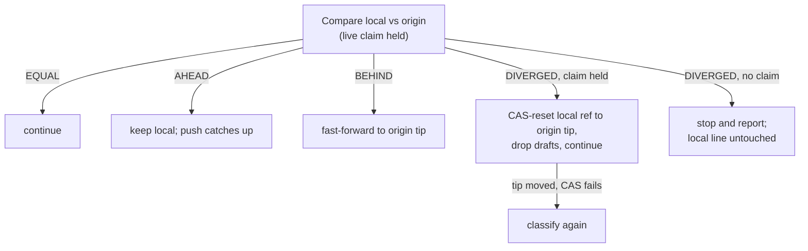

# task-branch-contract

## Purpose

Define the contract every task branch obeys between factory transitions: a total classification of the branch tip into named shapes, exactly one recovery owner per shape, claim-epoch fencing of every write, replica-pair reconciliation rules between the local clone and origin, and a budgeted recovery loop that quarantines instead of crash-looping. The contract exists so that any frozen intermediate state left by a crash is a classified, recoverable shape — never a surprise for the next pickup.

## Requirements

### Requirement: Total branch-shape classification
A classifier SHALL map any task branch to exactly one shape of a closed set of twelve: `Bare`, `Created`, `InProgress`, `AwaitingApproval`, `Parked`, `Answered`, `CompletedUncleaned`, `Delivered`, `Unregistered`, `UnsupportedVersion`, `Corrupt(reason)` and `Unknown`. The set SHALL be a sealed hierarchy so readers switch without a default branch.

The happy path and the group quarantined on first classification:

```mermaid
stateDiagram-v2
    [*] --> Bare: branch ref created
    Bare --> Created: STARTED commit
    Created --> InProgress: round recorded
    InProgress --> AwaitingApproval: manual stage passed
    AwaitingApproval --> InProgress: approval write
    InProgress --> Parked: outcome, human awaited
    Parked --> Answered: decision appended
    Parked --> InProgress: resumed write
    Answered --> InProgress: resume
    InProgress --> CompletedUncleaned: Completed outcome
    CompletedUncleaned --> Delivered: cleanup + finish
    Delivered --> [*]

    state "Quarantine on first classification" as Q {
        Corrupt
        UnsupportedVersion
        Unknown
    }
    state "Not yet fetched" as U {
        Unregistered
    }
    U --> InProgress: touchpoint fetch lands the register (any shape, by its content)
    note right of U: still no register after the read: quarantined on a claimed take
```
**Implements**: FR10 of fix-terminal-receipt-convergence; FR11 of make-checkpoint-gate-durable; FR1, FR3, FR15, NFR-R2 of harden-task-branch-contract; FR1, FR2 of fix-claim-epoch-fence; FR14, NFR-R4 of fix-operator-blockers; FR1, FR2 of split-long-spec-requirements
**Notes**: Where the registered commit comes from is the requirement "Classification reads the factory register".
**Notes**: The twelve names are the canonical vocabulary every other artifact of this contract refers to rather than restates.
**Notes**: The distinct `UnsupportedVersion` shape is what lets a version diagnosis name the version rather than a parse failure.
**Notes**: The classifier reads the registered commit's envelope, file set, versions and position, and the tip's relation to it.

#### Scenario: Every generated tip classifies to exactly one shape
- **WHEN** property-generated branch tips (arbitrary file subsets, envelope versions and positions) are classified
- **THEN** each input yields exactly one named shape and no input throws

#### Scenario: A gate classifies by its position, not by the park
- **WHEN** a tip's `state.json` position is `AwaitingApproval(stage)` and its `task.json` outcome is null, `paused`, or a stale earlier outcome
- **THEN** the shape is `AwaitingApproval` in all three cases, and never `InProgress` or `Parked`

#### Scenario: Pre-contract tip is a legal initial shape
- **WHEN** the tip carries `task.json` but no `state.json`
- **THEN** the shape is `Created` and resume starts the first stage from scratch

#### Scenario: Unsupported envelope version is its own shape, not a parse failure
- **WHEN** a state file at the tip declares an envelope version the factory does not support
- **THEN** the tip classifies as `UnsupportedVersion` with a diagnosis naming the file, the observed version, and the supported range — on every reading path including take and serve — and never as `Corrupt` or `Unknown`

#### Scenario: A tip stamped by an earlier tenure classifies by its content
- **WHEN** a task is reclaimed and its tip commit carries a claim epoch older than the new claim's
- **THEN** the shape is the one the tip's files and envelopes describe — `Parked`, `AwaitingApproval`, `Answered`, `InProgress`, `CompletedUncleaned`, `Created`, or `Delivered` — and the reclaim routes on that shape

#### Scenario: A cleanup commit inherited from the base does not deliver a live task
- **WHEN** an earlier task's delivered branch was merged into the base with its history, and a new task forked from that base is parked, in progress or freshly created
- **THEN** the new task classifies by its own content — `Parked`, `InProgress` or `Created` — and never as `Delivered`, on every reading path including `status`, take and serve

#### Scenario: A base merged into a live task after it started does not deliver it
- **WHEN** a base holding an earlier task's cleanup commit is merged into a live task branch after the task started
- **THEN** the live task does not classify as `Delivered`

#### Scenario: A branch ref with no STARTED commit is Bare
- **WHEN** the task branch ref exists but carries no STARTED commit
- **THEN** the shape is `Bare`, and the branch has no delivery whatever its history holds

#### Scenario: A started branch with no completed round is Created
- **WHEN** the STARTED commit is present, no round has completed, and no decision is recorded
- **THEN** the shape is `Created`

#### Scenario: A run underway is InProgress
- **WHEN** rounds are recorded, no outcome is recorded, and the position is at a stage or the pipeline end
- **THEN** the shape is `InProgress`

#### Scenario: An outcome awaiting a human at a non-gate position is Parked
- **WHEN** an outcome is recorded at a non-gate position and a human is awaited, with or without the pending-write marker
- **THEN** the shape is `Parked` in both cases — the marker is a sub-state, not a separate shape

#### Scenario: An appended decision with the outcome cleared is Answered
- **WHEN** the human's decision is appended and the outcome cleared, with no round run since
- **THEN** the shape is `Answered`, and the branch is resumable

#### Scenario: A recorded completion awaiting cleanup is CompletedUncleaned
- **WHEN** a `Completed` outcome is recorded and the cleanup is still pending
- **THEN** the shape is `CompletedUncleaned`

#### Scenario: A cleanup commit in the task's own history is Delivered
- **WHEN** the cleanup commit is found in the task's own history and further commits follow it
- **THEN** the shape is `Delivered` — the post-cleanup commits are tolerated

#### Scenario: Unreadable or self-contradictory content is Corrupt
- **WHEN** a tip's content is unreadable or self-contradictory
- **THEN** the shape is `Corrupt(reason)`, the reason naming the offending file and the observed versus expected content

#### Scenario: A legal but unrecognized combination is Unknown
- **WHEN** a tip's files form a legal combination this contract does not recognize
- **THEN** the shape is `Unknown`

#### Scenario: A tip without its register is Unregistered, not Unknown
- **WHEN** the tip carries a factory envelope and the clone holds no `refs/gnomish-factory/<task>` for the task — as an operator's or an IDE's `git fetch`, or a `git clone`, leaves a task branch
- **THEN** the shape is `Unregistered`, its diagnosis names the register and the command that fetches it, its recovery owner is the touchpoint fetch, and it is never `Unknown`

#### Scenario: A fetched register reclassifies an Unregistered branch by its content
- **WHEN** the touchpoint fetch lands origin's register for an `Unregistered` branch
- **THEN** the branch classifies by that register as any other branch does, and a second fetch changes nothing

#### Scenario: An unsupported version never reads as its closest legal shape
- **WHEN** an envelope at the tip declares an unsupported version while the rest of the tip resembles a legal shape
- **THEN** the shape is `UnsupportedVersion`, never the closest legal match

#### Scenario: No shape name collides with a domain type
- **WHEN** the shape names are compared with the existing domain types
- **THEN** the shape for "awaiting a human" is `Parked` (never `Escalated`, a `TaskOutcome` variant), the shape for a closed gate is `AwaitingApproval` (the word the position carries, since the shape is the position), and the shape for "decision landed" is `Answered` (never `Decision`, the human's answer record)

#### Scenario: An unreachable environment is the classifier's only error
- **WHEN** git or the daemon is unreachable while a tip is read for classification
- **THEN** the failure surfaces as an infrastructure error that retries under the existing policy without burning a quality attempt; no content ever makes the classifier throw

### Requirement: Classifier is the single entry to branch state
Every reader of task-branch state — take routing, resume, reconciliation, status, usage, denial-cursor restore — SHALL obtain the shape only through the classifier, and per-shape handling SHALL be exhaustive by construction: adding a shape SHALL force every reader to handle it, with no default or catch-all branch.
**Implements**: FR2 of harden-task-branch-contract

#### Scenario: No reader bypasses the classifier
- **WHEN** any reading path inspects a task branch tip
- **THEN** the shape it acts on is the classifier's verdict, never an ad-hoc file-presence check

#### Scenario: New shape cannot be silently ignored
- **WHEN** a new shape is added to the closed set
- **THEN** every per-shape handler fails to build until it names the new shape explicitly

### Requirement: One recovery owner per shape
Each named shape SHALL have exactly one recovery owner — the component responsible for converging that shape to a clean expected state. Recovery SHALL be idempotent and convergent.
**Implements**: FR11, NFR-R1, NFR-R2 of make-checkpoint-gate-durable; G1, G2, NFR-R1 of harden-task-branch-contract; FR3, FR5, FR8, NFR-R1 of fix-envelope-medium
**Notes**: A working copy the factory keeps between pickups is a staging area for the next write, not an input to any recovery decision.

#### Scenario: Recovering a recovered state is a no-op
- **WHEN** a shape's recovery runs and then runs again on the resulting state
- **THEN** the second run changes no branch content, no tracker state, and reports nothing to repair

#### Scenario: A gate with a lost park is re-delivered, never run
- **WHEN** a tip classifies as `AwaitingApproval` with `outcome` null and any instance picks the task up
- **THEN** the pickup records the `paused` outcome, delivers the park, runs no stage, and a second pickup of the resulting tip changes nothing

#### Scenario: A stale approval refuses
- **WHEN** the approval write is asked to open a gate whose stage differs from the tip's recorded `AwaitingApproval(stage)`, or the tip is no longer at a gate
- **THEN** the write refuses with a diagnosis naming the tip's actual position and lands no commit

#### Scenario: Kill mid-recovery converges on the next pickup
- **WHEN** a recovery is killed after any of its durable steps
- **THEN** the next pickup classifies the frozen state to a named shape whose recovery completes the work

#### Scenario: The instance that froze the state converges it
- **WHEN** an instance dies with its working copy ahead of or behind the branch tip and the same
  instance picks the task up again with that working copy still in place
- **THEN** classification and recovery read the tip, the working copy's state does not change the
  route taken, and the branch converges to the same shape another instance would have produced

#### Scenario: A working-copy read on a recovery path fails the build
- **WHEN** a recovery-path component reads a factory-owned envelope file from the working copy
  instead of through the tip reader
- **THEN** the architecture gate fails the build naming the file and the owner to route through

#### Scenario: The gate's owner re-delivers the park where no tracker exists
- **WHEN** a tip classifies as `AwaitingApproval` and the run that picks it up has no tracker
- **THEN** the stage engine's run entry records the `paused` outcome if `task.json` lacks it, prints the stop, and runs no stage

#### Scenario: Only the approval write opens a gate
- **WHEN** a tip classifies as `AwaitingApproval`
- **THEN** no recovery advances it; the gate opens only through the approval write, which a human's return or `--resume` performs

#### Scenario: A stale resumed write refuses
- **WHEN** the resumed write is asked to clear an outcome the tip no longer records
- **THEN** the write refuses and lands no commit

### Requirement: Claim-epoch fencing
Each (re)claim SHALL be issued a monotonically increasing epoch, recorded with the claim and stamped into every commit and tracker write of that tenure.
**Implements**: FR13, NFR-S1 of harden-task-branch-contract; FR2, FR3 of fix-claim-epoch-fence
**Notes**: On the branch the stamp is provenance — it names the tenure that made a commit — and at the tracker it is the identity a fenced claim operation compares against.

#### Scenario: Reclaim increases the epoch
- **WHEN** a task is reclaimed after its previous holder died
- **THEN** the new claim's epoch is strictly greater than the previous claim's

#### Scenario: Every commit of a tenure carries its epoch
- **WHEN** a holder commits a round, an outcome, a salvage, a decision acknowledgement, or a cleanup under a live claim
- **THEN** the commit message carries that claim's epoch trailer, and a reclaiming tenure's commits carry the new epoch

#### Scenario: Stale-epoch artifact is its own shape
- **WHEN** a reclaiming instance reads a tip whose epoch is older than its own claim's
- **THEN** no distinct shape is produced for it: the tip classifies to the shape its content describes, the instance resumes from it, writes nothing to repair it, and no quarantine or discard is raised on account of the epoch (the scenario keeps its historical name because the OpenSpec archive refuses a MODIFIED block that drops a scenario; its body records the reversal of the former rule, which fired on every legitimate reclaim)

#### Scenario: A superseded tenure's late push is rejected by the remote
- **WHEN** a holder whose lease lapsed pushes after a newer tenure has pushed
- **THEN** the push is refused as non-fast-forward, origin keeps the newer tenure's tip, and the lapsed holder's round follows the aborted path

#### Scenario: Unconfirmed heartbeat self-fences
- **WHEN** a holder cannot confirm its own heartbeat
- **THEN** it writes nothing past the next boundary until the claim is re-verified

#### Scenario: The round-boundary check stops a holder whose claim is gone
- **WHEN** a holder reaches a round boundary after its claim has stopped being its own
- **THEN** the tracker's fence, the round-boundary revocation check, stops it

#### Scenario: An epoch stamp carries no host or credential data
- **WHEN** any commit or tracker write of a tenure is stamped
- **THEN** the stamp carries only task identity and counters — no paths, hostnames, or credential material

### Requirement: Replica-pair reconciliation
When the local branch and origin differ and the instance holds a live claim, the pair SHALL reconcile: local ahead of origin keeps local; local behind fast-forwards to origin; true divergence discards local (reset to the origin tip, dropping drafts) and continues automatically, with the reset applied as an explicit compare-and-swap against the tip the decision was made on.


**Implements**: FR8, NFR-R3 of harden-task-branch-contract
**Notes**: Movement across repositories is reconciled, not transactional.

#### Scenario: Divergence resolves automatically under the lease
- **WHEN** the local branch and origin have truly diverged and the instance holds a live claim
- **THEN** the local branch resets to the origin tip via compare-and-swap, drafts are dropped, and the take continues without an operator flag

#### Scenario: A diverged pair with no live claim is not discarded
- **WHEN** the local branch and origin have truly diverged and the instance holds no claim on the task — the claimless `gnomish run --resume` paths, which run no claim protocol at all
- **THEN** the local line is left intact and the run stops with an operator-facing report naming both tips, since the automatic discard's justification is the claim protocol and nothing arbitrated this pair

#### Scenario: Local-ahead is kept, local-behind fast-forwards
- **WHEN** the local branch is strictly ahead of origin, or strictly behind it
- **THEN** ahead keeps the local commits for pushing, behind fast-forwards to the origin tip, and neither case discards work

#### Scenario: Origin history is never rewritten
- **WHEN** any automatic recovery or reconciliation path runs
- **THEN** origin history is unchanged except by fast-forward pushes

#### Scenario: One task is one ref, one transition one commit
- **WHEN** a transition of a task is written to a repository
- **THEN** it lands as one commit on the task's one ref in that repository

#### Scenario: A transition is durable at its push
- **WHEN** a transition is committed locally and its push has not yet succeeded
- **THEN** the transition is not yet durable: origin is the sole inter-instance source of truth, and the durability point is the successful push, never the local commit

#### Scenario: Equal, ahead and behind reconcile without a claim
- **WHEN** the local branch equals origin, is strictly ahead, or is strictly behind, and the instance holds no claim
- **THEN** the pair reconciles exactly as it would under a live claim

### Requirement: Budgeted recovery with quarantine
Automatic recovery SHALL be budgeted by a persisted per-task counter of recovery attempts with backoff; this budget and the existing crash fuse SHALL be one accounting — one counter model, one quarantine outcome — while quality attempts stay separate. On exhaustion the task quarantines to the needs-human status with its failure history.
**Implements**: FR14, FR15, NFR-O1, NFR-O2 of harden-task-branch-contract

#### Scenario: Non-recoverable shape parks once with a diagnosis
- **WHEN** a tip first classifies as `Corrupt`, `UnsupportedVersion`, or `Unknown`
- **THEN** the task quarantines immediately with a diagnosis naming the offending file and the expected shape, and no crash-fuse cycle is consumed

#### Scenario: Exhausted budget quarantines with history
- **WHEN** recovery of the same task fails until the persisted budget is exhausted
- **THEN** the task moves to the needs-human status with a report naming the shape, the diagnosis, and every recovery attempt consumed

#### Scenario: Repairs are observable
- **WHEN** any classified shape other than the clean expected one is repaired
- **THEN** one structured log line records the shape, task, epoch, and action, and a repeated repair of the same task within the window logs a warning

#### Scenario: A quarantine report stands without the logs
- **WHEN** an operator reads the report of a quarantined task
- **THEN** it names the shape, the diagnosis, and the recovery attempts consumed, readable without the factory's logs

### Requirement: The tenure record has one owner
Within one factory process, the record of which epoch it holds on each task SHALL have exactly one owner, and both halves of a tenure — the tracker that records the epoch a claim was issued, and the git writers that stamp it — SHALL be served by that one record.
**Implements**: FR4, FR5, FR6 of fix-claim-epoch-fence

#### Scenario: A test assembly stamps like production
- **WHEN** two independently assembled instances drive claim, work, tenure end, and reclaim against one real origin and one shared tracker
- **THEN** the first tenure's commits carry the first epoch and the second tenure's commits carry the second, with no epoch wiring done by the test beyond assembling the instances

#### Scenario: Escalated, returned, reclaimed
- **WHEN** one instance escalates a task, a human replies and returns it to ready, and a different instance claims it
- **THEN** the second instance resumes the branch as `Answered`, acknowledges the decision under its own epoch, and delivers the task

#### Scenario: Crashed, reaped, reclaimed
- **WHEN** one instance dies mid-round leaving a salvaged tip stamped with its epoch, the claim is reaped, and a different instance claims the task
- **THEN** the second instance resumes the branch as `InProgress` at the recorded position, and a second pickup of the same branch changes nothing

#### Scenario: A claimless git layer stays in the claimless commands
- **WHEN** the source tree is scanned for assemblies built with no tenure record
- **THEN** every hit is one of the claimless commands or a fixture of one, and any other hit fails the build

#### Scenario: A split tenure record cannot be assembled
- **WHEN** an assembly is written in which the git writers stamp from one tenure record while the tracker fills another
- **THEN** it does not compile

### Requirement: A recorded position never implies an authorisation not yet recorded
No durable write on the task branch SHALL encode a state a reader interprets as "proceed", "done" or "consumed" before the write that grants it has landed.
**Implements**: FR1, FR3, FR7, FR8 of make-checkpoint-gate-durable

#### Scenario: No tip says continue before the approval
- **WHEN** every commit a `manual` stage's pass and approval produce is inspected in order
- **THEN** no tip carries a position past the stage without the approval commit being that very tip or an ancestor of it

#### Scenario: A consumed outcome does not survive its consumption
- **WHEN** a parked task is continued by any path — decision, approval, or resumed write — and the process is killed at any later point before the next terminal write
- **THEN** the tip's `task.json` shows `outcome: null` and the attempt counter the continuation granted, and the next pickup does not walk the decision path again

#### Scenario: An escalating stop rides its round record
- **WHEN** a round produces a stop the engine will escalate
- **THEN** the stop is recorded in that round's own record commit, not in a later write

#### Scenario: Only three writes clear the outcome
- **WHEN** any commit sets `task.json`'s `outcome` to null
- **THEN** it is the decision commit, the approval write or the resumed write

#### Scenario: No in-memory attempt reset precedes its write
- **WHEN** a component resets the attempt history in memory
- **THEN** the decision commit, the approval write or the resumed write that grants the reset has already landed

### Requirement: Classification reads the factory register
Every reader of task-branch state SHALL take the envelope, the position, the outcome, the base pin and the delivery fact from the task's registered commit — the commit `refs/gnomish-factory/<task>` names — never from the branch tip. The tip SHALL contribute one fact: equal to the registered commit, a descendant of it, or neither. `Delivered` SHALL mean the registered commit is the cleanup commit. A record the gnome writes above the register SHALL change no shape and open no gate.
**Implements**: FR10 of fix-terminal-receipt-convergence; FR13, NFR-S2 of tighten-spec-contract
**Notes**: The register is the one ref only a factory closing push moves (git-task-persistence, "Factory register ref"); a commit id is content-addressed, so the gnome cannot forge one.
**Notes**: Host mode carries no integrity claim against the gnome (design D19 of tighten-spec-contract); there the register is a detection, not a guarantee.

#### Scenario: The tip equals the register
- **WHEN** the branch tip and the registered commit are the same commit
- **THEN** the shape is the one that commit's envelope describes, exactly as a tip read would have described it before the register existed

#### Scenario: A tip above the register is an open gnome range
- **WHEN** the branch tip descends from the registered commit and is not equal to it
- **THEN** the shape is the registered commit's, and the commits above the register are the open round's gnome range — salvaged or admitted by the round-close owner, never classified

#### Scenario: A register that is not an ancestor of the tip quarantines
- **WHEN** the registered commit is neither the tip nor an ancestor of it
- **THEN** the shape is `Unknown` with a diagnosis naming the register and the tip, and the existing budgeted recovery owner handles it

#### Scenario: A missing register is a state of the clone, not of the branch
- **WHEN** the register ref is missing in the clone for a branch that has a STARTED commit
- **THEN** the shape is `Unregistered`, nothing is read at a register that is not there, and the budgeted recovery owner takes it only after a touchpoint fetch still landed no register — or at once for a local head, which the locate does not fetch

#### Scenario: A gnome commit carrying the cleanup subject does not deliver the task
- **WHEN** the gnome commits on its own branch with a message carrying `gnomish: cleanup`, as the subject or anywhere in the message, and the register names a commit below it
- **THEN** the branch does not classify as `Delivered`, on every reading path including `status`, take and serve

#### Scenario: A gnome-written Completed outcome is not a pending cleanup
- **WHEN** a gnome commit above the register rewrites `task.json` with `outcome: COMPLETED`, alone or with a matching `state.json`
- **THEN** the branch does not classify as `CompletedUncleaned`, no cleanup is written, and no tracker finish is posted

#### Scenario: A gnome-written gate position opens no gate
- **WHEN** a gnome commit above the register writes an `AwaitingApproval(stage)` position with a `paused` outcome
- **THEN** the branch does not classify as `AwaitingApproval`, and the pickup performs no approval write

#### Scenario: A gnome-written base pin binds no law
- **WHEN** a gnome commit above the register rewrites the base pin in `task.json`
- **THEN** resume binds the law from the pin the registered commit carries, and the rewritten pin is never read

#### Scenario: No reader takes an envelope fact from the tip
- **WHEN** a production class in the git adapter or the application layer reads a factory-owned envelope file by the branch tip or `HEAD` outside the register owner
- **THEN** the architecture gate fails the build naming the file
