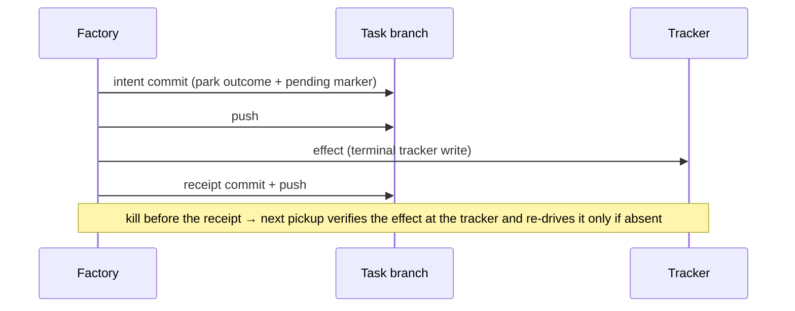

# execution-environment

## Purpose

The `TaskExecutionEnvironment` port is the single gateway through which every gnome-product process runs and through which the factory exchanges files with the working copy: it owns the working-copy lifecycle (materialize, harvest, dispose), all process execution over it (`exec`), and the factory↔environment file channel (`putFile`/`readFile`). A host adapter (worktree + local `ProcessBuilder`, no isolation) and a container adapter (Docker: cloned volume, internal-only network, resource limits) implement the same host-agnostic contract, so future adapters are swaps, not redesigns. Adapter capability passports, fail-closed reconciliation against repo-declared needs, environment lifecycle bound to stage segments, freshness knobs, a layered positive environment allowlist, resource limits, and orphan cleanup together keep gnome-product execution isolated by construction while remaining resumable by any factory instance from the task branch alone.

## Requirements

### Requirement: Task execution environment port
A `TaskExecutionEnvironment` port SHALL own the working-copy lifecycle, every process run over it, and the factory↔environment file channel: `materialize(branch, commit?)` prepares the task branch's working copy at an optional pinned commit (default: its tip), `exec(cmd, env, stdin?)` runs a process with streamed output and an exit code, `putFile`/`readFile(path, sizeCap)` write and read factory-chosen paths, `harvest()` makes the branch fetchable by the factory, `dispose()` tears it all down.
**Implements**: FR1 of add-sandbox-core
**Notes**: The scratch area is a per-environment directory outside the working copy that `materialize` allocates for factory↔environment protocol files (e.g. findings); the environment handle exposes its root to the factory.

#### Scenario: Contract suite runs against any adapter
- **WHEN** the port-level contract spec suite runs against an adapter
- **THEN** materialize → exec → putFile/readFile → harvest → dispose complete using only streams and git transport, with no adapter-specific calls from the caller

#### Scenario: No snapshot of a gnome-touched environment
- **WHEN** any caller holds a live environment handle
- **THEN** no port operation can persist the environment's state as a reusable image

#### Scenario: Materialize pinned at a commit
- **WHEN** an environment is materialized with a factory-chosen commit pin (e.g. the attempt commit)
- **THEN** the working copy matches that commit's tree, and branch commits after the pin are absent from it

#### Scenario: One materialize behind every fresh environment
- **WHEN** fresh-box verification, a sandboxed judge environment, or `--discard-work` needs a working copy
- **THEN** each obtains it through `materialize`, and no second preparation path exists

#### Scenario: The materialize pin is chosen by the factory
- **WHEN** `materialize` is given a commit pin
- **THEN** the pin is a commit the factory chose, never a name or SHA produced inside an environment

#### Scenario: File operations run only between rounds
- **WHEN** the factory exchanges a file with an environment through `putFile` or `readFile`
- **THEN** it does so only between rounds, never while a round is running in that environment

#### Scenario: File-channel paths resolve under the two roots
- **WHEN** `putFile` or `readFile` is given a path
- **THEN** the path resolves under the working copy or under the environment's scratch area, and under no other root

#### Scenario: Scratch content is never harvested and ends with dispose
- **WHEN** a protocol file is written to the scratch area, the branch is harvested, and the environment is disposed
- **THEN** the harvested branch carries no scratch content, and the scratch area no longer exists after `dispose()`

### Requirement: Channel content from the environment is inert and bounded
Everything the factory receives from an environment — exec output, `readFile` content, harvested objects — SHALL be inert data: never executed, never interpolated into commands, refspecs, or filesystem paths, and never materialized as files on factory-owned filesystem; it is held as bytes in memory, parsed and discarded. Reads SHALL happen only at factory-chosen paths with size caps.
**Implements**: NFR-S3, FR17 of add-sandbox-core

#### Scenario: Symlink escape on the host adapter is refused
- **WHEN** a factory-chosen read path inside a host working copy or scratch area is a symlink resolving outside both roots
- **THEN** the read is refused and reported as a violation, and no file outside those roots is opened

#### Scenario: Oversized protocol file cannot exhaust the factory
- **WHEN** a file at a factory-chosen path exceeds the read cap
- **THEN** the factory reads at most the cap, notes the truncation, and no factory-side file is created

#### Scenario: Environment content reaches logs only as sanitized excerpts
- **WHEN** content received from an environment is logged
- **THEN** the log carries a sanitized, capped excerpt of it, never the raw content

#### Scenario: Symlink escape on a host write is refused
- **WHEN** a factory-chosen write path inside a host working copy or scratch area is a symlink resolving outside both roots
- **THEN** the write is refused and no file outside those roots is created or modified

#### Scenario: Container file content streams through exec
- **WHEN** the container adapter reads or writes a file of the environment
- **THEN** the content is streamed through `exec`, and no host-side archive extraction takes place

#### Scenario: Factory writes run as the task user
- **WHEN** the factory writes a file or runs a command inside a box
- **THEN** it runs as the in-box task user, never as root

#### Scenario: Factory-invoked in-box git runs without hooks
- **WHEN** the factory invokes git inside an environment
- **THEN** hooks are disabled by argv-level config, so no hook in the working copy runs

### Requirement: Host adapter mechanics
A host adapter SHALL implement the port over worktree and `ProcessBuilder` mechanics: materialize = git worktree of the factory clone, exec = local subprocess with the working copy as working directory, harvest = no-op (the branch is already in the factory clone), scratch = a factory-private temp directory outside the worktree, decision file = a factory-private per-round temp file rather than an in-branch decision file.
**Implements**: FR2 of add-sandbox-core
**Notes**: The two decision-file media are a declared manual-sync pair (`DecisionFileTransport` in host mode, `BranchDecisionFile` in sandboxed modes): they share the variable name, the size cap and the tolerant read, and each owns its own staleness rule.

#### Scenario: Host adapter keeps worktree mechanics
- **WHEN** a pipeline runs through the host adapter
- **THEN** the working copy is a git worktree of the factory clone, processes run as local subprocesses, rounds close with the single round commit, and harvest performs no fetch

#### Scenario: Host passport declares no isolation
- **WHEN** the host adapter's capability passport is read
- **THEN** it declares no isolation, stating that the env allowlist bounds environment variables only, not filesystem access

#### Scenario: Mode-independent discipline applies in host mode
- **WHEN** a pipeline runs through the host adapter
- **THEN** the layered env allowlist, stdin prompts, law binding, the findings funnel, the pin-check and factory git hardening apply as in sandboxed modes; only the isolation mechanics and the decision file's medium differ — the gnome's decision request travels through a factory-private per-round temp file, not an in-branch decision file

### Requirement: Container adapter
The container adapter SHALL create per environment: an internal-only task network, a task volume holding the working copy, and one container from the operator-configured image (`factory.sandbox.image`), honoring the `factory.sandbox.runtime` knob. `exec` SHALL run inside that container; `dispose()` SHALL remove container, volume, and network as one idempotent operation.
**Implements**: FR3, NFR-R2 of add-sandbox-core; FR2 of add-serve-sandbox-lifecycle

#### Scenario: One task, one box
- **WHEN** an environment is materialized for a task in container mode
- **THEN** a labeled container, volume, and internal network exist for it — each carrying key, mode, and project labels from birth — and dispose removes all three

#### Scenario: Dispose is idempotent
- **WHEN** dispose is called twice, or after a partial teardown
- **THEN** the second call succeeds and no task objects remain

#### Scenario: Every factory object is labelled from creation
- **WHEN** the container adapter creates any Docker object
- **THEN** the object carries, from its creation, the `sandbox-lifecycle` ownership labels: factory ownership, the sanitized task environment key, the ownership mode (`tracked` | `manual`), and the project identity

### Requirement: Container realization of lifecycle roles
The container adapter SHALL realize the lifecycle roles of the `sandbox-lifecycle` decision matrix through its object naming: environments are keyed `<key>` (main), `<key>-j` (fresh judge box), `<key>-v` (fresh verification box), and object names carry the adapter's factory name prefixes (box, volume, network, and the per-environment-key egress guard).
**Implements**: FR4 of add-serve-sandbox-lifecycle

#### Scenario: Role recovered from the object itself
- **WHEN** the sweep classifies a listed factory-labelled container it did not create
- **THEN** the object's role (main box, judge, verification, guard, seed helper) and task key are derived from its own labels and name, with no reference to any in-memory key set

#### Scenario: An unnamed factory container is the seed helper
- **WHEN** the sweep classifies a factory-labelled container whose name matches no factory name pattern
- **THEN** it classifies as the seed-helper role — the one-shot seed-clone helper runs as an anonymous container carrying the factory and task labels but no factory-named identity

#### Scenario: Judge and verification objects of a live task classify alive
- **WHEN** the sweep classifies an object whose environment key carries a `-j` or `-v` suffix while its base task is live
- **THEN** the key resolves to its base task key and the object classifies alive

### Requirement: All gnome-product processes go through the port
Agent-CLI rounds, CLI judge votes, and command checks SHALL execute exclusively via `exec()` of the bound task environment; no factory code path may spawn a process over a working copy directly.
**Implements**: FR4 of add-sandbox-core

#### Scenario: Command check runs in the box
- **WHEN** a stage's command check executes in container mode
- **THEN** the process runs inside the task container against the volume working copy, and its exit code and output tail reach the engine unchanged

### Requirement: Layered positive environment allowlist
The child environment of every `exec()` SHALL be composed of exactly three layers, with nothing inherited implicitly: (1) the adapter's base set; (2) operator-configured passthrough variables, whose values are read from the factory process environment at exec time, never stored in config; (3) factory-set protocol variables (the AI base-url/auth-token seam, findings/decision file paths). It SHALL reach the child through environment channels only, never as a value on any spawn argv on the host.
**Implements**: FR9 of add-sandbox-core; FR22 of make-checkpoint-gate-durable; FR1, FR2, FR6, NFR-R1, NFR-S1 of fix-docker-exec-env-argv

#### Scenario: Host secrets never reach the box
- **WHEN** the factory process holds a tracker token and unrelated cloud keys in its environment
- **THEN** the environment observed inside `exec()` contains only the three allowlist layers, and the unrelated cloud keys are absent

#### Scenario: Typical host project needs no env configuration
- **WHEN** a host-bound command check runs with an empty passthrough list
- **THEN** its environment contains exactly the host base set plus factory-set protocol variables, and toolchains resolvable via `PATH` work without operator configuration

#### Scenario: Passthrough carries live values by name
- **WHEN** the operator lists `JAVA_HOME` in passthrough and its value in the factory's environment later changes
- **THEN** the next `exec()` child observes the current value with no config change

#### Scenario: The fixture box inherits nothing from the test process
- **WHEN** the test JVM's own environment carries a `GNOMISH_DECISION_FILE` naming a file, and a fake-agent round whose scenario carries a decision runs through the fixture box with no decision path set by the spec
- **THEN** the fake agent observes no such variable and the named file is left untouched

#### Scenario: The host base set is a fixed minimum without agent sockets
- **WHEN** the factory process environment carries `SSH_AUTH_SOCK` and a host-bound process is executed
- **THEN** the host base set it receives is the documented minimum (`PATH`, `HOME`, `TMPDIR`, locale variables, `TERM`, `USER`, `SHELL`), and `SSH_AUTH_SOCK` is absent

#### Scenario: The container base set is empty
- **WHEN** a process is executed in a container box with an empty passthrough list
- **THEN** the factory adds no base variables; the runtime environment comes from the image's own `ENV` plus the factory-set protocol variables

#### Scenario: Passthrough names are exact
- **WHEN** the operator lists a passthrough entry
- **THEN** it matches exactly one variable name; no pattern is expanded

#### Scenario: A credential passthrough name fails startup
- **WHEN** the operator lists a passthrough name declared as a credential
- **THEN** the factory refuses to start with a configuration error

#### Scenario: Applied allowlist names are logged without values
- **WHEN** a process is executed
- **THEN** the names of the applied allowlist are logged at debug level for that exec, and no value is logged

#### Scenario: Every test spawner composes over a cleared environment
- **WHEN** a test spawns a gnome-product process — through the fixture box that stands in for the host adapter, the fake-agent invocation, or the end-to-end harness
- **THEN** the child environment is composed over a cleared environment, through the production allowlist where one exists and from an explicit list otherwise, so the spawner is never laxer than the production owner and the child observes no `GNOMISH_*` variable the test itself did not set

#### Scenario: No environment value on any spawn argv
- **WHEN** a container exec runs with passthrough entries and factory-set entries, including a credential-shaped AI-seam value, and the composed docker argv is inspected
- **THEN** every environment flag on the argv names a variable and carries no `=` and no value, the same names appear with their values in the docker client's environment for that exec, and the in-box child observes the same names and values it observed before this change

#### Scenario: Process table during a round shows names only
- **WHEN** an operator lists host processes while an agent round or judge vote runs in container mode
- **THEN** the docker process's command line shows the environment variable names and no value

#### Scenario: An absent name stays unset in the box
- **WHEN** a container exec runs with a passthrough variable absent from the factory's environment
- **THEN** the variable is unset in the box and no error is raised

### Requirement: Read-only control surfaces inside the box
Injection-persistence surfaces inside the container SHALL be read-only for the gnome: agent-CLI configuration, shell rc files, and the baked proxy/CA/build configs SHALL be root-owned or `:ro`-mounted so in-box writes to them fail. The gnome's own clone (including its hooks) stays writable — hooks execute only inside the box and never cross the harvest boundary.
**Implements**: FR20, NFR-S2 of add-sandbox-core

#### Scenario: Cage rules cannot be rewritten from inside
- **WHEN** a process inside the box attempts to modify the agent-CLI config, a shell rc file, or a baked proxy/CA config
- **THEN** the write fails, and the surface's content is unchanged for every later process in the same environment

### Requirement: Resource limits
The container adapter SHALL apply operator-configured CPU, memory, and PID-count limits at container creation, with documented defaults. Working-volume disk-size enforcement (`--storage-opt size=`) SHALL be applied only when the operator enables it (`factory.sandbox.enforce-disk-quota`, default off).
**Implements**: FR10 of add-sandbox-core
**Notes**: Disk quota is off by default because it requires a quota-capable storage driver (overlay2 on xfs with `pquota`) that most daemons lack; enabling it without one fails every container start, so the operator opts in on a capable host.

#### Scenario: Runaway build is contained
- **WHEN** a process inside the box exceeds the memory limit or forks past the PID limit
- **THEN** only in-box processes are killed; the factory observes a failed round, and the host stays healthy

#### Scenario: Disk quota is enforced only when opted in
- **WHEN** the operator sets `factory.sandbox.enforce-disk-quota` on a daemon whose storage driver supports quotas
- **THEN** the container is created with `--storage-opt size=` at the configured working-volume size; left at its default, no disk cap is applied and container creation does not depend on a quota-capable driver

### Requirement: Runtime outage is an infrastructure failure
When the container runtime dies mid-task, the affected operation SHALL classify as an infrastructure failure: it is not retried, no stage attempt is burned, and the task escalates at once with a "cannot execute" report. When the runtime is unavailable at materialize, before any round of the claimed task, the run SHALL end with the typed precondition result instead: the claim is released, nothing is escalated, and under `serve` the container-runtime condition opens.
**Implements**: NFR-R1 of add-sandbox-core; FR14, FR15, NFR-R2 of add-sandbox-base-image; FR1, FR2 of split-long-spec-requirements
**Notes**: The mid-task class is the existing infrastructure-failure class, consistent with the other failure classes. Work in progress is the task's and is escalated; a box that never started is the operator's precondition and is a daemon condition (design D19).

#### Scenario: Docker daemon dies mid-task
- **WHEN** the daemon becomes unreachable between rounds
- **THEN** the round classifies as an infrastructure failure, the attempt counter is unchanged, and the task escalates as cannot-execute at once, the round not retried

#### Scenario: Runtime unreachable at materialize returns the task
- **WHEN** the container runtime is unreachable when a claimed task's first box would be created
- **THEN** no box is created, the run ends with the typed precondition result, the claim is released with no abort marker and no escalation report, and under `serve` the container-runtime condition opens

### Requirement: Environment lifecycle bound to stage segments
Sandbox binding SHALL be resolved per stage; an environment SHALL live for a contiguous segment of equally-bound stages. A binding change between stages SHALL be executed as harvest → dispose → materialize from the task branch. Reuse across different bindings SHALL be impossible by construction. Within a segment the environment SHALL be reused — no repeated materialization.
**Implements**: FR12, NFR-P1 of add-sandbox-core; FR21 of make-checkpoint-gate-durable
**Notes**: Reuse within a segment keeps environment overhead negligible against round duration.

#### Scenario: Segment switch reuses resume mechanics
- **WHEN** stage N is bound to container A and stage N+1 to a different binding
- **THEN** the branch is harvested, environment A disposed, and a new environment materialized from the branch before stage N+1 starts

#### Scenario: Reuse within a segment avoids repeated clones
- **WHEN** two consecutive stages share the same binding and neither declares `requires-fresh`
- **THEN** the second stage runs in the same environment with no new clone or container creation

#### Scenario: A reader never waits on a materialize in flight
- **WHEN** a materialize for a new key is blocked inside Docker and another thread asks for the current box
- **THEN** the reader returns promptly with what the record holds — none while the build is in flight, since claiming a build for a new key takes the previous box out of the record

#### Scenario: Two requests for one key share one build
- **WHEN** two callers ask for the same key while no box is recorded for it
- **THEN** exactly one materialize runs and both callers receive the box it produced

#### Scenario: A failed build releases its claim
- **WHEN** the materialize of a claimed build fails
- **THEN** every caller waiting on that build receives the failure, no box is recorded, and the next request for the key starts a fresh build

#### Scenario: One live-box mechanism keeps a box per role and key
- **WHEN** the round-box lease or the fresh judge box is asked for a box
- **THEN** one live-box mechanism serves both: it keeps one materialized box per role while its key (the stage segment; the attempt commit) is unchanged, and rebuilds the box when the key changes

#### Scenario: A reader never waits on a disposal in flight
- **WHEN** the live-box mechanism is disposing a box inside Docker and another thread asks for the current box
- **THEN** the reader returns promptly with what the record holds, without waiting for the disposal to finish

#### Scenario: The live-box lock spans no Docker work and no git read
- **WHEN** the live-box mechanism builds or replaces a box
- **THEN** it decides and claims under its lock, materializes and disposes with nothing held, and records the outcome under the lock again

### Requirement: Freshness knobs
A stage MAY declare `requires-fresh`, forcing a new environment even within a segment. A command check MAY declare `verify-in: fresh-box`, running in a new environment materialized from the attempt commit. Defaults SHALL be segment reuse and same-box verification.
**Implements**: FR13 of add-sandbox-core

#### Scenario: Fresh box resets out-of-branch poisoning
- **WHEN** a stage with `requires-fresh` starts after a prior stage modified files outside the working copy (PATH shims, init scripts)
- **THEN** the new environment contains only image content plus the branch state

#### Scenario: fresh-box verification proves branch self-sufficiency
- **WHEN** a command check declared `verify-in: fresh-box` runs
- **THEN** it executes in an environment materialized from the attempt commit, so uncommitted work cannot influence the verdict

### Requirement: Adapter passports and fail-closed reconciliation
Each adapter SHALL expose a machine-readable capability passport (isolation boundary, egress control, task↔task boundary, docker-inside support). Before starting a stage, the factory SHALL reconcile the repo-declared needs against the bound adapter's passport and SHALL refuse with an infrastructure failure on mismatch. Repo declarations may only tighten; adapter binding and any weakening are operator-only.
**Implements**: FR14 of add-sandbox-core

#### Scenario: Mismatch refuses fail-closed
- **WHEN** a stage declares a need the bound adapter's passport does not satisfy
- **THEN** the task does not start the stage and the error names the unmet need

### Requirement: Container is the default binding
With no operator binding configured, stages SHALL bind to the container adapter. If Docker is unavailable, the factory SHALL refuse with an error naming the two options (install Docker or explicitly bind host); it SHALL never fall back to host silently.
**Implements**: G2, G4, FR14 of add-sandbox-core

#### Scenario: No silent weakening
- **WHEN** the factory starts with default binding on a machine without Docker
- **THEN** the run refuses with the explanatory error and no process executes on the host

### Requirement: Denial findings readable through the port
The `TaskExecutionEnvironment` port SHALL expose the environment's egress denial findings as structured findings, so consumers reach denials through the contract without knowing the adapter. Each finding SHALL be paired with its source-assigned identity — the denial source's own event timestamp and the source identity — so consumers can merge re-reads idempotently.
**Implements**: FR1, NFR-R1 of fix-denial-report-attachment; FR7 of fix-denial-attribution-durability

#### Scenario: Sandboxed environment surfaces its guard denials
- **WHEN** a consumer holding the port type asks a sandboxed environment for denial findings after a round with a denied request
- **THEN** it receives the structured denial findings recorded by the guard, each paired with its source-assigned identity, without downcasting to any adapter type

#### Scenario: Guard-less environment reports no denials
- **WHEN** a consumer asks a host (non-sandboxed) environment for denial findings
- **THEN** it receives an empty list

#### Scenario: Unreadable denial log degrades to empty
- **WHEN** the guard's denial log is missing or unreadable at read-back time
- **THEN** the port returns an empty list and the round completes normally

#### Scenario: An unreadable denial source fails no attempt and no report
- **WHEN** the denial source is missing or unreadable when an attempt is recorded and its report is built
- **THEN** the attempt and the report carry an empty denial list, and neither fails because of the denial source

### Requirement: Denial read position survives the process
The denial findings a round receives are the delta since the previous read, tracked by a cursor the environment advances. The `TaskExecutionEnvironment` port SHALL expose that cursor — a read position paired with the identity of the source it was read from — so the factory can commit it with the attempt it delimits, and SHALL accept a cursor committed by an earlier lease before the first read of the current one.
**Implements**: FR17 of make-checkpoint-gate-durable; FR5 of fix-denial-report-attachment; FR6 of fix-denial-attribution-durability
**Notes**: The cursor must survive the process because a denial source outlives the factory process that created it. A restored cursor is an offer, not an instruction.

#### Scenario: A resumed lease reports only its own rounds' denials
- **WHEN** an environment is offered the cursor committed by an earlier lease, naming the denial source it is now attached to, and its first round closes
- **THEN** it reports only the denials recorded after that position, not those the source still holds from earlier rounds

#### Scenario: A cursor from another denial source is ignored
- **WHEN** an environment is offered a cursor whose source identity is not its own live denial source — a resume on another machine, or onto a recreated source
- **THEN** the position is ignored and the environment reads its own source from the beginning, so no real denial is filtered out of the report

#### Scenario: Guard-less environment has no cursor
- **WHEN** a host (non-sandboxed) environment is asked for its denial cursor, or offered one
- **THEN** it exposes none and accepts the offer without failing

#### Scenario: A delegating view forwards the denial surface
- **WHEN** the factory reads the denial cursor, reads findings, or restores a cursor through a delegating view of the port over a guard-backed environment
- **THEN** the delegate's real answers come back — never the interface defaults — and the committed state carries the cursor the delegate reported

#### Scenario: A reattached box carries the recorded position
- **WHEN** a container-mode task is resumed onto a surviving guard whose branch tip records a denial cursor and the identities reported with it, and the resume reattaches the box before anything else runs
- **THEN** the box the lease hands out already holds that offer, and the next round's findings contain no denial the record already reported — the same result the first round of a fresh start gets

#### Scenario: The offer is read when the box is built, not when the run was assembled
- **WHEN** a lifecycle commit that moves the recorded cursor lands between the run's assembly and the first environment build
- **THEN** the environment is offered the position the tip records at build time

#### Scenario: Every box build carries the offer
- **WHEN** a container round environment is built for the first round's open, at a segment boundary, or for a resume's reattach
- **THEN** the one component that builds container round environments makes the offer as part of the build, from the branch tip as it stands at that moment

#### Scenario: No separate offering step exists
- **WHEN** a caller obtains a container round environment through the run-support surface
- **THEN** the surface offers no separate step to offer a cursor, and the environment the lease hands out already carries the offer

#### Scenario: The cursor round-trip runs through the production delegating view
- **WHEN** a cursor read through the production delegating view of the port is committed and later restored through it onto the same guard-backed source
- **THEN** the restored environment reports only the denials recorded after that position — the round-trip is pinned on the production view, not on a test double

### Requirement: Docker management commands are bounded
Every docker management command the factory issues (create, run, inspect, remove, list, and the
rest of the non-streaming CLI surface) SHALL be bounded by a configured deadline and have its
output drained concurrently with the running process — including `docker run` when the image is
absent locally and the CLI reaches a registry over the network. The existing classification of an unreachable daemon as an infrastructure failure is
unchanged.
**Implements**: FR10, NFR-R1, G1 of bound-subprocess-commands

#### Scenario: A wedged registry does not hang the take
- **WHEN** a box's image is absent and the registry accepts the connection but never answers
- **THEN** the management command returns within the configured docker deadline and the failure is
  classified as infrastructure, not quality

#### Scenario: Expiry is a timed-out outcome, not an exit code
- **WHEN** a docker management command runs past its configured deadline
- **THEN** the caller receives a distinct timed-out outcome, never an ordinary non-zero exit

### Requirement: Environment process termination is tree-wide and interruption is named
When an execution-environment process is killed on a timeout, the kill SHALL terminate the process
and every descendant it spawned, cooperatively first and forcibly after a short grace, and reap
them — an agent CLI's own children do not outlive the round that launched them. An interrupted
wait SHALL be a named outcome of the environment's wait contract, distinct from any exit code, on
every wait path the environment exposes.
**Implements**: FR11, NFR-R2, G2, G5 of bound-subprocess-commands

#### Scenario: A timed-out round leaves no orphaned agent children
- **WHEN** an agent round expires on its round timeout and the agent CLI had spawned subprocesses
- **THEN** the CLI and all its descendants are terminated and reaped

#### Scenario: Interruption is not an exit code
- **WHEN** a wait on an environment process is interrupted by shutdown
- **THEN** the caller observes a named interrupted outcome, not a sentinel exit code

### Requirement: Container park records its outcome on the branch
A park (Escalated or Paused) of a container-mode task SHALL record its outcome on the task branch through the same intent→effect→receipt protocol host mode uses: the factory-side outcome commit carrying the pending-write marker is the durable intent, the terminal tracker write is the effect, and the receipt is recorded after it.

**Implements**: FR10 of harden-task-branch-contract

#### Scenario: Container park round-trips a human decision
- **WHEN** a container-mode task parks with a question, the operator answers, and the task is returned
- **THEN** resume finds the recorded park outcome on the branch, reads the answer, and continues — it does not re-park with the same question

#### Scenario: Kill between intent and receipt converges
- **WHEN** an instance dies after the container park's outcome commit but before its receipt is recorded
- **THEN** the next pickup verifies whether the tracker write landed, re-drives it only if absent, and records the receipt — with no duplicate tracker artifact

### Requirement: Kept box excludes factory-side branch commits
Between a park's outcome commit and the disposal of its kept box, the factory SHALL NOT create further factory-side commits on the task branch — the kept box's clone cannot learn of them, and a later harvest would diverge. Resuming an escalated container task SHALL dispose the kept box before the decision commit is created, so the next round's box is materialized from a tip that already contains the decision from its start.
**Implements**: FR17 of harden-task-branch-contract

#### Scenario: Escalated-container resume disposes before deciding
- **WHEN** an escalated container task with a kept box is resumed with a human decision
- **THEN** the kept box is disposed first, the decision commit is created on the harvested tip after disposal, and the freshly materialized box contains the decision from its first round

#### Scenario: No factory commit lands behind a kept box's back
- **WHEN** a container-mode task is parked with its box kept
- **THEN** no factory-side commit advances the task branch until that box is disposed, so no future harvest can diverge from a tip the box never saw

### Requirement: Shared factory-owned-paths salvage policy
Host and container salvage SHALL consume one shared factory-owned-paths policy — a single definition of which working-copy paths are factory-owned, not two adapter-local lists. Under it, gnome-owned work files in a dirty working copy are salvageable; factory-owned files under `.gnomish-task/` are restored from the branch tip during recovery and never salvaged from the dirty working copy.
**Implements**: FR5 of harden-task-branch-contract

#### Scenario: Both adapters classify a path identically
- **WHEN** the same working-copy path is evaluated by host salvage and by container salvage
- **THEN** both classify it identically — factory-owned or gnome-owned — through the one shared policy

#### Scenario: A tampered state file cannot ride a salvage commit
- **WHEN** an interrupted round's dirty working copy holds gnome source edits and a modified `.gnomish-task/state.json`
- **THEN** salvage commits the source edits, excludes the state file, and recovery proceeds from the `state.json` at the branch tip

### Requirement: Exit 137 is annotated with the container's OOM state
When a process run through the container adapter's `exec()` exits with code 137, the adapter SHALL read the container's `OOMKilled` runtime state and, when it is `true`, annotate the reported failure with a "likely container OOM" note at the point the exit code is surfaced to the operator. The annotation SHALL be advisory only: the exit code, the failure classification, and attempt accounting are unchanged.
**Implements**: FR1, NFR-R1, NFR-O1, UX2 of polish-sandbox-forensics

#### Scenario: OOM-killed process is reported as likely OOM
- **WHEN** an in-box process exits 137 and the container's runtime state reports `OOMKilled=true`
- **THEN** the failure reported for that exec carries the "likely container OOM" annotation alongside the exit code, and the failure's classification and the attempt counter are exactly what they would be without the annotation

#### Scenario: Plain kill is not blamed on memory
- **WHEN** an in-box process exits 137 and the container's runtime state reports `OOMKilled=false`
- **THEN** the failure is reported without an OOM annotation

#### Scenario: Unreadable runtime state degrades to no annotation
- **WHEN** an in-box process exits 137 and the container state cannot be inspected
- **THEN** the failure is reported exactly as today, with no annotation and no additional error

### Requirement: Container failures name the container ready-to-paste
Operator-facing failure messages about a task container or its egress guard — container materialization failures, guard start failures, and the notice that a box was kept — SHALL embed the concrete Docker object name the operator would pass to `docker logs` / `docker cp`, not only the environment key it is derivable from. Messages SHALL carry only object names and runtime metadata — never credentials or environment values.
**Implements**: FR2, NFR-S1, UX1 of polish-sandbox-forensics

#### Scenario: Materialize failure names the box
- **WHEN** a container materialization step fails against the runtime
- **THEN** the resulting error message contains the task container's concrete name

#### Scenario: Guard failure names the guard container
- **WHEN** the egress guard cannot be brought to a running state
- **THEN** the resulting error message contains the guard container's concrete name

#### Scenario: Keep notice names the kept box
- **WHEN** a run ends by keeping its box (park, abort, or failed self-check)
- **THEN** the operator-facing notice names the kept container, so inspection can start from the message alone

### Requirement: Image-declared volumes are never anonymous
Before creating any factory container from an image — the egress guard, the main box, a judge box, a verification box — the container adapter SHALL read the image's declared volume paths from the runtime and SHALL mount a size-bounded ephemeral (`tmpfs`) filesystem over every declared path that is not already the destination of an explicit factory mount for that container.
**Implements**: FR1, FR2, FR3, FR4, G1, G2 of fix-image-declared-volumes; FR2, UX2 of fix-image-declared-volumes; NFR-S1 of fix-image-declared-volumes; NFR-R2 of fix-image-declared-volumes; NFR-R1 of fix-image-declared-volumes
**Notes**: An anonymous volume is an unlabelled, runtime-named volume; the overrides exist so the factory never causes one to exist on the daemon.

#### Scenario: Guard image declaring a volume leaves no anonymous volume
- **WHEN** an environment is materialized with a guard image whose Dockerfile declares a `VOLUME` (the default `mitmproxy` image does)
- **THEN** the guard container runs with an ephemeral filesystem at that path, and the daemon's set of anonymous volumes is the same after the guard has been created and disposed as it was before

#### Scenario: Box image declaring a volume leaves no anonymous volume
- **WHEN** an environment is materialized from a task image declaring a `VOLUME` at some path outside the working copy, a round writes into that path, and the environment is disposed
- **THEN** the write succeeded inside the box, and the daemon's set of anonymous volumes is unchanged by the whole sequence

#### Scenario: Explicit factory mounts are not overridden
- **WHEN** an image declares a `VOLUME` at the exact path the factory mounts explicitly (the working copy in the box, the config directory in the guard)
- **THEN** the explicit factory mount stands and no ephemeral filesystem is layered over it

#### Scenario: Judge and verification boxes are covered by the same rule
- **WHEN** a fresh judge or verification environment (`<key>-j`, `<key>-v`) is materialized from an image declaring a `VOLUME`
- **THEN** its container carries the same ephemeral overrides as the main box would, and no anonymous volume is created

#### Scenario: Image content under a declared path is not visible in the box
- **WHEN** an image ships a file under a path it declares as a `VOLUME`, and an environment is materialized from it
- **THEN** the declared path in the box is an empty ephemeral filesystem and the file is absent — content an image needs in the box lives under a path the image does not declare

#### Scenario: The override introduces no host path
- **WHEN** the run argv for any factory container is built with a non-empty override set
- **THEN** every override fragment is a memory-backed mount with no host source; no bind mount or volume name is added beyond the factory's own explicit mounts

#### Scenario: The override is a pure function of image and explicit mounts
- **WHEN** the override set is resolved twice for the same image answer and the same explicit destinations
- **THEN** both resolutions are equal and render the same argv fragments in the image's declaration order

#### Scenario: Declared-volume read failure is an infrastructure failure
- **WHEN** the runtime cannot report the image's declared volumes (the daemon is unreachable, or the answer is unparseable)
- **THEN** the materialize fails as an infrastructure failure per the existing runtime-outage requirement — it never proceeds with an empty override set

#### Scenario: The seed-clone helper is exempt from the overrides
- **WHEN** the one-shot seed-clone helper is started from an image declaring a `VOLUME`
- **THEN** it gets no ephemeral override; it runs as a self-removing container, and the runtime removes its anonymous volumes with it, so none remains after it exits

#### Scenario: No image's declared path is named in production code
- **WHEN** the override set is built for a container
- **THEN** its paths come only from the image's own declaration read at creation time, and no production source names a declared path of any particular image

### Requirement: Overridden declared paths are named in the creation anchor
The environment-creation lifecycle anchor (the existing INFO line stating that a container environment was created) SHALL name the declared paths that were made ephemeral for the box, stating explicitly when there were none; the guard's creation SHALL record its overridden paths at DEBUG. No new operator-plane (WARN/ERROR) event is introduced.
**Implements**: NFR-O1, UX1 of fix-image-declared-volumes

#### Scenario: Operator sees which paths were made ephemeral
- **WHEN** an environment is created from an image declaring `/cache` and `/var/lib/tool`
- **THEN** the creation anchor line names both paths as ephemeral overrides

#### Scenario: Image with no declared volumes
- **WHEN** an environment is created from an image declaring no volumes
- **THEN** the creation anchor line states that no declared path was overridden

### Requirement: Container environment factory
Container round environments SHALL be built by a factory constructed once per ownership mode with the installation's box equipment — the sandbox settings, the box timing, the guard config root and the ownership mode — whose one method takes only what varies per task: the environment key, the box git link, the child-env allowlist, the project identity and the denial restoration read.
**Implements**: FR19, FR20 of make-checkpoint-gate-durable

#### Scenario: One factory per ownership mode serves every run
- **WHEN** two container runs of the same ownership mode are created by one factory process
- **THEN** both are built through the same environment factory, each with its own key, link, allowlist and restoration read, and every object they create carries that mode's label

#### Scenario: A per-run caller cannot pass installation settings
- **WHEN** a runner creates a run's container support
- **THEN** it passes the clone, the task, the segment plan, the pipeline and the credential names to scrub, and nothing else — the sandbox and factory settings are not on the call

#### Scenario: No constructor mixes installation equipment and task inputs
- **WHEN** a container round environment or a run's container support is constructed
- **THEN** no constructor or static factory takes the installation's equipment and a task's inputs in one parameter list, and the run-support factory holds the installation's settings as fixed state

### Requirement: The box's git meets the floor before the seed clone
The container adapter SHALL, before every seed clone of a box, run the image's own `git --version` in a one-shot, network-less helper carrying the environment's ownership labels, and SHALL refuse the image when the reported version is below the factory's git floor or no version is reported. A claimed task whose box image is refused SHALL be released, not aborted. A helper the runtime could not start SHALL be reported as the runtime's failure, never as a version refusal.
**Implements**: NFR-S2 of tighten-spec-contract; FR10 of own-git-invocation-policy; FR11, FR14, NFR-R2 of add-sandbox-base-image; FR1, FR2 of split-long-spec-requirements
**Notes**: The seed clone reads the factory clone, on the reftable ref backend, with the image's git; the factory has one git floor (`GitVersion.FLOOR`), judged by one parser for the factory's own git and the box's, and the base image carries a git at or above it, so an image built `FROM` the base passes.
**Notes**: A seed clone happens at a fresh materialize and at a reattach that applies a commit pin.

#### Scenario: An image whose git is below the floor is refused before the seed clone
- **WHEN** a box is materialized on an image whose `git --version` reports 2.43.0
- **THEN** the run stops with a message naming the image, the floor, the reported version and the remedy; the check itself logs nothing and the layer that decides writes one coded line — `take` and `run` an ERROR beside the message they print, `serve` the box-git-floor condition's opening WARN — and no network, volume or container was created

#### Scenario: An image without git is refused with the runtime's complaint
- **WHEN** a box is materialized on an image in which `git` cannot be executed
- **THEN** the refusal quotes the runtime's answer instead of a version and nothing is created

#### Scenario: A runtime that cannot start the helper is not a version refusal
- **WHEN** the container runtime is unreachable when the floor probe would run
- **THEN** the failure classifies as the container runtime's, not the image's: no version refusal is logged and, under `serve`, the container-runtime condition opens rather than the box-git-floor one

#### Scenario: An image at or above the floor seeds as before
- **WHEN** a box is materialized on an image whose git reports the floor or newer
- **THEN** the probe logs nothing and the materialize continues with the seed clone

#### Scenario: A refused image releases the claimed task
- **WHEN** a claimed run stops because its box image's git is below the floor
- **THEN** the run ends with the typed precondition result, the claim is released, the task is not aborted, and under `serve` the box-git-floor condition opens so no further task is claimed until a probe passes

### Requirement: The box image declares a matching contract version
Before creating a box, the container adapter SHALL read the configured sandbox image's labels and SHALL refuse to create the box when `io.gnomish.image-contract` is missing or differs from the contract version the factory was built with. The refusal SHALL be a configuration error raised before any round, naming the image, the found and the required version, and a `FROM ghcr.io/oinsio/gnomish-sandbox-base:<tag>` line to rebuild from.
**Implements**: FR5, NFR-R1, NFR-O1, UX2 of add-sandbox-base-image
**Notes**: `<tag>` is the base tag of the factory's release: `X.Y` for a final release, the full version for a pre-release, the locally built base for a development build (design D11).

#### Scenario: Stale image refused with the fix
- **WHEN** the configured image carries `io.gnomish.image-contract=1` and the factory requires 2
- **THEN** no box is created, and the error names the image, versions 1 and 2, and the base tag to rebuild from

#### Scenario: Image not built on the base
- **WHEN** the configured image has no `io.gnomish.image-contract` label
- **THEN** no box is created, and the error says the image is not built on the base and how to fix it

#### Scenario: Matching image starts normally
- **WHEN** the configured image carries the required contract version
- **THEN** the box is created with exactly one inspection of the sandbox image: the labels are read by the same inspection that reads its declared volumes

### Requirement: Container exec launch is one value
The container adapter SHALL produce the argv and the docker client environment of one exec together, from one composed child environment, as a single launch value, and the docker start seam SHALL accept only that value. The docker client's environment for an exec SHALL be the factory's inherited process environment with every name the run's child-environment allowlist declares as a credential removed, and the composed child environment laid on top.
**Implements**: FR3, FR4, FR5, NFR-S2, NFR-S4 of fix-docker-exec-env-argv
**Notes**: Only declared credentials are removed, so the docker client keeps the home, path, docker-configuration, certificate and proxy variables its own setup depends on.

#### Scenario: Names and values cannot diverge
- **WHEN** an exec launch is built from a composed child environment
- **THEN** the set of variable names on its argv equals the key set of the environment it delivers, for every composed map

#### Scenario: Declared credential is subtracted from the client
- **WHEN** the factory process exports a declared tracker credential and a passthrough variable, and an exec is launched whose composed environment carries the passthrough variable only
- **THEN** the docker client process for that exec observes the passthrough variable with its live value and does not observe the declared credential, while an unrelated variable of the factory's environment (such as the docker daemon address) is still present

#### Scenario: Environment-free exec stays flag-free
- **WHEN** the container file channel writes or reads a file
- **THEN** the exec argv contains no environment flag and the docker client's environment is the inherited environment minus declared credentials, with nothing laid on top

#### Scenario: Scratch directory creation carries no environment flag
- **WHEN** the materializer creates the scratch directory, a bounded management command
- **THEN** its exec argv contains no environment flag, and its docker client environment is the management commands' inherited environment, unchanged by this requirement

#### Scenario: The bare form is unconstructible
- **WHEN** production code under the sandbox tree is scanned
- **THEN** exactly one source spells the environment flag, the only sources constructing a process are the docker client seam and the host adapter, and the docker start seam exposes no entry taking a bare argv
