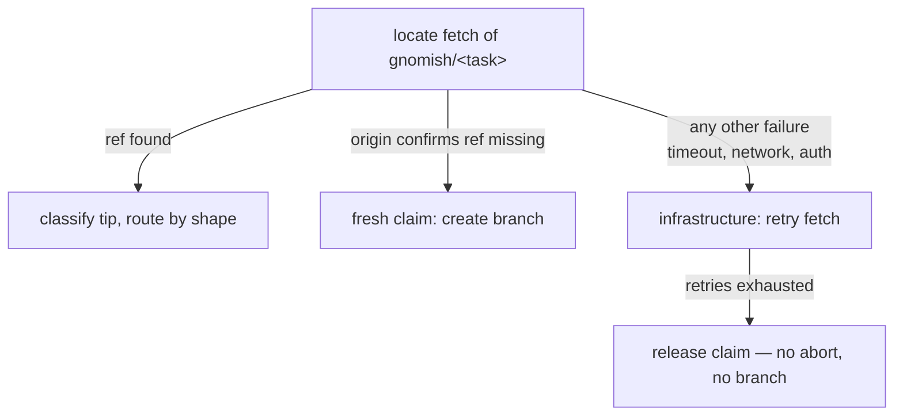

# tracker-take

## Purpose

The `gnomish take` CLI: single-task tracker modes (explicit ref and bare
auto-take), the disposition matrix, snapshot at claim, tracker-driven resume
with decision collection, abort handling with the K fuse, revocation at round
boundaries, delivery, and the operator guide.

## Requirements

### Requirement: take subcommand surface
`gnomish take` SHALL be a separate subcommand, always in git mode, with three
forms: `take <ref>` (explicit mode), `take <ref> <ref> ...` (batch mode, two
or more refs), and bare `take` (auto mode). Its supported flags SHALL be
`--dir`, `--base` (single explicit-mode start only), `--discard-work`, and the
headless takeover flag; any other flag is a usage error.
**Implements**: FR1 of remove-interactive-console
**Notes**: `--discard-work` is salvage-only: it resets the working copy to the last recorded round and replays the interrupted round (git-task-persistence, "Salvage of interrupted rounds").

#### Scenario: Flag validation
- **WHEN** `take` is invoked with `--mode`, `--task`, `--resume`, `--interactive`, or bare
  `take` with `--base` or `--takeover`
- **THEN** each invocation fails with a validation error before touching the
  tracker

#### Scenario: Batch rejects interactivity
- **WHEN** `take 42 43 --interactive` is invoked
- **THEN** the invocation fails with a validation error before touching the
  tracker, as for any unknown flag

#### Scenario: Foreign canonical id is refused
- **WHEN** `take github:other/repo#7` names a repo that is neither the configured
  binding nor (via the adapter's rename tolerance) a predecessor of it
- **THEN** the run refuses (exit 15) before fetching the task, naming both repos

#### Scenario: Short ref expansion
- **WHEN** the operator runs `take 42` with a configured GitHub binding
- **THEN** the run targets the canonical id built from the binding and issue 42

#### Scenario: Every retired flag is a usage error
- **WHEN** `take` is invoked with `--task-file`, `--task-id`, or `--from-stage`
- **THEN** each invocation fails with a usage error before touching the tracker, like any
  unknown flag

#### Scenario: Batch rejects a base
- **WHEN** `take 42 43 --base main` is invoked
- **THEN** the invocation fails with a validation error before touching the tracker

#### Scenario: A hash-prefixed short ref expands like a bare number
- **WHEN** the operator runs `take '#42'` with a configured GitHub binding
- **THEN** the run targets the same canonical id as `take 42`

#### Scenario: Discard-work plays no role in divergence
- **WHEN** `take <ref> --discard-work` resumes a task whose local branch has truly diverged
  from origin
- **THEN** the divergence resolves exactly as it does without the flag — the local branch is
  reset to the origin tip — and the flag acts only on the salvage of the interrupted round

#### Scenario: The run flag matrix is unchanged
- **WHEN** `gnomish run` is invoked with flags `take` rejects (`--task-file`, `--from-stage`)
- **THEN** `run` accepts them exactly as before

### Requirement: Explicit-mode disposition by task state
`take <ref>` SHALL act as an operator mandate per the task's logical state:
`Ready` (or readiness criterion unmet) → claim and work, unless the task's
history carries a finish report; `AwaitingHuman` (any reason) → refuse;
`Working` held by another instance → the takeover path, which requires
explicit confirmation before any claim; `Finished` → skip reporting "already
done"; `Gone` (closed or nonexistent) → skip with a clear error.
**Implements**: FR9 of add-tracker-port; FR6 of add-claim-heartbeat; FR5 of enforce-finish-terminality
**Notes**: The takeover confirmation is the one deliberate deviation from "identical with and without a TTY": a gate before the claim, not a wait inside the run.

#### Scenario: Mandate overrides readiness and backoff
- **WHEN** `take <ref>` targets an open task without the ready label and with
  unexpired abort backoff
- **THEN** the task is claimed and worked, and the abort counter is not reset by
  the mandate itself

#### Scenario: Parked task is refused
- **WHEN** `take <ref>` targets a task in `AwaitingHuman`
- **THEN** the run refuses without claiming, naming the park reason and that
  reason's way back to ready — reply in the tracker when a question is pending

#### Scenario: Held task shows facts and asks
- **WHEN** `take <ref>` targets a task claimed by instance B with a TTY
  attached
- **THEN** the run prints the holder and the age of the last beat and asks for
  confirmation; declining leaves the tracker untouched and exits as a refusal
  naming instance B

#### Scenario: Confirmed takeover resumes the task
- **WHEN** the operator confirms the takeover of a task whose holder died
  mid-work
- **THEN** the thread records the holder-transition marker, the old claim is
  removed, the run claims the task by the ordinary lease, and work resumes
  from the branch state

#### Scenario: Headless takeover needs the flag
- **WHEN** `take <ref>` targets a `Working` task without a TTY and without the
  takeover flag
- **THEN** the run refuses naming the holder and mentioning the flag; with the
  flag it proceeds as a confirmed takeover

#### Scenario: Finished task is skipped
- **WHEN** `take <ref>` targets a delivered task
- **THEN** the run reports it as already done and does not resume it

#### Scenario: Reopened finished task is declined, not worked
- **WHEN** `take <ref>` targets a task a human moved back to ready after it
  was finished
- **THEN** the run refuses even under the explicit mandate: the terminal
  status is restored, the explanation comment is posted, and the exit
  outcome clearly signals the refusal

#### Scenario: The mandate resumes from the recorded outcome
- **WHEN** `take <ref>` claims a ready task whose branch records an outcome and whose thread
  holds a reply after the last ack
- **THEN** the reply is collected and acknowledged, and the run resumes with it
- **WHEN** the recorded outcome is `DecisionNeeded` and no reply is pending
- **THEN** the task is parked again with the question restated
- **WHEN** any other outcome is recorded and no reply is pending
- **THEN** the run continues on the return alone

#### Scenario: Closed or nonexistent task is skipped
- **WHEN** `take <ref>` targets a closed issue or a ref that names no task
- **THEN** the run skips it with an error naming the ref and its state, and claims nothing

### Requirement: Bare auto mode takes the head of the queue
Bare `gnomish take` SHALL fetch the ready queue via `listReady`, claim one
eligible task from the head zone — a random pick among the first K eligible,
oldest-first as a soft preference — process exactly that one task to its
terminal result, and exit. A task is eligible when its abort backoff has
expired, it is not finished, and, if fresh, the WIP limit admits it;
returned tasks are preferred over fresh ones.
**Implements**: FR10 of add-tracker-port; NFR-C1 of add-tracker-port; FR6, FR9 of add-factory-serve; FR3 of enforce-finish-terminality

#### Scenario: One task per run
- **WHEN** the queue holds three ready tasks and bare `take` runs
- **THEN** exactly one task from the head zone is processed and the process
  exits after its terminal result

#### Scenario: Backoff hides a task
- **WHEN** the queue head aborted moments ago and its backoff has not expired
- **THEN** bare `take` claims the next eligible task instead

#### Scenario: WIP limit blocks a fresh start
- **WHEN** open fronts equal W and only fresh tasks are ready
- **THEN** bare `take` claims and runs nothing and exits with the skipped outcome, exit code 15,
  its reason naming the WIP limit

#### Scenario: Returned task preferred
- **WHEN** the queue holds an older fresh task and a younger returned task
- **THEN** bare `take` claims the returned task

#### Scenario: Finished task never claimed from the feed
- **WHEN** the queue lists a reopened finished task ahead of a fresh task
- **THEN** bare `take` declines the finished task and claims the fresh one

#### Scenario: Backoff grows exponentially up to its cap
- **WHEN** core computes a ready task's backoff from the adapter's abort facts
- **THEN** the delay is the configured base doubled per consecutive abort after the first,
  capped at the configured cap, and the task stays hidden until that delay has passed since
  its last abort

#### Scenario: Returned task claimable at the WIP limit
- **WHEN** open fronts equal W and a returned task is ready
- **THEN** bare `take` claims the returned task

#### Scenario: Nothing eligible is a clean no-op naming the reason
- **WHEN** every ready task is hidden by its unexpired backoff
- **THEN** bare `take` exits as a clean no-op naming that nothing is eligible

#### Scenario: A lost claim race falls through
- **WHEN** another instance claims the picked task between the queue read and this run's claim
- **THEN** bare `take` tries the next eligible task instead of ending the run

### Requirement: Batch take works the list with a summary and one exit code
Batch `take <ref> <ref> ...` SHALL apply the explicit-mode disposition matrix
to each ref independently, working refs through the scheduler up to N
concurrently: skipped and refused refs are reported with their reason and the
run continues. The run SHALL end with a summary naming every ref's outcome and
exit with one aggregate code in which the "tool could not operate" family
(codes below 10) dominates the "legitimate outcome" family (10 and above).
**Implements**: FR2, FR3, FR4 of add-factory-serve; NFR-O2 of add-factory-serve

#### Scenario: Mixed batch summarized
- **WHEN** `take 42 43 44` delivers 42, skips 43 as held by another instance,
  and parks 44 as an escalation
- **THEN** the summary lists all three outcomes and the exit code comes from
  the legitimate-outcome family

#### Scenario: Tool failure dominates
- **WHEN** one ref fails with a pipeline load failure and the others deliver
- **THEN** the aggregate exit code comes from the below-10 family

#### Scenario: Batch never prompts for a held ref
- **WHEN** a batch names a ref held by another instance, a TTY is attached, and the headless
  takeover flag is absent
- **THEN** the ref is skipped as held without any prompt
- **WHEN** the same batch runs with the headless takeover flag
- **THEN** the ref is taken over as a confirmed takeover

#### Scenario: An all-delivered batch exits zero
- **WHEN** every ref of a batch delivers
- **THEN** the aggregate exit code is 0

### Requirement: Container-bound stages run through take
`gnomish take` (explicit ref, bare auto-take, and batch) SHALL execute container-bound stages through the same container assembly as `gnomish run`: fresh claim, tracker-driven resume with decision collection, salvage on takeover and revocation, keep-on-non-completed-exit, and `--discard-work` all function in container mode.
**Implements**: FR1, FR2, NFR-R4 of add-serve-sandbox-lifecycle; FR1 of add-serve-sandbox-lifecycle

#### Scenario: A delivered container task with a pending finish reconciles by ref
- **WHEN** a container-mode task records `Completed` — its cleanup commit having stripped `.gnomish-task/` from the branch tip — while its tracker finish never landed, and the task is taken again by ref
- **THEN** the deferred finish is posted from the branch's own delivered state and the task ends `Finished`, with zero engine rounds and no environment reattached — identical to the host-mode reconcile

#### Scenario: Tracker task completes in a container
- **WHEN** take claims a task whose stages are container-bound
- **THEN** the pipeline runs in the box, the branch is harvested and pushed, the outcome is recorded, and the environment is disposed — identical to the run-mode container path

#### Scenario: Takeover salvages from the kept box
- **WHEN** take seizes a task whose previous holder's claim went stale, and that holder's stopped box survives
- **THEN** resume reattaches (or recreates over the surviving volume), salvages un-harvested work, and continues from the recorded pipeline position

#### Scenario: Take labels its objects tracked
- **WHEN** take creates a container, volume, or network for a container-bound stage
- **THEN** each object carries the `tracked` label

#### Scenario: Host-mode take is unchanged
- **WHEN** take claims a task whose stages are host-bound
- **THEN** the pipeline runs in the task worktree as before, and no container object is created

### Requirement: Startup sweep pass with a reported summary
Each `take` invocation SHALL run one sweep pass at startup, evaluating the shared `sandbox-lifecycle` policy, and SHALL log verdicts in the uniform vocabulary plus one summary line with the per-category counts, in the invocation's log. No failure of the pass SHALL block the take.
**Implements**: FR6, FR9, NFR-O4 of add-serve-sandbox-lifecycle
**Notes**: The summary stays out of the task's finish report because a finish report describes one task, while the sweep is project-wide and mostly concerns objects of other tasks.

#### Scenario: Take reports its sweep
- **WHEN** a take run's startup pass stops one abandoned box and disposes two aged remnants
- **THEN** the invocation logs a summary line naming one stopped and two disposed objects, and each action is a structured log line with object, task key, and reason

#### Scenario: A failing sweep never fails the take
- **WHEN** the container runtime is unreachable when the startup pass runs
- **THEN** the pass is abandoned with one logged line, and the take proceeds to claim and work exactly as it would with nothing to sweep

#### Scenario: A tracker error during the sweep skips the verdict
- **WHEN** the tracker read for one swept object fails during the startup pass
- **THEN** that object is logged as skipped with no verdict, the pass continues, and the take proceeds

#### Scenario: The sweep summary stays out of the finish report
- **WHEN** a take run's startup pass acts on objects and the run then delivers its task
- **THEN** the sweep summary appears in the invocation's log and not in the task's finish report

### Requirement: Snapshot at first claim
At the first claim of a task the factory SHALL read id/title/body once into
`TaskContext` and persist them in `task.json`. Later issue edits SHALL NOT affect
the running or parked task; resume SHALL NOT re-read the snapshot — it collects
decisions only. Status output takes the title from the snapshot.
**Implements**: FR11 of add-tracker-port

#### Scenario: Issue edited mid-task
- **WHEN** a human edits the issue body while the task is `Working` or parked
- **THEN** the gnome's context and `task.json` retain the claim-time snapshot,
  and resume proceeds from the snapshot plus collected decisions

### Requirement: Decision consumption always leaves an ack
At resume claim the factory SHALL collect decisions posted after the last ack;
consuming a decision SHALL post an "acting on decision: <text>" ack comment
before acting. The ack records which reply the factory acted on and anchors
future decision collection.
**Implements**: FR12 of add-tracker-port

#### Scenario: Ack precedes acting
- **WHEN** a resumed run consumes a human reply
- **THEN** the tracker shows the "acting on decision" ack before any further
  work is recorded

#### Scenario: Reply consumed on resume
- **WHEN** an instance claims a returned task whose thread holds a reply after
  the last ack
- **THEN** the reply is acknowledged and recorded as the decision driving the
  resumed run

### Requirement: Escalation parks and exits
An escalation SHALL end the take run identically with or without a TTY: park the task with its report, then exit telling the operator where the question is and how to return the task ("reply in the tracker and move the task back to ready"). There is no in-run decision wait. A resume claim of a returned park SHALL write what the return decides — the approval of a checkpoint, the reset of an outcome continued without a reply, or the park it is still owed — before any stage runs.
**Implements**: FR4, FR7, FR11 of make-checkpoint-gate-durable; FR13 of add-tracker-port

#### Scenario: Escalation ends the run
- **WHEN** a take run escalates while a TTY is attached
- **THEN** the task is parked with the report and the run exits with the return-path message — no console prompt is opened

#### Scenario: Returned without an answer
- **WHEN** a human moves a `DecisionNeeded`-parked task back to ready without replying and a take run claims it
- **THEN** the task is parked again with the question restated

#### Scenario: Returned checkpoint is approved before the run continues
- **WHEN** a human moves a checkpoint-parked task back to ready and a take run claims it
- **THEN** the branch gains the approval commit (position past the gate, outcome null) before the following stage's first round, and a kill right after the claim leaves the next pickup continuing from the approved position

#### Scenario: Bare return of an exhausted stage resets once
- **WHEN** a human returns an `AttemptsExhausted`-parked task without a reply and the run is killed after its first round
- **THEN** the tip shows `outcome: null` with the reset counter from the resumed commit, and the next claim continues at the recorded attempt instead of resetting again

#### Scenario: A gate killed before its park is delivered, not run
- **WHEN** a `manual` stage passed, the process died before the park was recorded, and a take run claims the task
- **THEN** the claim records the `paused` outcome, parks the task as a checkpoint, and exits; no stage ran

#### Scenario: A returned infrastructure park is reset before any stage
- **WHEN** a human returns an infrastructure-parked task after fixing the cause, without a reply, and a take run claims it
- **THEN** the branch gains the resumed commit (`outcome: null`, reset state) before the first round of the resumed stage

### Requirement: Abort protocol with a K fuse
On an infrastructure abort — an engine `Aborted` outcome (durable persist
failed) or an uncaught exception of the take run itself — the factory SHALL
log ERROR, then best-effort post the structural abort comment, release the
claim, and return the task to `Ready` via `recordAbort`; a dead tracker never
blocks the abort itself. When the shared recovery accounting reaches its
configured threshold, the factory SHALL instead park the task as
`AwaitingHuman(infra)`.
**Implements**: FR14 of add-tracker-port; NFR-R2 of add-tracker-port; NFR-C1 of add-tracker-port; FR14, NFR-O2 of harden-task-branch-contract; FR1 of cap-abort-cause-length; NFR-R1 of cap-abort-cause-length; NFR-O1 of cap-abort-cause-length
**Notes**: The consecutive-abort count is the crash-cause category of "Recovery attempts share one budgeted accounting with the crash fuse"; it replaced the earlier standalone fuse counter.
**Notes**: The budget is sized so the comment body fits every supported tracker (the smallest known limit is Jira Cloud's 32,767 characters) with headroom for the report's framing; the tail is kept because a rendered exception chain carries its root cause there, and the bound is the tracker's, not the diagnostic record's.

#### Scenario: Abort below the fuse
- **WHEN** a run aborts with the shared accounting below its threshold
- **THEN** the task returns to `Ready` with a structural abort comment and the
  slot-free process exits

#### Scenario: Fuse trips at K
- **WHEN** a run aborts and the shared accounting reaches its threshold
- **THEN** the task is parked as `AwaitingHuman(infra)` with a report carrying
  the categorized history (crash vs recovery causes, counts, last cause and
  time) pointing to the structural records as the full cross-instance history

#### Scenario: Runner crash is an abort
- **WHEN** the take run dies with an uncaught exception mid-run
- **THEN** the best-effort abort protocol runs: structural abort comment, claim
  released, task back to `Ready` (or parked at the shared threshold)

#### Scenario: Oversized cause is capped before the tracker write
- **WHEN** a run aborts with a cause longer than the abort-cause budget (e.g. a
  deep rendered exception chain)
- **THEN** the structural abort marker and, at the fuse, the park report carry
  the cause truncated to the budget — head kept, tail kept, an explicit
  omitted-characters marker between them — while the ERROR log carries the full
  text

#### Scenario: Cause within the budget is untouched
- **WHEN** a run aborts with a cause at or under the abort-cause budget
- **THEN** the tracker writes carry the cause byte-for-byte, with no marker

#### Scenario: Capped cause never breaks the abort accounting
- **WHEN** a run aborts with an arbitrarily large cause
- **THEN** the comment body the tracker write produces is within every supported
  tracker's limit, so the abort marker lands and the consecutive-abort count
  stays honest

#### Scenario: Aborts on different instances share one count
- **WHEN** instance A aborts a task, and instance B later claims it and aborts it too
- **THEN** the abort facts B reads from the tracker count both aborts in the crash-cause
  category of the shared accounting, and the fuse decision rests on that one count

#### Scenario: The branch keeps the uncapped cause
- **WHEN** a run aborts with a cause longer than the abort-cause budget
- **THEN** the task branch's own state records carry the full, uncapped cause, while the
  tracker writes carry the capped one

### Requirement: Factory emits durable progress at the round boundary
On the first durable round after a claim, the factory SHALL call
`recordProgress` for the task exactly once per claim, from the round-boundary
hook that runs strictly after a round is durably persisted. The call SHALL be
best-effort: a tracker failure SHALL be logged at WARN and swallowed — it
SHALL NOT abort, block, or fail the run.
**Implements**: FR2 of fix-abort-progress-reset; NFR-R1 of fix-abort-progress-reset; NFR-O1 of fix-abort-progress-reset
**Notes**: Best effort is safe because the round is already durable when the call runs; this is the mechanism behind the `add-tracker-port` FR14 clause "the counter resets on the first durably persisted round after claim".

#### Scenario: First durable round records progress
- **WHEN** a claimed task completes its first durable round
- **THEN** the factory calls `recordProgress` once for that task, after the
  round is persisted and before the revocation check

#### Scenario: Later rounds do not re-emit within the same claim
- **WHEN** a claimed task persists a second and third durable round
- **THEN** the factory does not call `recordProgress` again for that claim

#### Scenario: A progress-record failure never fails the run
- **WHEN** the `recordProgress` call throws (tracker unreachable)
- **THEN** the failure is logged at WARN and the run proceeds exactly as if the
  call had succeeded — no abort, no park, no non-zero exit attributable to it

#### Scenario: Progress resets the counter end-to-end
- **WHEN** a claim records two aborts, is reclaimed, persists a durable round,
  and later aborts once
- **THEN** the abort facts observed for the next backoff/fuse decision report a
  count of one, and backoff is computed from that count

### Requirement: Revocation detected at round boundaries
After every durably persisted round the factory SHALL verify the task is still
ours and alive in one tracker query — not closed, claim intact, state not changed
by a human. On revocation, it SHALL salvage uncommitted work through the bound
task environment, push it best-effort factory-side, post a structural "work
stopped" note, release the claim, leave the tracker state untouched, and keep
the branch and the working copy per the keep semantics of git-task-persistence.
**Implements**: FR15 of add-tracker-port; FR5, FR6 of add-sandbox-core

#### Scenario: Issue closed under a working gnome
- **WHEN** a human closes the issue while a round is executing
- **THEN** at the next round boundary the run stops, salvages and pushes the work,
  posts the stop note, releases the claim, and reports the revocation result

#### Scenario: Revoked sandboxed task keeps a stopped environment
- **WHEN** revocation is detected while the task runs in container mode
- **THEN** leftovers are salvage-committed inside the environment and harvested,
  the push runs factory-side after the harvest, and the environment is left as
  the claim loss found it — neither stopped nor disposed by the run — so the
  lifecycle sweep classifies it unowned and stops it, volume and network
  retained

#### Scenario: Revoked host task keeps its worktree
- **WHEN** revocation is detected while the task runs in host mode
- **THEN** leftovers are committed as a salvage commit in the worktree, pushed best-effort,
  and the worktree is kept

#### Scenario: Revocation is a runner result, not an engine outcome
- **WHEN** a run stops on revocation
- **THEN** the run reports the revocation as its own runner-level result, and no engine
  `TaskOutcome` is produced for it

### Requirement: Delivery posts a final report and ends the factory's involvement
On engine `Completed` the factory SHALL transition the task to `Finished` with a
final report comment rendered from the status-report model (stages with attempts
and results, cumulative usage, branch reference, wall time) and SHALL never touch
the task again — re-running a finished task is a new task, not a resume. All
lifecycle actions SHALL be logged with the canonical task id in MDC.
**Implements**: FR18 of add-tracker-port; NFR-O1 of add-tracker-port

#### Scenario: Full delivery
- **WHEN** the engine completes the last stage
- **THEN** the tracker shows the delivered state and a final report comment, and
  subsequent runs treat the task only per the disposition matrix ("already done")

### Requirement: Any instance can pick up a returned task
Resume of a returned task SHALL require nothing instance-local: claim, decisions, abort facts, and reports live in the tracker; work artifacts, state, the gate and its approval live on the task branch. A different instance than the one that escalated or paused SHALL be able to claim, collect the decision or perform the approval, and continue from the recorded pipeline position.
**Implements**: FR4 of make-checkpoint-gate-durable; NFR-R3 of add-tracker-port

#### Scenario: Cross-instance resume
- **WHEN** instance A escalates a task and instance B runs `take <ref>` after a human reply and return to ready
- **THEN** B claims, collects the reply, acknowledges it, and resumes from the branch state without any data from A

#### Scenario: Cross-instance approval
- **WHEN** instance A parks a task at a checkpoint and instance B claims it after the human returned it
- **THEN** B performs the approval on the branch and continues the following stage without any data from A

### Requirement: Exit codes by take result
`gnomish take` SHALL exit with: 0 — Delivered, or a clean bare-mode no-op;
1 — failure outside a claimed run; 2 — usage error; 3 — pipeline load
failure; 10 — parked as escalation; 11 — parked as checkpoint; 12 —
infrastructure abort below the fuse; 13 — parked as infra; 14 — revoked;
15 — refused or skipped; 16 — claim released on a base-refresh
infrastructure failure before any work started.
**Implements**: FR9 of add-tracker-port; FR10 of add-tracker-port; FR15 of add-tracker-port; FR9 of add-base-ref-resolution

#### Scenario: Empty queue exits clean
- **WHEN** bare `take` finds no eligible ready task
- **THEN** the process exits 0 reporting an empty queue

#### Scenario: Escalation park exit
- **WHEN** a take run parks its task as an escalation
- **THEN** the process exits 10

#### Scenario: Refusal exit
- **WHEN** `take <ref>` refuses a task held by another instance
- **THEN** the process exits 15 naming the holder

#### Scenario: Released-on-outage exit
- **WHEN** a single-shot `take` releases its claim because the base refresh
  hit a dead remote
- **THEN** the process exits 16 naming the remote and the cause, and the
  task is Ready with no new marker

#### Scenario: Failure before a claim exits 1
- **WHEN** the tracker is unreachable at startup, or label provisioning fails
- **THEN** the process exits 1

#### Scenario: Infra park exit
- **WHEN** a take run parks its task as infra, by a fuse trip or an infrastructure escalation
- **THEN** the process exits 13

#### Scenario: Every refusal and skip exits 15
- **WHEN** `take <ref>` finds its task already done, closed or nonexistent, or names a foreign
  repo
- **THEN** the process exits 15

#### Scenario: Shared codes mean the same in run
- **WHEN** `gnomish run` and `gnomish take` end with the same result family (usage error,
  pipeline load failure)
- **THEN** both exit with the same code

#### Scenario: An uncaught exception never exits a bare 1
- **WHEN** a claimed take run dies with an uncaught exception
- **THEN** the abort protocol runs and the process exits 12, or 13 at the fuse — never 1

### Requirement: Operator guide
The change SHALL ship an operator guide (`docs/guides/operator-guide.md`) that
describes the `take` operator surface — configuration, handing off a task, the
label dictionary, the escalation round-trip, snapshot behavior, stuck-`Working`
recovery, the heartbeat settings, Projects v2 boards, the fork warning, and the
`take` CLI reference with exit behavior — without reference to factory source
code.
**Implements**: FR19 of add-tracker-port; FR6 of add-claim-heartbeat; NFR-P1, UX2, UX3 of add-claim-heartbeat; FR1 of fix-reaper-idle-liveness; UX1 of fix-reaper-idle-liveness

#### Scenario: Guide covers the operator surface
- **WHEN** an operator follows the guide against a fresh repository
- **THEN** every step from configuration to first delivered task and first
  escalation round-trip is described without reference to factory source code

#### Scenario: Guide states when recovery is automatic
- **WHEN** an operator reads the stuck-`Working` section
- **THEN** it distinguishes automatic reaping (any running instance whose run
  outlives a TTL — no claim of its own required), explicit takeover (any time,
  confirmed), and the cron-only manual escape hatch, and names the
  write-budget consequence of shortening the beat interval

#### Scenario: Guide covers configuration and hand-off
- **WHEN** an operator reads the quick start and the hand-off sections
- **THEN** they name the tracker config section, the token environment variable and the
  factory config layers, hand-off via the ready label with automatic label provisioning, and
  the label dictionary with who moves what

#### Scenario: Guide covers the escalation round-trip and the snapshot
- **WHEN** an operator reads the escalation and snapshot sections
- **THEN** they describe the reply, return-to-ready and re-run flow with its ack, and state
  that issue edits do not affect a taken task, whose course changes only through decisions or
  revoke-and-recreate

#### Scenario: Guide covers reaping, takeover and the cron limitation
- **WHEN** an operator reads the stuck-`Working` section
- **THEN** it states that reaping runs whenever any factory instance is running, claim in hand
  or not, bounded only by runs too short to observe a full TTL; describes the confirmed
  `take <ref>` takeover with its headless flag; and states that one-shot cron runs cannot
  observe longer than the TTL, so cron-only operation keeps the manual label flip

#### Scenario: Guide covers heartbeat settings, boards and the fork warning
- **WHEN** an operator reads the remaining sections
- **THEN** they give the heartbeat/TTL settings with the write-budget coupling (beat interval
  × concurrent tasks against the shared token's write limits), Projects v2 boards as a
  display-only parallel universe with the reference `docs/examples/board-bridge.yml` cron
  workflow, the fork warning ("fix `tracker.repo`"), and the `take` CLI reference with exit
  behavior

### Requirement: Operator guide covers autonomous operation
The operator guide SHALL gain the autonomous-operation surface: the
`serve` / batch / drain CLI reference with lifecycle behavior; the feed states
and what the WIP-limit message means; the instance knobs versus the protocol
constants in `.gnomish/`; the shared write budget; the WIP method boundary;
the autonomy gate; CI hygiene for gnome branches; and the cron path through
drain mode.
**Implements**: NFR-P2, NFR-S1, NFR-S2 of add-factory-serve; UX1, UX2, UX4 of add-factory-serve

#### Scenario: Guide explains the stalled factory
- **WHEN** an operator sees the daemon idle at the WIP limit
- **THEN** the guide names the state, the reason (open fronts ≥ W), and the
  unblocking action (answer escalations; returned tasks drain first)

#### Scenario: Guide states the autonomy gate
- **WHEN** an operator considers bridging external issues to the ready label
- **THEN** the guide forbids auto-`ready` from untrusted sources, equating
  ready-label access with code execution on the factory host

#### Scenario: Guide covers the serve lifecycle and its knobs
- **WHEN** an operator reads the `serve` / batch / drain reference
- **THEN** it describes SIGTERM grace, drain semantics and restart, and separates the instance
  knobs (slots N, idle interval, grace) from the protocol constants in `.gnomish/` (`wip-limit`
  beside the heartbeat keys)

#### Scenario: Guide explains the write budget and the WIP boundary
- **WHEN** an operator plans how many instances to run
- **THEN** the guide states that heartbeat dominates steady-state writes, bounding total
  concurrency ΣN at the default beat interval, names the beat interval (not the instance
  count) as the scaling knob, and states that W limits how many branches are open, not whether
  they merge — integration discipline stays with the pipeline author

#### Scenario: Guide keeps gnome-branch CI unprivileged
- **WHEN** an operator sets up CI for the repository
- **THEN** the guide requires that workflows triggered by `gnomish/*` pushes carry no
  privileged secrets and that `GITHUB_TOKEN` is read-only for them

#### Scenario: Guide points cron at drain mode
- **WHEN** an operator reads how to run the factory from cron
- **THEN** the guide points to drain mode and demotes the manual label flip to a last-resort
  escape hatch

### Requirement: Take runs the heartbeat thread and the reaper duty
A take run SHALL start the beat-only instance heartbeat thread at its first
successful claim and stop it when no claim is held (terminal result reached or
claim lost). Independently of any claim, the run SHALL start the standing
reaper at the run start and stop it when the invocation ends, whether or not
the run currently holds a claim of its own; the heartbeat thread performs no
reaper duty.
**Implements**: FR1, FR4 of add-claim-heartbeat; FR1, FR5 of fix-reaper-idle-liveness
**Notes**: Reaping is a duty of the run itself, not a byproduct of holding a claim: it is the same standing-reaper mechanism `serve` uses, scoped to one invocation.

#### Scenario: Beat starts with the claim
- **WHEN** bare `take` claims the queue head
- **THEN** the claim comment starts receiving beats within one interval, until
  the run reaches its terminal result

#### Scenario: Long run reaps a neighbor
- **WHEN** a take run works a multi-hour task while another instance died
  holding a claim
- **THEN** before the run ends, the dead claim is removed and its task is
  `Ready` — unclaimed by the reaping run

#### Scenario: Reaping outlives the beat thread
- **WHEN** a take run's heartbeat thread dies abnormally while a foreign
  claim in the listing goes stale
- **THEN** the standing reaper, on its own thread, still removes the stale
  foreign claim before the run ends

#### Scenario: The reaper tick lists, observes and removes
- **WHEN** a reaper tick of a take run runs while the run holds no claim of its own
- **THEN** it lists the open tasks, updates its observations of their claims, and removes
  the claims its observations judge stale

### Requirement: Reconcile precedes resume
Every claim of a task with an existing branch SHALL begin with the reconcile
check, routed by the `task-branch-contract` shape classifier: when the tip
records a terminal outcome whose tracker counterpart is missing (finish or
park never landed), the run SHALL complete the deferred delivery and end —
executing no stage. Only when branch and tracker agree does the ordinary
resume (decision collection, engine run) proceed.
**Implements**: FR10 of add-claim-heartbeat; NFR-C1 of add-claim-heartbeat; FR9 of harden-task-branch-contract
**Notes**: For a `Completed` tip whose cleanup commit is also absent, the deferred delivery is the full finish of "A Completed-without-cleanup tip is finished, never re-executed" (cleanup commit, push, tracker finish); the two requirements name one behavior, not two checks.

#### Scenario: Deferred finish is delivered, not re-run
- **WHEN** a take run claims a task whose branch records `Completed` but whose
  tracker state is still open after its holder died mid-outage
- **THEN** the run posts the final report, transitions the task to `Finished`,
  and exits with the delivery exit code without invoking any executor

#### Scenario: Deferred park is delivered, not re-run
- **WHEN** a take run claims a task whose branch records a park outcome whose tracker park
  never landed
- **THEN** the run parks the task in the tracker with the recorded report and exits with the
  park's exit code without invoking any executor

### Requirement: Terminal tracker writes retry against an outage
When a terminal outcome (finish, park, abort record) cannot be written because
the tracker is unreachable, the run SHALL keep the outcome durable in the
branch and retry the write with backoff for a bounded period before giving up
with an ERROR naming the unreconciled state; the reconcile-on-resume closes
the gap whenever the process dies or gives up first. Abort-path writes remain
best-effort as before — a dead tracker never blocks the abort itself.
**Implements**: FR10 of add-claim-heartbeat; NFR-R3 of add-claim-heartbeat

#### Scenario: Finish lands after the outage
- **WHEN** the tracker recovers while a completed run is still retrying its
  final write
- **THEN** the delivery completes normally with the final report, and the
  thread shows nothing unusual beyond the beat gap

#### Scenario: Give-up past the bound names the unreconciled state
- **WHEN** the tracker stays unreachable until the retry bound elapses, so a
  finish or park write is given up as deferred
- **THEN** the run logs exactly one ERROR naming the task and its unreconciled
  tracker-write state (the pending finish, or the "tracker-write pending" park),
  keeps the outcome durable in the branch, and returns the mapped terminal
  result for reconcile-on-resume to close later

### Requirement: Routing decides only on origin-confirmed state
Fresh-vs-resume routing SHALL rely only on origin-confirmed state: the take
routes to a fresh claim only after origin confirms the task ref is missing. A
locate fetch that fails for any other reason SHALL classify as an
infrastructure failure, retried under the infrastructure-retry policy; on
exhaustion the take releases the claim outside the abort accounting, as a base
infrastructure failure does, and it SHALL NOT route to a fresh claim or create
a new branch.

**Implements**: FR6 of harden-task-branch-contract

#### Scenario: Fetch failure never forks a duplicate branch
- **WHEN** the locate fetch of `gnomish/<task>` fails with a network timeout
  while the branch exists on origin
- **THEN** the take retries the fetch and, on exhaustion, releases the claim
  outside the abort accounting without creating a branch or starting a round —
  the existing branch is untouched

#### Scenario: Confirmed-missing ref routes fresh
- **WHEN** origin answers the locate fetch confirming no `gnomish/<task>` ref
  exists
- **THEN** the take routes to a fresh claim and creates the branch

#### Scenario: Every non-confirming locate failure is infrastructure
- **WHEN** the locate fetch fails on a network error, an authentication refusal, or an
  interrupted or timed-out subprocess
- **THEN** the take classifies it as an infrastructure failure and never routes to a fresh
  claim

#### Scenario: The locate retry spends its own budget
- **WHEN** the locate fetch is interrupted or times out
- **THEN** it is retried under the infrastructure-retry policy's own budget, never through the
  bounded re-attempt that bound-subprocess-commands forbids spending on an interrupted or
  timed-out invocation

### Requirement: Divergence resolves automatically under the lease
When the instance holds a live claim, the local task branch and the origin
tip SHALL reconcile automatically before resume: local ahead of origin keeps
the local tip; local behind origin fast-forwards to the origin tip; true
divergence discards the local branch — reset to the origin tip, drafts
dropped — and the run continues from origin.
**Implements**: FR8 of harden-task-branch-contract

#### Scenario: Stale local branch is discarded and work continues
- **WHEN** an instance resumes a task whose work was superseded from another
  host, so local and origin have truly diverged
- **THEN** the local branch is reset to the origin tip, the run continues from
  the origin state in the same invocation, and origin history is untouched

#### Scenario: Local-ahead is kept, not discarded
- **WHEN** the local branch holds commits origin lacks and origin has not moved
- **THEN** the local tip is kept and pushed; nothing is discarded

#### Scenario: A diverged resume asks the operator for nothing
- **WHEN** a resume finds the local branch and origin truly diverged
- **THEN** the resolution consults no operator flag or prompt, and the run does not exit
  demanding git surgery

#### Scenario: The discard is a compare-and-swap on the local ref
- **WHEN** the local ref moves between the divergence decision and the discard's reset
- **THEN** the reset fails instead of overwriting the moved ref, no push runs, and origin
  history is untouched

### Requirement: A Completed-without-cleanup tip is finished, never re-executed
When the branch tip records the `Completed` outcome but the cleanup commit is
absent, the take SHALL finish the delivery — deliver the tracker finish, then
commit the cleanup and push it — and SHALL NOT re-enter the engine: zero
rounds, no executor or judge invocation. The delivered state a recovery
reports SHALL be read from the `Completed` commit itself.
**Implements**: FR9 of harden-task-branch-contract; FR6 of fix-envelope-medium
**Notes**: The order is FR10's: the cleanup is the destructive step, so it runs behind the confirmed finish.

#### Scenario: Kill between Completed and cleanup costs no re-run
- **WHEN** a previous run died after committing `Completed` but before its
  cleanup commit, and the task is taken again
- **THEN** the run posts the finish, commits the cleanup, pushes, and exits
  with the delivery exit code without executing any stage

#### Scenario: A finish that already landed is not posted twice
- **WHEN** the recovering run probes the tracker and finds the task already
  finished
- **THEN** no second finish is written, the cleanup commit still lands, and the
  run exits with the delivery exit code

#### Scenario: Delivered state survives commits after cleanup
- **WHEN** a delivered branch gained one or more commits after its cleanup
  commit and its tracker finish is still owed
- **THEN** the recovery locates the cleanup commit in history, reads the
  `Completed` envelope at its parent, and posts a finish carrying the state
  that was delivered

#### Scenario: Delivered state is read at the tip while the envelope is still there
- **WHEN** the tip still carries the `Completed` envelope
- **THEN** the delivered state is read at the tip, not at any parent

#### Scenario: A kill during the finish leaves the recoverable shape
- **WHEN** the recovering run is killed after the tracker finish but before the cleanup commit
- **THEN** the tip still records `Completed` with its envelope intact, and the next take
  recovers it by this same requirement

### Requirement: Recovery attempts share one budgeted accounting with the crash fuse
Automatic recovery of a non-clean branch shape SHALL be budgeted: a persisted
per-task counter of recovery attempts with backoff between attempts, and
quarantine to the needs-human status carrying the failure history once the
budget is exhausted. This budget and the existing K crash fuse SHALL be one
accounting — one counter model and one quarantine outcome, not two parallel
fuses. Quality attempts (stage verification failures) SHALL remain a separate
count and never burn recovery budget.
**Implements**: FR14 of harden-task-branch-contract

#### Scenario: Exhausted recovery budget quarantines with history
- **WHEN** recovery of the same task fails repeatedly until the shared budget
  is exhausted
- **THEN** the task is parked needs-human with a report carrying the failure
  history of all recovery attempts, and no further automatic recovery runs

#### Scenario: Quality failures never burn the recovery budget
- **WHEN** a task accumulates stage-verification failures within its stage
  attempt limit
- **THEN** the recovery/crash counter is unchanged by those quality attempts

### Requirement: Non-recoverable shapes quarantine on first classification
A branch tip classifying as one of the three non-recoverable shapes of the
`task-branch-contract` closed set — `Corrupt`, `UnsupportedVersion`, or
`Unknown`, on every reading path of take and serve — SHALL quarantine
the task on its first classification with a diagnosis, without burning
crash-fuse or recovery-budget cycles and without a crash loop.
**Implements**: FR15 of harden-task-branch-contract; UX2, NFR-O2 of harden-task-branch-contract

#### Scenario: Corrupt branch parks once, not per pickup
- **WHEN** a take claims a task whose `state.json` is unparseable
- **THEN** the task is parked needs-human on that first classification with a
  report naming the file, the observed and expected shape, and attempts
  consumed — and subsequent pickups do not re-run recovery on it

#### Scenario: Unsupported version is a shape, not a crash
- **WHEN** the branch's state envelope carries a version this factory does not
  support
- **THEN** the take classifies it as `UnsupportedVersion` and parks with the
  observed and supported versions named in the diagnosis, burning no crash-fuse
  cycle

#### Scenario: The quarantine report stands without the logs
- **WHEN** a task is quarantined for a non-recoverable shape
- **THEN** the report in the tracker names the observed shape, the offending file, the expected
  shape and the recovery attempts consumed, so an operator diagnoses it without factory logs

### Requirement: Base resolution runs between claim and task creation
For a fresh start, `take` (explicit, batch, and auto forms alike) SHALL
resolve the base after the factory clone is hardened and before the task is
created on the branch — evaluate the task's `base` designator, apply the
priority order, and refresh the resolved ref — then load the task tier of the
law from the refreshed base's commit (see pipeline-config). Resume of a task
whose branch already exists SHALL perform no base resolution: the pin
governs.
**Implements**: FR4 of add-base-ref-resolution
**Notes**: The hardening is the branch hardening step that precedes task creation; resolution and refresh are specified by base-ref-resolution and git-task-persistence.

#### Scenario: Auto mode resolves without flags
- **WHEN** bare `take` claims a task carrying a valid `base` designator
- **THEN** the task branch starts from the refreshed designated ref with no
  command-line flag involved

#### Scenario: Resume never re-resolves
- **WHEN** `take <ref>` resumes a task whose branch carries a pinned base
- **THEN** no base resolution runs, the run continues per the pin, and the
  law binds from the pinned ref's current tip — so a human fix on the base
  reaches the resumed task

#### Scenario: The base configuration is bound once at startup
- **WHEN** the default branch's `task-branch.base` configuration changes after a take run
  started, and the run then claims a fresh task
- **THEN** the resolution uses the configuration of the trusted tier bound at startup from the
  refreshed default branch, not a per-claim re-read

#### Scenario: A task-tier law load error parks the task
- **WHEN** the task tier of the law fails to load from the refreshed base's commit
- **THEN** the task is parked with a configuration report and no stage runs

#### Scenario: An explicit base outranks the designator
- **WHEN** a single explicit-mode `take <ref> --base <ref>` starts a task that carries its own
  `base` designator
- **THEN** the branch starts from the `--base` ref, the top priority tier

### Requirement: Base infrastructure failure releases the claim outside the abort accounting
When base resolution or the base refresh fails infrastructurally in a
tracker-driven start — default-branch discovery or the base fetch
exhausting its bounded retries — the take SHALL release the
claim through the plain claim-release path and end without creating a
branch, with a typed result naming the infrastructure cause. The release
SHALL write no abort marker and no comment. Every fetch a take performs at claim time, of whatever ref, SHALL classify
under this same rule.
**Implements**: FR9 of add-base-ref-resolution; M4 of add-base-ref-resolution
**Notes**: The outage is charged to the daemon, never to the task: the abort protocol itself is unchanged and never sees this failure.

#### Scenario: Dead remote returns the task to the pool
- **WHEN** the base fetch exhausts retries during an auto-take claim
- **THEN** the claim is released through the plain release path with no new
  comment — the reaper returns the task to Ready once the claim lapses — and
  a later take of the same task succeeds once the remote returns

#### Scenario: Escalation is reserved for human-decidable input
- **WHEN** one claimed task has a conflicting designator and another hits a
  dead remote
- **THEN** the first parks with a human-facing report while the second is
  silently released, and only the first counts as an escalation

#### Scenario: Release leaves the abort accounting untouched
- **WHEN** a task with two recorded aborts is claimed and its base refresh
  hits a dead remote
- **THEN** the claim is released with exactly two abort facts, its backoff
  unchanged, and no new marker in its thread

#### Scenario: The outage is classified at the fresh claim, not aborted
- **WHEN** the base fetch of a fresh claim exhausts its bounded retries
- **THEN** the failure is caught at the fresh-claim step and the run ends with the
  released-on-outage result, never through the abort protocol as an uncaught exception

#### Scenario: Non-reachability base failures park the task
- **WHEN** the base names a ref that does not exist, the remote refuses authentication, a
  local tag under the base's name diverges, or the remote refuses fetch-by-SHA — whichever
  step observed the failure
- **THEN** the task is parked with a report per base-ref-resolution, and its claim is not
  silently released

### Requirement: One resume routing table for both execution modes
A resumed branch SHALL be routed by one shared routing table regardless of execution mode: a delivered branch whose tracker finish never landed reconciles the deferred finish, a park whose tracker write never landed reconciles the deferred park, an escalation-kind park enters the decision dialog, and any other recorded outcome resumes on the return alone — each with the same tracker effect and the same number of engine rounds in host and container mode.
**Implements**: FR1, FR2, NFR-R4 of add-serve-sandbox-lifecycle; FR4 of tighten-spec-contract
**Notes**: Split from "Container-bound stages run through take", whose scenario `A delivered container task with a pending finish reconciles by ref` covers the delivered route in container mode.

#### Scenario: Every recorded outcome routes alike in host and container mode
- **WHEN** a task is resumed by take in host mode and, separately, in container mode, with the
  same branch record — a delivered tip with its finish owed, a park with its tracker write
  owed, an escalation-kind park, or any other recorded outcome
- **THEN** both modes take the same route, produce the same tracker effect, and run the same
  number of engine rounds
